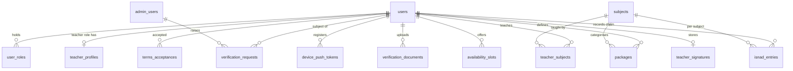
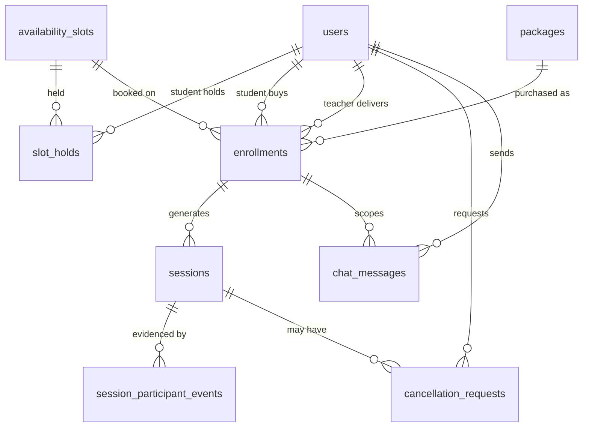
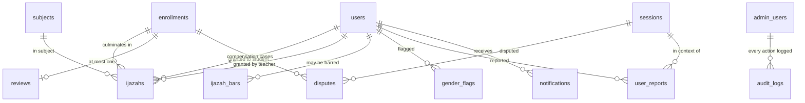

# Ijazah — Entity-Relationship Design

*Version 1.3 · Companion to SRS v1.4, ARCHITECTURE v3.2 and Constitution 2.1 · September 2026*

## 0. How to read this

This is the complete data model for the MVP — 33 tables across twelve module domains plus the platform kernel, every one traceable to an SRS requirement. If a feature needs a table that isn't here, the feature is out of spec: stop and raise it (Architecture principle 10), don't add the table silently.

> **Count history.** v1.0 said 36 and defined 35; v1.1 corrected the figure to 35. v1.2 removed the five managed-payment tables (ADR 0005 D1) and defined 30. v1.3 adds `payments` and `payment_events` — records of gateway orders and their signed events, never balances (ADR 0007) — and defined 32. v1.3 addendum (ADR 0008) adds `idempotency_keys` for the kernel and defines **33**. The domain map below, the table sections and `packages/config/module-tables.json` all agree on that number and on which module owns each table.

Conventions, binding on every table:

- Primary keys are `id` — UUID v7 (time-ordered, index-friendly).
- Money is integer piasters, columns end `_piasters`. Never decimal, never float. The only money columns are package prices, their enrollment snapshot, and the gross, fee and net amounts the gateway reports on a `payments` row. The platform never holds a balance (ADR 0007).
- Timestamps are UTC `timestamptz`, columns end `_at`.
- Local wall-clock values end `_local` and always sit next to a timezone column.
- Booleans read as assertions: `is_minor`, `is_active`.
- Enums are Postgres enums, defined once in `base.prisma`.
- Soft state lives in status enums; nothing that matters is hard-deleted — not ijazahs, not audit entries.
- Where hard deletion is forbidden, the table carries `deleted_at` and removal is a soft deletion. This covers `users`, `sessions`, `enrollments` and `ijazahs`. One table is excepted and has no removal path whatsoever: `audit_logs`, which is strictly append-only.
- A soft-deleted row is excluded from every ordinary read, count and facet. Where a unique constraint covers a value a deleted row still holds, the constraint says explicitly whether the row keeps occupying it — see §15.11.
- Every table carries `created_at`; mutable tables carry `updated_at`.
- Derived values — sessions remaining, minor status, bar status, no-show counts, average ratings — are computed, not stored, with two deliberate cached exceptions: `teacher_profiles.average_rating` with `review_count`, and `sessions.scheduled_start_at` with `scheduled_end_at`, derived from the session's stored local time and zone (ADR 0009). Another requires an ADR before it exists (R-DB-4).
- Secrets are never plaintext. What must be *verified* is hashed (`*_hash`); what must be *recovered or presented to a third party* is encrypted in the column (`*_encrypted`, bytea).

## 1. Domain map

Twelve domains, named exactly as the backend modules that own them (ADR 0005 D2, ADR 0007 D4).

| Domain | Module | Tables |
|---|---|---|
| IDENTITY | `identity` | `users` · `user_roles` · `teacher_profiles` · `otp_codes` · `device_push_tokens` · `terms_acceptances` |
| VERIFICATION | `verification` | `verification_documents` · `verification_requests` |
| CATALOG | `catalog` | `subjects` · `teacher_subjects` · `packages` · `availability_slots` · `isnad_entries` · `teacher_signatures` |
| BOOKING | `booking` | `slot_holds` · `enrollments` |
| PAYMENTS | `payments` | `payments` · `payment_events` |
| SESSIONS | `sessions` | `sessions` · `session_participant_events` · `cancellation_requests` |
| CHAT | `chat` | `chat_messages` |
| CERTIFICATION | `certification` | `ijazahs` · `ijazah_bars` |
| REVIEWS | `reviews` | `reviews` |
| MODERATION | `moderation` | `disputes` · `gender_flags` · `user_reports` |
| NOTIFICATIONS | `notifications` | `notifications` |
| ADMIN | `admin` | `admin_users` · `audit_logs` · `settings` |
| PLATFORM | `platform` (kernel, not a module) | `idempotency_keys` |

Thirty-three tables. One database, one schema. The grouping above maps 1:1 to the multi-file Prisma layout (`prisma/schema/<module>.prisma`), to backend module ownership, and to `packages/config/module-tables.json`: the owning module is the only module whose repository touches these tables (R-API-6). Discovery is a service inside `catalog` and owns nothing. Session generation is requested by `booking` but the rows are written by `sessions` through its public entry. `payments` confirms an enrollment through `booking`'s public entry and records payout readiness through `identity`'s.

## 2. Identity

### `users`

The root identity. One row per human, regardless of how many roles they hold.

| Column | Type | Notes |
|---|---|---|
| id | uuid | PK |
| phone | text, unique, nullable | E.164. At least one of phone/email — DB check constraint |
| email | text, unique, nullable | citext |
| password_hash | text, nullable | null for OTP-only accounts |
| gender | enum male · female | Self-declared, FR-AUTH-3. Changed only via admin (FR-GENDER-5) |
| date_of_birth | date | FR-AUTH-4 |
| display_name | text | |
| preferred_language | enum ar · en | |
| timezone | text (IANA) | Device-reported, manual override allowed (FR-AUTH-10) |
| account_status | enum active · suspended · verification_required · banned | |
| deleted_at | timestamptz, nullable | Soft deletion. Hard DELETE is revoked (§15.10) |
| created_at / updated_at | timestamptz | |

`is_minor` is derived from `date_of_birth` and computed on read, never stored — it would be a third cached value and the constitution permits two (R-DB-4). The same applies to the former `ijazah_barred` flag: current bar state is `exists(ijazah_bars where user_id = … and lifted_at is null)`.

### `user_roles`

Roles are a set (dual-role, SRS §2.2).

| Column | Type | Notes |
|---|---|---|
| id | uuid | PK |
| user_id | FK → users | |
| role | enum student · teacher | |
| status | enum active · suspended | Per-role suspension independent of account |
| granted_at | timestamptz | unique (user_id, role) |

### `teacher_profiles`

Exists only for users holding the teacher role. 1:1 with the role.

| Column | Type | Notes |
|---|---|---|
| id | uuid | PK |
| user_id | FK → users, unique | |
| bio | text | |
| photo_key | text, nullable | Storage key, served via signed URL |
| qualification_summary | text | Years/type, FR-PROFILE-1 |
| verification_status | enum pending · approved · rejected · suspended · banned | FR-AUTH-9, FR-VERIFY-8/9 |
| verification_call_completed_at | timestamptz, nullable | Gate on approval, FR-VERIFY-5 |
| verification_call_notes | text, nullable | |
| approved_by_admin_id | FK → admin_users, nullable | |
| approved_at | timestamptz, nullable | |
| payout_account_ref_encrypted | bytea, nullable | The gateway's recipient reference, encrypted (R-DB-8). Never a raw account number. Set by payout setup after approval (FR-PAYG-13) |
| payout_configured_at | timestamptz, nullable | When the teacher submitted payout setup |
| payout_verified_at | timestamptz, nullable | When the gateway verified the account. NULL means not discoverable, not bookable, cannot publish (FR-PAYG-14, §3.7.1 predicate) |
| average_rating | numeric(3,2), nullable | Cached exception #1 — recomputed on every review write |
| review_count | int, default 0 | Cached with it |

### `otp_codes`

Signup verification and password reset (FR-AUTH-1/6).

| Column | Type | Notes |
|---|---|---|
| id | uuid | PK |
| destination | text | phone or email |
| code_hash | text | Never store the code plain |
| purpose | enum signup · login · password_reset | |
| expires_at | timestamptz | Short TTL |
| consumed_at | timestamptz, nullable | Single-use |
| attempt_count | int, default 0 | Rate-limit companion |

### `device_push_tokens`

Targets for FR-NOTIF-1.

| Column | Type | Notes |
|---|---|---|
| id | uuid | PK |
| user_id | FK → users | |
| token_encrypted | bytea | Provider push token, encrypted at rest (R-DB-8). Must be presented to the provider, so it cannot be hashed |
| token_hash | text, unique | Deduplication and lookup without decrypting |
| platform | enum ios · android | |
| last_seen_at | timestamptz | Stale tokens pruned |

### `terms_acceptances`

FR-AUTH-11 — versioned, because Terms will change and re-acceptance must be provable.

| Column | Type | Notes |
|---|---|---|
| id | uuid | PK |
| user_id | FK → users | |
| terms_version | text | |
| accepted_at | timestamptz | |

## 3. Verification

### `verification_documents`

Uploaded identity and credential documents (FR-VERIFY-1). Admin: view only, never modify.

| Column | Type | Notes |
|---|---|---|
| id | uuid | PK |
| user_id | FK → users | Teacher applicants and any user under FR-VERIFY-10 |
| document_type | enum national_id · passport · credential · other | |
| storage_key_encrypted | bytea | Identity-document reference, encrypted in the column itself (R-DB-8). Signed-URL access only (NFR-SEC-2/3) |
| uploaded_at | timestamptz | |

### `verification_requests`

Admin-initiated "provide ID" demands (FR-VERIFY-10) — distinct from the teacher application flow.

| Column | Type | Notes |
|---|---|---|
| id | uuid | PK |
| user_id | FK → users | |
| requested_by_admin_id | FK → admin_users | |
| reason | text | Mandatory |
| status | enum open · satisfied · expired | Open request ⇒ account_status verification_required |
| created_at / resolved_at | timestamptz | |

## 4. Catalog

### `subjects`

| Column | Type | Notes |
|---|---|---|
| id | uuid | PK |
| name_ar / name_en | text | Both mandatory (FR-LOC-1) |
| is_active | boolean | Admin-managed list |

### `teacher_subjects`

| Column | Type | Notes |
|---|---|---|
| id | uuid | PK · teacher_user_id FK · subject_id FK — unique (teacher_user_id, subject_id) |

### `packages`

| Column | Type | Notes |
|---|---|---|
| id | uuid | PK |
| teacher_user_id | FK → users | |
| subject_id | FK → subjects | FK, not enum |
| session_count | int | > 0 |
| session_duration_minutes | int | Must equal slot duration at booking (FR-PROFILE-8) |
| price_piasters | bigint | ≥ 0. Charged in full through the gateway at checkout; the gateway settles the net to the teacher (FR-PAYG-1) |
| currency | char(3), default 'EGP' | |
| is_active | boolean | Deactivation never touches existing enrollments (FR-PROFILE-3) |

### `availability_slots`

Recurring weekly, local wall-clock + zone (Architecture §9).

| Column | Type | Notes |
|---|---|---|
| id | uuid | PK |
| teacher_user_id | FK → users | |
| day_of_week | smallint | 0–6 |
| start_time_local | time | Local concept — never store UTC here |
| duration_minutes | int | |
| timezone | text (IANA) | The teacher's zone at creation |
| is_active | boolean | Deactivation never affects generated sessions (FR-PROFILE-9) |

### `isnad_entries`

Chain of transmission — ordered names, per teacher per subject (FR-ISNAD-1…6). Not a graph.

| Column | Type | Notes |
|---|---|---|
| id | uuid | PK |
| teacher_user_id | FK → users | |
| subject_id | FK → subjects | |
| position | int ≥ 1 | 1 = the teacher's own teacher, ascending toward origin |
| transmitter_name | text | Free text, Arabic or English |
| verification_status | enum unverified · verified | Scholar-committee outcome, recorded by admin (FR-ISNAD-4). Any edit reverts to unverified (FR-ISNAD-6) |
| verified_by_admin_id | FK → admin_users, nullable | |
| verified_at | timestamptz, nullable | unique (teacher_user_id, subject_id, position) |

### `teacher_signatures`

Required before Mode A granting (FR-IJAZAH-12).

| Column | Type | Notes |
|---|---|---|
| id | uuid | PK · teacher_user_id FK unique · storage_key text · uploaded_at |

## 5. Booking and sessions

Two modules share this section. `booking` owns `slot_holds` and `enrollments`; `sessions` owns `sessions`, `session_participant_events` and `cancellation_requests` (ADR 0005 D2).

### `slot_holds`

Checkout reservation with TTL (FR-BOOK-9). Enforced against double-booking together with `sessions`.

| Column | Type | Notes |
|---|---|---|
| id | uuid | PK |
| slot_id | FK → availability_slots | |
| student_user_id | FK → users | |
| expires_at | timestamptz | Default 10 min, admin-configurable |
| released_at | timestamptz, nullable | Set on conversion or expiry job |

### `enrollments`

The central entity: one student's purchase of one package. Snapshots everything a mutable parent could change (principle 4, FR-PROFILE-3).

| Column | Type | Notes |
|---|---|---|
| id | uuid | PK |
| student_user_id | FK → users | |
| teacher_user_id | FK → users | Denormalised for query sanity; check ≠ student_user_id (FR-BOOK-11) |
| package_id | FK → packages | |
| slot_id | FK → availability_slots | |
| snapshot_price_piasters | bigint | |
| snapshot_session_count | int | |
| snapshot_duration_minutes | int | |
| snapshot_subject_id | FK → subjects | |
| snapshot_slot_timezone | text | Zone frozen at purchase — DST maths uses this |
| status | enum pending_payment · confirmed · completed · terminated_no_show · cancelled | `pending_payment` from creation; `confirmed` only by the confirm-enrollment job on the gateway's paid event (FR-PAYG-5); `cancelled` on order expiry or failure (FR-PAYG-6); `terminated_no_show` at the teacher no-show threshold (FR-NOSHOW-4) |
| confirmed_at | timestamptz, nullable | Set once, by the confirm-enrollment job (FR-PAYG-5). There is no other write path (R-HONEST-1) |
| cancellation_reason | enum payment_expired · payment_failed · admin · gender_correction · teacher_suspended, nullable | Why a `cancelled` enrollment was cancelled |
| deleted_at | timestamptz, nullable | Soft deletion. Hard DELETE is revoked (§15.10) |
| purchased_at | timestamptz | |

`sessions_remaining` is derived: `snapshot_session_count − count(sessions where status is terminal-delivered)`. Never stored.

The teacher no-show count toward the FR-NOSHOW-3/4 threshold is likewise derived — `count(sessions where status = 'teacher_no_show')` — not a stored counter. The only cached values in this model are `teacher_profiles.average_rating` and `review_count`, and `sessions.scheduled_start_at` and `scheduled_end_at` (ADR 0009); nothing about no-shows is among them (R-DB-4).

### `sessions`

One scheduled occurrence. Its local date, local start time and zone are the schedule; the UTC instants are derived from them and recomputed when the time zone data changes (Architecture §9, ADR 0009).

| Column | Type | Notes |
|---|---|---|
| id | uuid | PK |
| enrollment_id | FK → enrollments | |
| sequence_number | int ≥ 1 | unique (enrollment_id, sequence_number) |
| scheduled_date_local | date | The calendar date the occurrence was requested for. With the next two columns, the session's schedule and the source of truth; stores what was asked for, never where a DST gap moved it (ADR 0009 D1) |
| scheduled_start_time_local | time | The start time the teacher chose, as requested (the slot's `start_time_local`) |
| timezone | text (IANA) | Zone of the local fields (the enrollment's `snapshot_slot_timezone`) |
| scheduled_start_at / scheduled_end_at | timestamptz | Cached exception #2 (ADR 0009 D2, R-DB-4): the local start resolved in `timezone`, and that instant plus `snapshot_duration_minutes`. Recomputed when the time zone data changes |
| status | enum scheduled · done · student_no_show · teacher_no_show · both_no_show · under_threshold · provider_outage · cancelled_by_agreement · cancelled_by_admin · disputed | Full machine, SRS §3.7.5 + §3.8 |
| simultaneous_connected_seconds | int, default 0 | Accumulated across reconnections (FR-SESS-18) |
| provider_room_id | text, nullable | Video provider reference |
| evaluated_at | timestamptz, nullable | When the worker settled it |
| settled_by_admin_id | FK → admin_users, nullable | For review-queue resolutions (FR-SESS-19) |
| deleted_at | timestamptz, nullable | Soft deletion. Hard DELETE is revoked (§15.10) |

### `session_participant_events`

Raw attendance evidence, from provider webhooks only — never the client (Architecture §11).

| Column | Type | Notes |
|---|---|---|
| id | uuid | PK |
| session_id | FK → sessions | |
| user_id | FK → users | |
| event_type | enum joined · left | |
| occurred_at | timestamptz | |
| provider_event_id | text, unique | Idempotency — a replayed webhook cannot double-insert |

### `cancellation_requests`

Mutual-agreement flow (FR-CANCEL-1…5), either direction.

| Column | Type | Notes |
|---|---|---|
| id | uuid | PK |
| session_id | FK → sessions | |
| requested_by_user_id | FK → users | Student or teacher |
| reason | text | |
| status | enum pending · accepted · declined · expired | Auto-expires at scheduled start (FR-CANCEL-4) |
| responded_at | timestamptz, nullable | |

## 6. Chat

### `chat_messages`

Scoped to the enrollment (FR-SESS-6). Persisted; admin-readable only under open dispute/report; purged by the retention job (FR-SESS-13).

| Column | Type | Notes |
|---|---|---|
| id | uuid | PK |
| enrollment_id | FK → enrollments | |
| sender_user_id | FK → users | |
| body | text, nullable | Text message |
| attachment_key | text, nullable | PDF/document only; images rejected by content sniffing (FR-SESS-8) |
| attachment_filename | text, nullable | |
| attachment_mime | text, nullable | Verified server-side, not trusted from client |
| sent_at | timestamptz | |
| purged_at | timestamptz, nullable | Retention marker; body/attachment nulled, row kept for counts |

Check constraint: at least one of `body` / `attachment_key`.

## 7. Payments

Records of what the gateway did. Owned by `payments`. The platform takes 0% commission and holds no funds: the gateway settles the net directly to the teacher (FR-PAYG-1, ADR 0007). Nothing here is a balance; there is no wallet, ledger or escrow table and never will be without a new ADR.

### `payments`

One row per gateway order. An enrollment may have several (a failed or expired attempt, then a paid one); at most one reaches `paid`, which is enforced by the confirm step being idempotent on the enrollment rather than by a partial index.

| Column | Type | Notes |
|---|---|---|
| id | uuid | PK |
| enrollment_id | FK → enrollments | |
| gateway | enum (one value per integrated gateway) | Declared in `base.prisma` by T059 once a gateway is integrated (OPEN-11); absent until then, see the T013 note in tasks.md. The adapter is selected by config (R-API-4), independently of this enum |
| gateway_order_id | text, unique | Created by the platform on the gateway (FR-PAYG-2) |
| gateway_transaction_id | text, unique, nullable | Reported by the paid event |
| amount_piasters | bigint | Gross — the snapshot price charged |
| gateway_fee_piasters | bigint, nullable | Reported by the gateway on the paid event |
| net_piasters | bigint, nullable | Settled to the teacher; `amount − fee`, as reported, never computed here (R-MONEY-5) |
| currency | char(3) | |
| status | enum created · paid · failed · expired · refunded | `refunded` records a refund Platform Administration executed through the gateway after a compensation decision (FR-DISPUTE-6), learned from the gateway's signed event; the platform's code never initiates one (FR-PAYG-10) |
| created_at / updated_at | timestamptz | |

### `payment_events`

Append-only record of every signed inbound gateway event. Replay safety is the unique provider event id, the same pattern as `session_participant_events` (§15.4, §15.13).

| Column | Type | Notes |
|---|---|---|
| id | uuid | PK |
| payment_id | FK → payments | |
| provider_event_id | text, unique, NOT NULL | Idempotency — a replayed webhook cannot double-insert (FR-PAYG-4, R-MONEY-8) |
| event_type | enum paid · failed · expired · refunded · recipient_verified · recipient_rejected | |
| signature_verified_at | timestamptz | Set by the signature guard before the row is written (R-MONEY-9). A row cannot exist for an unverified event |
| payload_hash | text | Hash of the raw body, for audit; the body itself is never stored (R-SEC-2) |
| received_at | timestamptz | |

## 8. Certification

### `ijazahs`

| Column | Type | Notes |
|---|---|---|
| id | uuid | PK |
| certificate_number | text, unique | Non-sequential, non-guessable |
| enrollment_id | FK → enrollments | |
| student_user_id / teacher_user_id | FK → users | Denormalised for rendering |
| subject_id | FK → subjects | |
| mode | enum generated · uploaded | FR-IJAZAH-2, DEC-42 |
| language | enum ar · en | Mode A template language (FR-LOC-4) |
| chain_snapshot | jsonb, nullable | Ordered names at grant time, teacher appended (FR-ISNAD-7). Immutable. Mode A only |
| certificate_storage_key | text | Generated PDF or uploaded scan; signed URLs only |
| paper_copy_intended | boolean | Informational (FR-IJAZAH-5) |
| verification_token_hash | text, unique | Backs the public QR page (FR-IJAZAH-10). The QR carries the plaintext token; the database stores only its hash and looks up by hash (R-DB-7) |
| granted_at | timestamptz | |
| revoked_at | timestamptz, nullable | FR-IJAZAH-8. Revocation, not deletion — a revoked ijazah is never shown as valid |
| revoked_reason | text, nullable | Mandatory when revoked |
| revoked_by_admin_id | FK → admin_users, nullable | |
| deleted_at | timestamptz, nullable | Soft deletion, distinct from revocation. Hard DELETE is revoked (§15.10) |

### `ijazah_bars`

FR-IJAZAH-9 — barring is explicit and reasoned, and reversible with history. This table is the record, and current bar state is read from it rather than mirrored onto `users`.

| Column | Type | Notes |
|---|---|---|
| id | uuid | PK |
| user_id | FK → users | |
| reason | text | Mandatory |
| barred_by_admin_id | FK → admin_users | |
| barred_at | timestamptz | |
| lifted_at | timestamptz, nullable | |
| lifted_by_admin_id | FK → admin_users, nullable | |

## 9. Community

### `reviews`

One per enrollment, terminal status + ≥1 delivered session (FR-REVIEW-1/2).

| Column | Type | Notes |
|---|---|---|
| id | uuid | PK |
| enrollment_id | FK → enrollments, unique | The one-review rule, at the DB level. Plain unique, never partial (§15.11, ADR 0006) |
| student_user_id / teacher_user_id | FK → users | |
| rating | smallint | 1–5, check |
| comment | text, nullable | |
| comment_removed_at | timestamptz, nullable | Moderation removes the comment; the star still counts (FR-REVIEW-5) |
| moderated_by_admin_id | FK → admin_users, nullable | |
| created_at | timestamptz | |

## 10. Moderation

### `disputes`

| Column | Type | Notes |
|---|---|---|
| id | uuid | PK |
| enrollment_id | FK → enrollments | Every case belongs to one enrollment |
| session_id | FK → sessions, nullable | Set for a session dispute; NULL for an enrollment-level compensation case (FR-DISPUTE-5) |
| kind | enum session_dispute · compensation_case | `compensation_case` rows are opened automatically by termination flows (FR-DISPUTE-5) |
| raised_by_user_id | FK → users, nullable | Within the dispute window only (FR-DISPUTE-1); NULL when opened by the system |
| reason | text | |
| status | enum open · resolved · dismissed | An open session dispute freezes the session's outcome (FR-DISPUTE-4) |
| resolution | enum upheld · re_marked · no_show_recorded · compensation_ordered · party_suspended · party_banned, nullable | `compensation_ordered` records the decision only; execution is by Platform Administration outside the code path and the outcome lands on `payments` when the gateway reports it (FR-DISPUTE-6) |
| resolution_notes | text, nullable | Mandatory on resolve |
| resolved_by_admin_id | FK → admin_users, nullable | |
| created_at / resolved_at | timestamptz | |

### `gender_flags`

| Column | Type | Notes |
|---|---|---|
| id | uuid | PK |
| flagged_user_id | FK → users | |
| raised_by_user_id | FK → users, nullable | Null when admin-initiated (FR-GENDER-3) |
| status | enum open · corrected · fraud_ban · dismissed | Outcomes per FR-GENDER-6/7 |
| resolution_notes | text, nullable | |
| resolved_by_admin_id | FK → admin_users, nullable | |
| created_at / resolved_at | timestamptz | |

### `user_reports`

FR-SESS-15 — report from any session or profile.

| Column | Type | Notes |
|---|---|---|
| id | uuid | PK |
| reported_user_id | FK → users | |
| reporter_user_id | FK → users | |
| context | enum session · profile · chat | |
| session_id | FK → sessions, nullable | Extends chat retention while open (FR-SESS-13) |
| reason | text | |
| status | enum open · actioned · dismissed | |
| resolved_by_admin_id | FK → admin_users, nullable | |
| created_at / resolved_at | timestamptz | |

## 11. Notifications

### `notifications`

Backs both push delivery and the notification centre (FR-NOTIF-1/2).

| Column | Type | Notes |
|---|---|---|
| id | uuid | PK |
| user_id | FK → users | |
| type | enum teacher_application_status_changed · new_booking · session_reminder · no_show_recorded · cancellation_requested · cancellation_request_accepted · cancellation_request_declined · payment_confirmed · payment_failed · payment_expired · payout_account_verified · dispute_resolved · gender_flag_resolved · ijazah_granted · ijazah_revoked · new_review | One member per FR-NOTIF-1 event, in the order the SRS states them (DEC-13c) |
| title_key / body_key | text | i18n keys — rendered in the user's language at display time (FR-NOTIF-3) |
| payload | jsonb | Deep-link data (enrollment_id, session_id, …) |
| read_at | timestamptz, nullable | Unread state for the centre |
| pushed_at | timestamptz, nullable | Set by the delivery job (FR-NOTIF-4) |
| created_at | timestamptz | |

## 12. Admin and platform kernel

### `admin_users`

Separate from `users` entirely (FR-ADMIN-1) — different auth, different tables, no crossover.

| Column | Type | Notes |
|---|---|---|
| id | uuid | PK |
| email | text, unique | |
| password_hash | text | |
| mfa_secret_encrypted | bytea | MFA mandatory (NFR-SEC-6) |
| display_name | text | |
| is_active | boolean | |
| created_at | timestamptz | |

### `audit_logs`

Every admin action (FR-ADMIN-17). Append-only.

| Column | Type | Notes |
|---|---|---|
| id | uuid | PK |
| admin_id | FK → admin_users | |
| action | text | Stable machine string |
| target_type / target_id | text / uuid | Polymorphic reference |
| reason | text, nullable | Mandatory for destructive actions |
| before / after | jsonb, nullable | State snapshot |
| occurred_at | timestamptz | Never edited, never deleted. Strictly append-only — no `deleted_at`, no removal path at all (§15.10) |

### `settings`

Backs SRS §3.14. Changes are prospective-only and audit-logged.

| Column | Type | Notes |
|---|---|---|
| key | text | PK — e.g. `attendance_threshold_pct`, `join_window_minutes`, `dispute_window_hours`, `slot_hold_ttl_minutes`, `reminder_offsets`, `chat_retention_days` |
| value | jsonb | |
| updated_by_admin_id | FK → admin_users | |
| updated_at | timestamptz | |

### `idempotency_keys`

Owned by the platform kernel (`apps/api/src/platform/idempotency`), not by `admin`. Backs FR-042 and R-API-14 for client-retried mutations: the key and the effect commit in one transaction (research R-14). This is **not** the webhook replay mechanism — that is the unique provider event id on `payment_events` and `session_participant_events` (§15.4, §15.13). Added by ADR 0008 D2.

| Column | Type | Notes |
|---|---|---|
| id | uuid | PK |
| scope | text | The procedure or job the key applies to |
| key | text | Client-supplied idempotency key; unique with `scope` (§15.16) |
| request_hash | text | Hash of the canonical request; a reuse with a different hash is refused |
| response | jsonb, nullable | The first outcome, replayed on repeat |
| status | enum in_progress · completed | `in_progress` blocks a concurrent duplicate |
| created_at | timestamptz | |
| expires_at | timestamptz | `created_at` plus the retention setting (§3.14); swept by `expire-idempotency-keys` |

## 13. Relationship diagrams

Four domain-scoped diagrams rather than one unreadable wall. Cardinality: `||` one, `o{` many.

### 13.1 Identity, catalog and verification

### 13.2 Booking and sessions

### 13.3 Payments

### 13.4 Certification, reviews and moderation

## 14. Indexes that matter

Beyond PKs, uniques and FK indexes, four composites carry the hot paths:

| Index | Serves |
|---|---|
| `sessions (enrollment_id, sequence_number)` unique | Ordered session lists |
| `sessions (scheduled_end_at) WHERE status = 'scheduled'` partial | The evaluate-session sweep |
| `slot_holds (slot_id) WHERE released_at IS NULL` partial | Availability checks |
| `notifications (user_id, read_at)` | Notification centre badge |

Add nothing else until a query is measurably slow (Architecture §17).

## 15. Integrity rules the database itself enforces

Rules that must hold even if application code is buggy — so they live in the schema, not just the service:

1. `users`: at least one of phone/email — check constraint.
2. `enrollments`: `student_user_id ≠ teacher_user_id` — check constraint (FR-BOOK-11).
3. `reviews.enrollment_id` unique — one review per enrollment, unbypassable.
4. `session_participant_events.provider_event_id` unique — webhook replay safety (attendance).
5. *Retired (ADR 0005 D1).* Was `ledger_entries.idempotency_key` unique. Number kept so old citations resolve.
6. *Retired (ADR 0005 D1).* Was UPDATE/DELETE revoked on `ledger_entries`. Number kept so old citations resolve.
7. `isnad_entries (teacher, subject, position)` unique — a chain cannot have two names at one position.
8. `chat_messages`: body or attachment — check constraint.
9. `reviews.rating` between 1 and 5 — check constraint.
10. `users`, `sessions`, `enrollments`, `ijazahs`, `audit_logs`: no DELETE — revoked at the Postgres role level (R-DB-3). For the first four, removal is `deleted_at` and the row survives. `audit_logs` has no `deleted_at` either: it is strictly append-only, with no removal path at all. The app's DB user physically cannot destroy a person, a lesson, a purchase, a certificate, or any record of what an administrator did.
11. Unique constraints that a soft-deleted row would otherwise keep occupying are partial, `WHERE deleted_at IS NULL`: `users.phone`, `users.email`. A deleted account releases its phone number so the person can sign up again. `reviews.enrollment_id` is **not** partial: `reviews` carries no `deleted_at`, and a soft-deleted enrollment is absent from ordinary reads so it cannot be reviewed at all — rule 3 stands unconditionally (ADR 0006 D3).
12. *Retired (ADR 0005 D1).* Was the NOT NULL requirement on money idempotency keys. Number kept so old citations resolve.
13. `payment_events.provider_event_id` unique and NOT NULL — gateway webhook replay safety (FR-PAYG-4, R-MONEY-8, ADR 0007).
14. `payments.gateway_order_id` unique; `payments.gateway_transaction_id` unique where present — one platform record per gateway order.
15. `enrollments.confirmed_at` is written only by the confirm-enrollment job; no application path sets `status = 'confirmed'` without a `paid` event row for that enrollment. Held at the service layer and by the CI test of R-HONEST-1, since the database cannot express the cross-table dependency without a trigger (research R-5).
16. `idempotency_keys (scope, key)` unique — a repeated client mutation returns the first outcome and never repeats the effect (FR-042, R-API-14, ADR 0008).

Rule 10 is the one to appreciate: the guarantee that a person, a lesson, a purchase, a certificate or an administrator's action cannot be destroyed stops being a code-review item and becomes physics.

Rule 10 treats `audit_logs` differently on purpose. Every other table on that list holds something a person might legitimately need removed — an account, a purchase, a lesson, a certificate. An audit log holds the record of what administrators did, and its only reader is someone checking whether an administrator acted properly. There is no operational need to remove a row, so the table gets no removal mechanism at all rather than one guarded by convention.

*End of document. 33 tables. Every table cites the SRS requirement it serves; every SRS entity in §6 of the spec resolves to a table here.*

## Changelog — v1.3 addendum (ADR 0008)

| # | Change | Decision |
|---|---|---|
| 1 | Added `idempotency_keys`, owned by the platform kernel, under §12; integrity rule 16; `PLATFORM` row in the domain map. Table count 32 → 33. | ADR 0008 D2 |

## Changelog — v1.2 → v1.3 (ADR 0007)

| # | Change | Decision |
|---|---|---|
| 1 | Added the `PAYMENTS` domain: `payments` (one row per gateway order: gross, fee, net, gateway ids, status) and `payment_events` (append-only signed events, unique provider event id). Table count 30 → 32. | ADR 0007 D1, D4 |
| 2 | `teacher_profiles` gains `payout_account_ref_encrypted`, `payout_configured_at`, `payout_verified_at`. `payout_verified_at IS NOT NULL` joins the visibility predicate. | ADR 0007 D3 |
| 3 | `enrollments`: `active` → `confirmed`; `marked_paid_at` removed; `confirmed_at` and `cancellation_reason` added. | ADR 0007 D2 |
| 4 | `users.ban_hold_expires_at` removed (a Mode B hold that outlived ADR 0005). | ADR 0007 |
| 5 | Integrity rules 13, 14, 15 added. | ADR 0007 D2 |
| 6 | `disputes` becomes the moderation case table: `enrollment_id` added, `session_id` nullable, `kind` added, `resolution` enum replaces the escrow-era `release · refund · split`. No new table. | ADR 0007 D5 |

## Changelog — v1.2 addendum (ADR 0006)

| # | Change | Decision |
|---|---|---|
| 1 | §15.11 no longer lists `reviews.enrollment_id`; that constraint is a plain unique (§15.3). `reviews` has no `deleted_at`, so the partial form could not exist. | ADR 0006 D3 |

## Changelog — v1.1 → v1.2

All per [ADR 0005](adr/0005-phase-0-document-amendments.md).

| # | Change | Decision |
|---|---|---|
| 1 | Removed the five managed-payment tables: `wallets`, `ledger_entries`, `payments`, `payout_destinations`, `withdrawal_requests`. Removed `enrollments.payment_mode` and `sessions.escrow_share_piasters`. §7 now records that payment is arranged directly and the model holds only `enrollments.marked_paid_at`. Integrity rules 5, 6 and 12 and the ledger index are retired. Table count 35 → 30. | D1 |
| 2 | Enrollment status `refunded_remaining` → `terminated_no_show`. | D1 |
| 3 | Domain map now names the owning module per row; `SESSIONS` added (owns `sessions`, `session_participant_events`, `cancellation_requests`), `COMMUNITY` → `REVIEWS`, `NOTIFICATION` → `NOTIFICATIONS`, `MONEY` removed. | D2 |

## Changelog — v1.0 → v1.1

Six deltas, all reconciling this model with `.specify/memory/constitution.md`, which governs where the two disagree (R-PROC-2).

| # | Change | Rule |
|---|---|---|
| 1 | Dropped `users.is_minor`, `users.ijazah_barred` and `enrollments.teacher_no_show_count`. All three were stored derived values; the model permits exactly two cached values and both are on `teacher_profiles`. Each is now computed on read. | R-DB-4 |
| 2 | `ledger_entries.idempotency_key` and `withdrawal_requests.client_reference` are now NOT NULL as well as unique. | R-MONEY-8 |
| 3 | DELETE revoked at role level on `users`, `sessions`, `enrollments`, `ijazahs`, `audit_logs`. The first four gain `deleted_at` and affected unique constraints become partial. Two tables get no removal path at all: `ledger_entries`, where a marker would be an UPDATE, and `audit_logs`, which stays strictly append-only. | R-DB-3 |
| 4 | `ijazahs.verification_token` → `verification_token_hash`; the QR carries the plaintext, the database stores only the hash. `device_push_tokens.token` → `token_encrypted` (bytea) plus `token_hash` for lookup, since a push token must be presented to the provider and so cannot be hashed alone. | R-DB-7, R-DB-8 |
| 5 | `verification_documents.storage_key` → `storage_key_encrypted` (bytea). It references an identity document, so the column itself is encrypted rather than only the object behind it. | R-DB-8 |
| 6 | Table count corrected from 36 to 35, matching what the document has always defined. | — |

One conflict raised during review was **withdrawn**: the `settings` table was read as failing R-PROC-11's word "prospectively" by holding a single current value per key with no effective-dating or history. That was an over-reading. The rule requires only that no operational number is hardcoded, that values are read from this table, and that changes go through the admin surface and are audit-logged. A change applies from when it is made, and terms already agreed are protected by the snapshot columns on `enrollments`. `settings` is unchanged.
