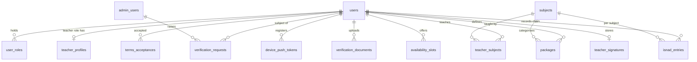
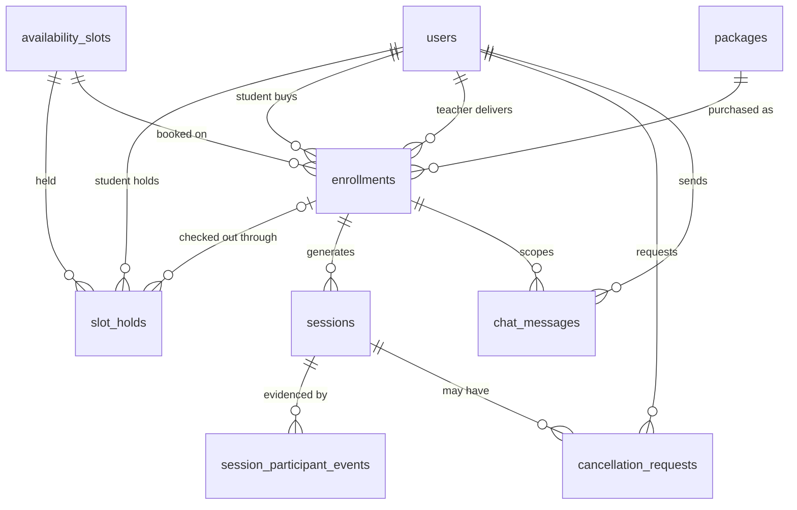
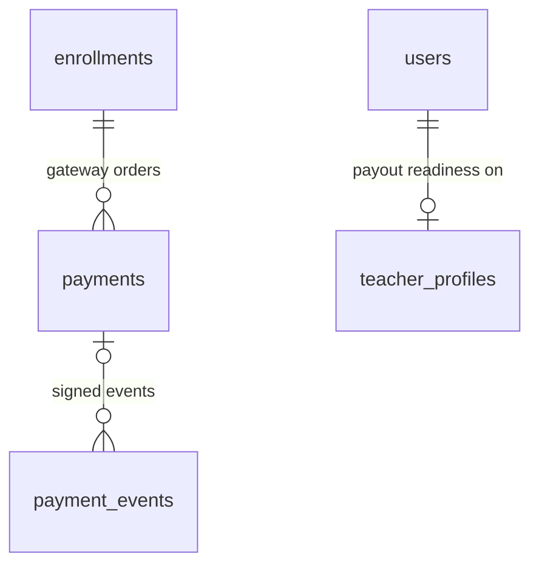
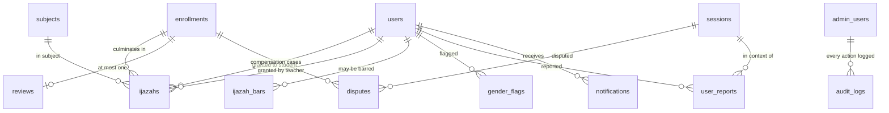

# Ijazah — Entity-Relationship Design

*Version 1.4 · Companion to SRS v1.4, ARCHITECTURE v3.2 and Constitution 2.3 · September 2026; v1.4 on 2026-10-18, the Phase 1 ERD pass (`specs/002-identity/data-model.md`, PR #77): six tables and the columns of Phase 1, listed in the "v1.3 → v1.4" changelog at the end*

## 0. How to read this

This is the complete data model for the MVP — 33 tables across twelve module domains plus the platform kernel, every one traceable to an SRS requirement. If a feature needs a table that isn't here, the feature is out of spec: stop and raise it (Architecture principle 10), don't add the table silently.

> **Count history.** v1.0 said 36 and defined 35; v1.1 corrected the figure to 35. v1.2 removed the five managed-payment tables (ADR 0005 D1) and defined 30. v1.3 adds `payments` and `payment_events` — records of gateway orders and their signed events, never balances (ADR 0007) — and defined 32. v1.3 addendum (ADR 0008) adds `idempotency_keys` for the kernel and defines **33**. The domain map below, the table sections and `packages/config/module-tables.json` all agree on that number and on which module owns each table.

Conventions, binding on every table:

- Primary keys are `id` — UUID v7 (time-ordered, index-friendly).
- Money is integer piasters, columns end `_piasters`. Never decimal, never float. The only money columns are package prices, their enrollment snapshot, and the gross, fee and net amounts the gateway reports on a `payments` row. The platform never holds a balance (ADR 0007).
- Timestamps are UTC `timestamptz`, columns end `_at`.
- Local wall-clock values end `_local` and always sit next to a timezone column.
- Booleans read as assertions: `is_minor`, `is_active`.
- Enums are Postgres enums, defined once in `base.prisma`.
- Soft state lives in status enums; nothing that matters is hard-deleted — not ijazahs, not audit entries.
- Where hard deletion is forbidden, the table carries `deleted_at` and removal is a soft deletion. This covers `users`, `sessions`, `enrollments` and `ijazahs`. One table is excepted and has no removal path whatsoever: `audit_logs`, which is strictly append-only.
- A soft-deleted row is excluded from every ordinary read, count and facet. Where a unique constraint covers a value a deleted row still holds, the constraint says explicitly whether the row keeps occupying it — see §15.11.
- Every table carries `created_at`; mutable tables carry `updated_at`.
- Derived values — sessions remaining, minor status, bar status, no-show counts, average ratings — are computed, not stored. The only deliberate cached exceptions are `teacher_profiles.average_rating` with `review_count`; `sessions.scheduled_start_at` with `scheduled_end_at`, derived from the session's stored local time and zone (ADR 0009); and `sessions.teacher_user_id` with `student_user_id`, copied from the enrollment so the database can refuse overlapping sessions (ADR 0010). Another requires an ADR before it exists (R-DB-4).
- Secrets are never plaintext. What must be *verified* is hashed (`*_hash`); what must be *recovered or presented to a third party* is encrypted in the column (`*_encrypted`, bytea).

## 1. Domain map

Twelve domains, named exactly as the backend modules that own them (ADR 0005 D2, ADR 0007 D4).

| Domain | Module | Tables |
|---|---|---|
| IDENTITY | `identity` | `users` · `user_roles` · `teacher_profiles` · `otp_codes` · `device_push_tokens` · `terms_acceptances` · `user_sessions` · `auth_identities` |
| VERIFICATION | `verification` | `verification_documents` · `verification_requests` |
| CATALOG | `catalog` | `subjects` · `teacher_subjects` · `packages` · `availability_slots` · `isnad_entries` · `teacher_signatures` · `teacher_credentials` |
| BOOKING | `booking` | `slot_holds` · `enrollments` |
| PAYMENTS | `payments` | `payments` · `payment_events` |
| SESSIONS | `sessions` | `sessions` · `session_participant_events` · `cancellation_requests` · `session_remedies` |
| CHAT | `chat` | `chat_messages` |
| CERTIFICATION | `certification` | `ijazahs` · `ijazah_bars` |
| REVIEWS | `reviews` | `reviews` |
| MODERATION | `moderation` | `disputes` · `gender_flags` · `user_reports` |
| NOTIFICATIONS | `notifications` | `notifications` |
| ADMIN | `admin` | `admin_users` · `audit_logs` · `settings` · `admin_sessions` · `admin_recovery_codes` |
| PLATFORM | `platform` (kernel, not a module) | `idempotency_keys` |

Thirty-nine tables: the thirty-three of Phase 0 and the six of the Phase 1 ERD pass (`user_sessions`, `auth_identities`, `admin_sessions`, `admin_recovery_codes`, `teacher_credentials`, `session_remedies`; migrations `20261018000000` to `20261018000300`). One database, one schema. The grouping above maps 1:1 to the multi-file Prisma layout (`prisma/schema/<module>.prisma`), to backend module ownership, and to `packages/config/module-tables.json`: the owning module is the only module whose repository touches these tables (R-API-6). Discovery is a service inside `catalog` and owns nothing. Session generation is requested by `booking` but the rows are written by `sessions` through its public entry. `payments` confirms an enrollment through `booking`'s public entry and records payout readiness through `identity`'s.

## 2. Identity

### `users`

The root identity. One row per human, with exactly one role (ADR 0016).

| Column | Type | Notes |
|---|---|---|
| id | uuid | PK |
| phone | text, unique, nullable | E.164. At least one of phone/email on a live row — DB check constraint (§15 rule 1, rewritten for deleted rows in the Phase 1 pass). Unused in MVP: phone sign-up is deferred (ADR 0012) |
| email | text, unique, nullable | citext. Present on every MVP account: Google and Apple always return one, and email accounts verify theirs (ADR 0012) |
| password_hash | text, nullable | null for Google and Apple accounts (ADR 0012) |
| gender | enum male · female | Self-declared, FR-AUTH-3. Changed only via admin (FR-GENDER-5) |
| date_of_birth | date, nullable | FR-AUTH-4. Nullable only for a deleted row, so the deletion transaction can erase it; §15 rule 32 keeps it NOT NULL while the row is live (Phase 1 pass, migration `20261018000000`) |
| display_name | text, nullable | Nullable only for a deleted row, as `date_of_birth` (rule 32) |
| certificate_name | text, nullable | The full name printed on certificates; asked once at the first ijazah request (ADR 0019, landed by the Phase 1 pass). Erased on deletion; the names a certificate prints are snapshotted onto `ijazahs` at issue (ADR 0015 D3, ADR 0019 D1) |
| photo_key | text, nullable | The profile photo of either role (decision 46), a storage key served by a signed link; erased on deletion. `teacher_profiles.photo_key` is unused since (Phase 1 pass) |
| preferred_language | enum ar · en | |
| timezone | text (IANA) | Device-reported, manual override allowed (FR-AUTH-10) |
| account_status | enum active · suspended · verification_required · banned | |
| deleted_at | timestamptz, nullable | Soft deletion. Hard DELETE is revoked (§15.10). Account deletion (FR-AUTH-14, ADR 0015) sets it and erases `display_name`, `email`, `phone`, `password_hash` and `date_of_birth` in the same transaction; history rows that point to the user stay |
| created_at / updated_at | timestamptz | |

`is_minor` is derived from `date_of_birth` and computed on read, never stored — it would be a cached value beyond the six the constitution permits (R-DB-4). The same applies to the former `ijazah_barred` flag: current bar state is `exists(ijazah_bars where user_id = … and lifted_at is null)`.

A Google or Apple sign-in is keyed by the provider's subject identifier, never by the email (ADR 0012 D2): its table is `auth_identities` below. The `users` row, its `auth_identities` row (or `password_hash`) and its `user_roles` row are written together when onboarding completes (ADR 0012 D4, FR-AUTH-12): no row exists for a sign-in whose onboarding is incomplete, which is why `gender` and `timezone` stay NOT NULL as columns, and `display_name`, `date_of_birth` and `email` NOT NULL for every live row by §15 rule 32 — the columns themselves are nullable since the Phase 1 pass, so the one transaction of FR-141 can erase them.

### `auth_identities`

A Google or Apple account, keyed by the provider's subject (ADR 0012 D2). Added by the Phase 1 pass (migration `20261018000000`; specs/002-identity/data-model.md §1).

| Column | Type | Notes |
|---|---|---|
| id | uuid | PK |
| user_id | FK → users | |
| provider | enum google · apple | |
| provider_subject | text | The token's `sub`; unique with `provider` (§15 rule 22) |
| provider_refresh_token_encrypted | bytea, nullable | Apple only: the refresh token obtained by exchanging the authorization code at the first sign-in, kept so deletion can revoke it (ADR 0015 D3, R-DB-8); null for Google. Reached by the `reencrypt-columns` job through the identity repository |
| created_at | timestamptz | |

Deleted outright on account deletion (ADR 0015 D3): the application role keeps DELETE on this table, and the uniqueness never blocks the person's new account.

### `user_sessions`

A device's session: its refresh token as a hash, rotation, revocation (FR-AUTH-7; specs/002-identity/research.md R-101). Added by the Phase 1 pass (migration `20261018000000`).

| Column | Type | Notes |
|---|---|---|
| id | uuid | PK |
| user_id | FK → users | Plain index, as every foreign key (§14); it serves "revoke every session of the user" |
| refresh_token_hash | text, unique | SHA-256 lookup hash of the current refresh token (R-DB-7; §15 rule 25) |
| previous_refresh_token_hash | text, nullable | The hash rotation retired, kept for the grace window; a presentation after it revokes the row (reuse detection) |
| device_label | text, nullable | What the device reported of itself; shown nowhere in Phase 1 |
| issued_at | timestamptz | |
| refreshed_at | timestamptz, nullable | The last rotation |
| expires_at | timestamptz | Absolute: issue plus `session_refresh_ttl_days`; never extended |
| revoked_at | timestamptz, nullable | |
| revoked_reason | enum sign_out · reuse_detected · password_reset · account_deleted · account_suspended · account_banned · admin_action, nullable | |
| created_at / updated_at | timestamptz | |

No `deleted_at`: a session is a credential, destroyed, not a record kept from view; the application role keeps DELETE. Rows are purged by `purge-expired-sessions` after `session_purge_after_days`.

### `user_roles`

One row per user in the MVP: an account is a student or a teacher, never both (SRS §2.2, ADR 0016). The table is kept so dual roles can return; the unique index on `user_id` (§15 rule 24) landed with the Phase 1 pass (migration `20261018000000`).

| Column | Type | Notes |
|---|---|---|
| id | uuid | PK |
| user_id | FK → users | |
| role | enum student · teacher | |
| status | enum active · suspended | Stays `active` in the MVP: suspension is per account (`users.account_status`, ADR 0016) |
| granted_at | timestamptz | unique (user_id, role); unique (user_id) since the Phase 1 pass (ADR 0016 D3) |

### `teacher_profiles`

Exists only for users holding the teacher role. 1:1 with the role.

| Column | Type | Notes |
|---|---|---|
| id | uuid | PK |
| user_id | FK → users, unique | |
| bio | text | |
| photo_key | text, nullable | Unused since the Phase 1 pass: the photo of either role is `users.photo_key`; the column stays |
| qualification_summary | text | Years/type, FR-PROFILE-1 |
| verification_status | enum pending · approved · rejected · suspended · banned · revoked | FR-AUTH-9, FR-VERIFY-8/9. `revoked` (Phase 1 pass, FR-165): a withdrawn approval, the teacher returns only through a new application; `suspended` stays the account-level word and is no longer written here |
| verification_call_completed_at | timestamptz, nullable | Gate on approval, FR-VERIFY-5 |
| verification_call_notes | text, nullable | |
| approved_by_admin_id | FK → admin_users, nullable | |
| approved_at | timestamptz, nullable | |
| payout_account_ref_encrypted | bytea, nullable | The gateway's recipient reference, encrypted (R-DB-8). Never a raw account number. Set by payout setup after approval (FR-PAYG-13) |
| payout_configured_at | timestamptz, nullable | When the teacher submitted payout setup |
| payout_verified_at | timestamptz, nullable | When the gateway verified the account. NULL means not discoverable, not bookable, cannot publish (FR-PAYG-14, §3.7.1 predicate) |
| average_rating | numeric(3,2), nullable | Cached exception #1 — recomputed on every review write |
| review_count | int, default 0 | Cached with it |
| application_submitted_at | timestamptz, nullable | The current application's submission; reapplying after a rejection sets it again (Phase 1 pass, migration `20261018000200`; specs/002-identity/data-model.md §3: the application is a state of the profile, not a table) |
| application_status | enum in_review · needs_document · rejected · banned · approved, nullable | What the applicant sees, the queue's tab; `verification_status` stays the product's status. Null before the first submission |
| application_note | text, nullable | The reviewer's latest note to the applicant (the request for a document, the rejection) |
| application_decided_at / application_decided_by_admin_id | timestamptz, nullable; FK → admin_users, nullable | |
| identity_document_id | FK → verification_documents, nullable | The identity document of the current application |
| identity_document_type | enum national_id · passport, nullable | One type shared with `verification_requests.document_type` |
| approved_shown_at | timestamptz, nullable | The once-only `ApplicationApproved` was shown (FR-152 of Phase 1) |
| payout_account_ref_hash | text, unique, nullable | SHA-256 lookup hash of the recipient reference beside the encrypted column; routes recipient events (§15 rule 27) |
| payout_rejected_reason | text, nullable | The gateway's last rejection reason, shown to the teacher; cleared on verification |

### `otp_codes`

Signup verification and password reset (FR-AUTH-1/6).

| Column | Type | Notes |
|---|---|---|
| id | uuid | PK |
| destination | text | an email address in MVP; a phone number when phone sign-up returns (ADR 0012) |
| code_hash | text | Never store the code plain |
| purpose | enum signup · login · password_reset · account_deletion | `login` is unused in MVP: email accounts sign in with their password (ADR 0012); `account_deletion` is the web deletion's code (FR-AUTH-15, Phase 1 pass) |
| expires_at | timestamptz | Short TTL |
| consumed_at | timestamptz, nullable | Single-use |
| attempt_count | int, default 0 | Rate-limit companion. Index `(destination, purpose)` since the Phase 1 pass: the lookup every verify and every purge makes |

### `device_push_tokens`

Targets for FR-NOTIF-1.

| Column | Type | Notes |
|---|---|---|
| id | uuid | PK |
| user_id | FK → users | |
| token_encrypted | bytea | Provider push token, encrypted at rest (R-DB-8). Must be presented to the provider, so it cannot be hashed |
| token_hash | text, unique | Deduplication and lookup without decrypting |
| platform | enum ios · android | |
| last_seen_at | timestamptz | Stale tokens pruned |

### `terms_acceptances`

FR-AUTH-11 — versioned, because Terms will change and re-acceptance must be provable.

| Column | Type | Notes |
|---|---|---|
| id | uuid | PK |
| user_id | FK → users | |
| terms_version | text | |
| accepted_at | timestamptz | |

## 3. Verification

### `verification_documents`

Uploaded identity and credential documents (FR-VERIFY-1). Admin: view only, never modify.

| Column | Type | Notes |
|---|---|---|
| id | uuid | PK |
| user_id | FK → users | Teacher applicants and any user under FR-VERIFY-10 |
| document_type | enum national_id · passport · credential · other | |
| storage_key_encrypted | bytea | Identity-document reference, encrypted in the column itself (R-DB-8). Signed-URL access only (NFR-SEC-2/3) |
| uploaded_at | timestamptz | |

### `verification_requests`

Admin-initiated "provide ID" demands (FR-VERIFY-10) — distinct from the teacher application flow.

| Column | Type | Notes |
|---|---|---|
| id | uuid | PK |
| user_id | FK → users | |
| requested_by_admin_id | FK → admin_users | |
| reason | text | Mandatory |
| status | enum open · satisfied · expired | Open request ⇒ account_status verification_required |
| document_id | FK → verification_documents, nullable | The document the user submitted for the request (Phase 1 pass, migration `20261018000200`) |
| document_type | enum national_id · passport, nullable | The same type as `teacher_profiles.identity_document_type` |
| created_at / resolved_at | timestamptz; `resolved_at` nullable | `resolved_at` is set on resolution |

## 4. Catalog

### `subjects`

| Column | Type | Notes |
|---|---|---|
| id | uuid | PK |
| name_ar / name_en | text | Both mandatory (FR-LOC-1). `name_en` is the English display name, required on creation (ADR 0021 D1) |
| is_active | boolean | Admin-managed list |

**Amended by ADR 0021 (D1, a note; no migration).** `name_en` is the English display name: every English page shows it wherever an Arabic page shows `name_ar` (the admin's English boards, the English phone app, the English certificate verification page). The admin's subject list (the "Admin-managed list" above, the subjects board) requires both names on creation and refuses a subject with an empty English name. A subject name is data, never an i18n key; the two catalogue strings that embed subject names as examples take them from this table at render time.

### `teacher_subjects`

| Column | Type | Notes |
|---|---|---|
| id | uuid | PK · teacher_user_id FK · subject_id FK — unique (teacher_user_id, subject_id) |

### `packages`

| Column | Type | Notes |
|---|---|---|
| id | uuid | PK |
| teacher_user_id | FK → users | |
| subject_id | FK → subjects | FK, not enum |
| session_count | int | > 0 |
| session_duration_minutes | int | Must equal slot duration at booking (FR-PROFILE-8) |
| price_piasters | bigint | ≥ 0. Charged in full through the gateway at checkout; the gateway settles the net to the teacher (FR-PAYG-1) |
| currency | char(3), default 'EGP' | |
| is_active | boolean | Deactivation never touches existing enrollments (FR-PROFILE-3) |
| track | enum recitation · ijazah_track | The teacher's choice at creation (ADR 0018 D1; Phase 1 pass, migration `20261018000300`, default `recitation` since no row existed). An ijazah can be requested only from the ijazah track (FR-IJAZAH-1) |

**ADR 0018, landed by the Phase 1 pass (migration `20261018000300`).** `packages.track`; `enrollments.snapshot_track` (§5); `sessions.makeup_for_session_id` and the `session_remedies` table (§5) record what each session not consumed is owed (FR-MAKEUP-1..6); `settings` holds the make-up choice window (seeded by T002).

### `availability_slots`

Recurring weekly, local wall-clock + zone (Architecture §9).

| Column | Type | Notes |
|---|---|---|
| id | uuid | PK |
| teacher_user_id | FK → users | |
| day_of_week | smallint | 0–6, 0 = Sunday (Postgres `EXTRACT(DOW)`) |
| start_time_local | time | Local concept — never store UTC here |
| duration_minutes | int | |
| timezone | text (IANA) | The teacher's zone at creation |
| is_active | boolean | Deactivation never affects generated sessions (FR-PROFILE-9) |

### `teacher_credentials`

One ijazah PDF per subject with its transcription; the chain hangs under it (ADR 0017 D5, FR-PROFILE-11). Added by the Phase 1 pass (migration `20261018000200`; specs/002-identity/data-model.md §1). Owned by `catalog`; the document itself is `verification`'s.

| Column | Type | Notes |
|---|---|---|
| id | uuid | PK |
| teacher_user_id | FK → users | |
| subject_id | FK → subjects | |
| document_id | FK → verification_documents | The ijazah PDF |
| holder_name | text, nullable | The teacher's full name as on the PDF, transcribed at approval (ADR 0019 D1) |
| riwaya / tariq | text, nullable | Transcribed at approval, Arabic as typed (ADR 0021 D1) |
| status | enum pending · needs_document · approved · rejected | |
| review_reason | text, nullable | Mandatory on reject and needs_document; the teacher sees it |
| reviewed_by_admin_id / reviewed_at | FK → admin_users, nullable; timestamptz, nullable | |
| submitted_with_application | boolean | Whether it came with an application («عند التقدّم») or was added after approval |
| created_at / updated_at | timestamptz | |

One approved credential per teacher and subject: partial unique `(teacher_user_id, subject_id) WHERE status = 'approved'` (§15 rule 23). A rejected credential stays as history; a new upload for the same subject is a new row.

### `isnad_entries`

Chain of transmission — one generation per row under a credential (FR-ISNAD-1…6). Not a graph. Re-keyed by ADR 0017 D5 in the Phase 1 pass (migration `20261018000200`): the chain is transcribed by the admin from the teacher's ijazah PDF, never typed by the teacher, and exists only on an approved credential, so it carries no verification state of its own. The table held no row, so the former columns (`teacher_user_id`, `subject_id`, `transmitter_name`, `verification_status`, `verified_by_admin_id`, `verified_at`) were dropped rather than deprecated; the enum `isnad_verification_status` stays declared (R-API-9).

| Column | Type | Notes |
|---|---|---|
| id | uuid | PK |
| credential_id | FK → teacher_credentials | |
| position | int ≥ 1 | Origin first, counting toward the teacher; unique (credential_id, position) — §15 rule 7, as re-keyed |
| names | text[] | One generation holding one or more names (ADR 0004 D3), Arabic as typed; never empty (check constraint) |
| created_by_admin_id | FK → admin_users | |
| created_at / updated_at | timestamptz | |

### `teacher_signatures`

Required before Mode A granting (FR-IJAZAH-12).

| Column | Type | Notes |
|---|---|---|
| id | uuid | PK · teacher_user_id FK unique · storage_key text · uploaded_at |

## 5. Booking and sessions

Two modules share this section. `booking` owns `slot_holds` and `enrollments`; `sessions` owns `sessions`, `session_participant_events` and `cancellation_requests` (ADR 0005 D2).

### `slot_holds`

Checkout reservation with TTL (FR-BOOK-9). Enforced against double-booking together with `sessions`. At most one active hold per slot and per student (§15.17–18, ADR 0010).

| Column | Type | Notes |
|---|---|---|
| id | uuid | PK |
| slot_id | FK → availability_slots | |
| student_user_id | FK → users | |
| enrollment_id | FK → enrollments, nullable | Set in the transaction that creates the enrollment at Pay; NULL while the student is in checkout before Pay. Conversion, release, the late-payment branch and a new checkout find the hold through it (ADR 0010 D2) |
| expires_at | timestamptz | Gateway checkout TTL plus the hold grace, counted from placement (defaults 10 + 5 min, admin-configurable; FR-BOOK-9, ADR 0010 D4) |
| released_at | timestamptz, nullable | Set on conversion, on expiry (by the expiry jobs, or before a new hold on the same slot or by the same student, ADR 0010 D3), by the student's own new checkout (FR-BOOK-12, ADR 0010 D6), or by the refusal branch of FR-PAYG-19. A failed gateway event does not set it (ADR 0010 D4). A release without conversion cancels the linked enrollment in the same transaction (ADR 0010 D7). NULL means active: §15.17–18 count the row even past `expires_at` |

### `enrollments`

The central entity: one student's purchase of one package. Snapshots everything a mutable parent could change (principle 4, FR-PROFILE-3).

| Column | Type | Notes |
|---|---|---|
| id | uuid | PK |
| student_user_id | FK → users | |
| teacher_user_id | FK → users | Denormalised for query sanity; check ≠ student_user_id (FR-BOOK-11) |
| package_id | FK → packages | |
| slot_id | FK → availability_slots | |
| snapshot_price_piasters | bigint | |
| snapshot_session_count | int | |
| snapshot_duration_minutes | int | |
| snapshot_subject_id | FK → subjects | |
| snapshot_slot_timezone | text | Zone frozen at purchase — DST maths uses this |
| snapshot_track | enum recitation · ijazah_track | The package's track at purchase (ADR 0018 D1, DEC-24; Phase 1 pass, migration `20261018000300`, default `recitation` as `packages.track`'s) |
| status | enum pending_payment · confirmed · completed · terminated_no_show · cancelled | `pending_payment` from creation; `confirmed` only by the confirm-enrollment job on the gateway's paid event (FR-PAYG-5); `cancelled` when its hold is released without conversion (FR-PAYG-6, ADR 0010 D7), and a paid event after that may still confirm it (FR-PAYG-19, ADR 0010 D5); `terminated_no_show` at the teacher no-show threshold (FR-NOSHOW-4) |
| confirmed_at | timestamptz, nullable | Set once, by the confirm-enrollment job (FR-PAYG-5). There is no other write path (R-HONEST-1) |
| cancellation_reason | enum payment_expired · payment_failed · admin · gender_correction · teacher_suspended · slot_unavailable · checkout_abandoned · account_deleted, nullable | Why a `cancelled` enrollment was cancelled. `slot_unavailable`: paid, but the database refused its confirmation (FR-PAYG-19); `checkout_abandoned`: its hold was released by the student's own new checkout (FR-BOOK-12). Both added by ADR 0010 D7. `account_deleted`: the student deleted their account (ADR 0015 D4), landed by the Phase 1 pass (migration `20261018000300`) |
| deleted_at | timestamptz, nullable | Soft deletion. Hard DELETE is revoked (§15.10) |
| purchased_at | timestamptz | |

`sessions_remaining` is derived: `snapshot_session_count − count(sessions where status is terminal-delivered)`. Never stored.

The teacher no-show count toward the FR-NOSHOW-3/4 threshold is likewise derived — `count(sessions where status = 'teacher_no_show')` — not a stored counter. The only cached values in this model are `teacher_profiles.average_rating` and `review_count`, `sessions.scheduled_start_at` and `scheduled_end_at` (ADR 0009), and `sessions.teacher_user_id` and `student_user_id` (ADR 0010); nothing about no-shows is among them (R-DB-4).

### `sessions`

One scheduled occurrence. Its local date, local start time and zone are the schedule; the UTC instants are derived from them and recomputed when the time zone data changes (Architecture §9, ADR 0009).

| Column | Type | Notes |
|---|---|---|
| id | uuid | PK |
| enrollment_id | FK → enrollments | |
| teacher_user_id | FK → users | Cached exception #3 (ADR 0010 D2, R-DB-4): copied from the enrollment at generation, never changed. Lets §15.19 refuse overlapping sessions for one teacher |
| student_user_id | FK → users | Cached with it: copied from the enrollment at generation, never changed. Lets §15.19 refuse overlapping sessions for one student |
| sequence_number | int ≥ 1 | unique (enrollment_id, sequence_number) |
| scheduled_date_local | date | The calendar date the occurrence was requested for. With the next two columns, the session's schedule and the source of truth; stores what was asked for, never where a DST gap moved it (ADR 0009 D1) |
| scheduled_start_time_local | time | The start time the teacher chose, as requested (the slot's `start_time_local`) |
| timezone | text (IANA) | Zone of the local fields (the enrollment's `snapshot_slot_timezone`) |
| scheduled_start_at / scheduled_end_at | timestamptz | Cached exception #2 (ADR 0009 D2, R-DB-4): the local start resolved in `timezone`, and that instant plus `snapshot_duration_minutes`. Recomputed when the time zone data changes |
| status | enum scheduled · done · student_no_show · teacher_no_show · both_no_show · under_threshold · provider_outage · cancelled_by_agreement · cancelled_by_admin · disputed | Full machine, SRS §3.7.5 + §3.8 |
| simultaneous_connected_seconds | int, default 0 | Accumulated across reconnections (FR-SESS-18) |
| provider_room_id | text, nullable | Video provider reference |
| evaluated_at | timestamptz, nullable | When the worker settled it |
| settled_by_admin_id | FK → admin_users, nullable | For review-queue resolutions (FR-SESS-19) |
| makeup_for_session_id | FK → sessions, nullable | The session this one makes up for (ADR 0018 D3; Phase 1 pass, migration `20261018000300`) |
| deleted_at | timestamptz, nullable | Soft deletion. Hard DELETE is revoked (§15.10) |

### `session_remedies`

What a session not consumed is owed (ADR 0018 D2 to D5, FR-MAKEUP-1..6). Added by the Phase 1 pass (migration `20261018000300`), columns only; no code of Phase 1 writes it, Phase 3 does. Owned by `sessions`.

| Column | Type | Notes |
|---|---|---|
| id | uuid | PK |
| session_id | FK → sessions, unique | One row per session not consumed |
| kind | enum makeup · refund | |
| status | enum awaiting_choice · proposed · counter_proposed · booked · refund_case | |
| proposed_date / counter_date | date, nullable | Calendar dates in the enrollment's `snapshot_slot_timezone`; the counter's time of day (ADR 0018 D3 lets the student propose a date and time) is Phase 3's pass to add |
| decided_at | timestamptz, nullable | |
| case_id | FK → disputes, nullable | The refund case |
| created_at / updated_at | timestamptz | |

### `session_participant_events`

Raw attendance evidence, from provider webhooks only — never the client (Architecture §11).

| Column | Type | Notes |
|---|---|---|
| id | uuid | PK |
| session_id | FK → sessions | |
| user_id | FK → users | |
| event_type | enum joined · left | |
| occurred_at | timestamptz | |
| provider_event_id | text, unique | Idempotency — a replayed webhook cannot double-insert |

### `cancellation_requests`

Mutual-agreement flow (FR-CANCEL-1…5), either direction.

| Column | Type | Notes |
|---|---|---|
| id | uuid | PK |
| session_id | FK → sessions | |
| requested_by_user_id | FK → users | Student or teacher |
| reason | text | |
| status | enum pending · accepted · declined · expired | Auto-expires at scheduled start (FR-CANCEL-4) |
| responded_at | timestamptz, nullable | |

## 6. Chat

### `chat_messages`

Scoped to the enrollment (FR-SESS-6). Persisted; admin-readable only under open dispute/report; purged by the retention job (FR-SESS-13).

| Column | Type | Notes |
|---|---|---|
| id | uuid | PK |
| enrollment_id | FK → enrollments | |
| sender_user_id | FK → users | |
| body | text, nullable | Text message |
| attachment_key | text, nullable | PDF/document only; images rejected by content sniffing (FR-SESS-8) |
| attachment_filename | text, nullable | |
| attachment_mime | text, nullable | Verified server-side, not trusted from client |
| sent_at | timestamptz | |
| purged_at | timestamptz, nullable | Retention marker; body/attachment nulled, row kept for counts |

Check constraint: at least one of `body` / `attachment_key`, unless `purged_at` is set: the retention purge nulls both and keeps the row (note under T051).

## 7. Payments

Records of what the gateway did. Owned by `payments`. The platform takes 0% commission and holds no funds: the gateway settles the net directly to the teacher (FR-PAYG-1, ADR 0007). Nothing here is a balance; there is no wallet, ledger or escrow table and never will be without a new ADR.

### `payments`

One row per gateway order. An enrollment may have several (a failed or expired attempt, then a paid one); at most one reaches `paid`, which is enforced by the confirm step being idempotent on the enrollment rather than by a partial index.

| Column | Type | Notes |
|---|---|---|
| id | uuid | PK |
| enrollment_id | FK → enrollments | |
| gateway | enum fake, then one value per integrated gateway | Declared in `base.prisma` by T059 with the single member `fake`, the recording stand-in the port carries from day one; production refuses `fake` in config (note under T059 in tasks.md). A real gateway's member is added when it is integrated (OPEN-11). The adapter is selected by config (R-API-4), independently of this enum |
| gateway_order_id | text, unique | Created by the platform on the gateway (FR-PAYG-2) |
| gateway_transaction_id | text, unique, nullable | Reported by the paid event |
| gross_piasters | bigint | Gross — the snapshot price charged. Named for what it is, so the R-MONEY-6 confinement rule recognises it by its words (PR #20) |
| gateway_fee_piasters | bigint, nullable | Reported by the gateway on the paid event |
| net_piasters | bigint, nullable | Settled to the teacher; `gross − fee`, as reported, never computed here (R-MONEY-5) |
| currency | char(3) | |
| status | enum created · paid · failed · expired · refunded | `refunded` records a refund Platform Administration executed through the gateway after a compensation decision (FR-DISPUTE-6), learned from the gateway's signed event; the platform's code never initiates one (FR-PAYG-10) |
| created_at / updated_at | timestamptz | |

### `payment_events`

Append-only record of every signed inbound gateway event. Replay safety is the unique provider event id, the same pattern as `session_participant_events` (§15.4, §15.13).

| Column | Type | Notes |
|---|---|---|
| id | uuid | PK |
| payment_id | FK → payments, nullable | NULL exactly when `event_type` is `recipient_verified` or `recipient_rejected`: those report on a teacher's payout account, not a gateway order, and are recorded here so the unique `provider_event_id` makes their replay a no-op too (FR-PAYG-4, FR-PAYG-15, §15.20) |
| provider_event_id | text, unique, NOT NULL | Idempotency — a replayed webhook cannot double-insert (FR-PAYG-4, R-MONEY-8) |
| event_type | enum paid · failed · expired · refunded · recipient_verified · recipient_rejected | |
| signature_verified_at | timestamptz | Set by the signature guard before the row is written (R-MONEY-9). A row cannot exist for an unverified event |
| payload_hash | text | Hash of the raw body, for audit; the body itself is never stored (R-SEC-2) |
| received_at | timestamptz | |

## 8. Certification

### `ijazahs`

**Amended by ADR 0017 (Phase 4 ERD pass, forward migration).** An ijazah is issued by the admin on the teacher's request: `ijazahs` gains `request_id` FK → `ijazah_requests` (unique) and `issued_by_admin_id` FK → `admin_users`. New table `ijazah_requests`: `id`, `enrollment_id`, `teacher_user_id`, `student_user_id`, `subject_id`, `completion_date` (date), `language` enum ar · en, `status` enum pending · approved · rejected, `reason` (nullable, mandatory on reject), `decided_by_admin_id`, `decided_at`, `created_at`; at most one pending request per enrollment. `chain_snapshot_json` keeps generations (arrays of names) with the teacher appended (FR-ISNAD-7). ADR 0019 D1 (same pass): `student_name_printed` and `teacher_name_printed` text NOT NULL, the names as issued, so the certificate verifies after a deletion erases `users.certificate_name` (ADR 0015 D3).

| Column | Type | Notes |
|---|---|---|
| id | uuid | PK |
| certificate_number | text, unique | Non-sequential, non-guessable |
| enrollment_id | FK → enrollments | |
| student_user_id / teacher_user_id | FK → users | Denormalised for rendering |
| subject_id | FK → subjects | |
| mode | enum generated · uploaded | FR-IJAZAH-2, DEC-42. Always `generated` in the MVP; `uploaded` is kept for a deferred mode and never written (ADR 0013) |
| language | enum ar · en | Mode A template language (FR-LOC-4) |
| chain_snapshot | jsonb, nullable | Ordered names at grant time, teacher appended (FR-ISNAD-7). Immutable. Mode A only, so always present in the MVP (ADR 0013) |
| certificate_storage_key | text | The generated PDF (an uploaded scan once Mode B returns, ADR 0013); signed URLs only |
| paper_copy_intended | boolean | Informational (FR-IJAZAH-5). Stays false in the MVP: the flag is deferred (ADR 0016) |
| verification_token_hash | text, unique | Backs the public QR page (FR-IJAZAH-10). The QR carries the plaintext token; the database stores only its hash and looks up by hash (R-DB-7) |
| granted_at | timestamptz | |
| revoked_at | timestamptz, nullable | FR-IJAZAH-8. Revocation, not deletion — a revoked ijazah is never shown as valid |
| revoked_reason | text, nullable | Mandatory when revoked |
| revoked_by_admin_id | FK → admin_users, nullable | |
| deleted_at | timestamptz, nullable | Soft deletion, distinct from revocation. Hard DELETE is revoked (§15.10) |

### `ijazah_bars`

FR-IJAZAH-9 — barring is explicit and reasoned, and reversible with history. This table is the record, and current bar state is read from it rather than mirrored onto `users`.

| Column | Type | Notes |
|---|---|---|
| id | uuid | PK |
| user_id | FK → users | |
| reason | text | Mandatory |
| barred_by_admin_id | FK → admin_users | |
| barred_at | timestamptz | |
| lifted_at | timestamptz, nullable | |
| lifted_by_admin_id | FK → admin_users, nullable | |

## 9. Community

### `reviews`

One per enrollment, terminal status + ≥1 delivered session (FR-REVIEW-1/2).

| Column | Type | Notes |
|---|---|---|
| id | uuid | PK |
| enrollment_id | FK → enrollments, unique | The one-review rule, at the DB level. Plain unique, never partial (§15.11, ADR 0006) |
| student_user_id / teacher_user_id | FK → users | |
| rating | smallint | 1–5, check |
| comment | text, nullable | |
| comment_removed_at | timestamptz, nullable | Moderation removes the comment; the star still counts (FR-REVIEW-5) |
| moderated_by_admin_id | FK → admin_users, nullable | |
| created_at / updated_at | timestamptz | `updated_at` because moderation changes the row (§0) |

## 10. Moderation

### `disputes`

| Column | Type | Notes |
|---|---|---|
| id | uuid | PK |
| enrollment_id | FK → enrollments | Every case belongs to one enrollment |
| session_id | FK → sessions, nullable | Set for a session dispute; NULL for an enrollment-level compensation case (FR-DISPUTE-5) |
| kind | enum session_dispute · compensation_case | `compensation_case` rows are opened automatically by termination flows (FR-DISPUTE-5) |
| raised_by_user_id | FK → users, nullable | Within the dispute window only (FR-DISPUTE-1); NULL when opened by the system |
| reason | text | |
| status | enum open · resolved · dismissed | An open session dispute freezes the session's outcome (FR-DISPUTE-4) |
| resolution | enum upheld · re_marked · no_show_recorded · compensation_ordered · party_suspended · party_banned, nullable | `compensation_ordered` records the decision only; execution is by Platform Administration outside the code path and the outcome lands on `payments` when the gateway reports it (FR-DISPUTE-6) |
| resolution_notes | text, nullable | Mandatory on resolve |
| resolved_by_admin_id | FK → admin_users, nullable | |
| created_at / resolved_at | timestamptz; `resolved_at` nullable | `resolved_at` is set on resolution |

### `gender_flags`

| Column | Type | Notes |
|---|---|---|
| id | uuid | PK |
| flagged_user_id | FK → users | |
| raised_by_user_id | FK → users, nullable | Null when admin-initiated (FR-GENDER-3) |
| status | enum open · corrected · fraud_ban · dismissed | Outcomes per FR-GENDER-6/7 |
| resolution_notes | text, nullable | |
| resolved_by_admin_id | FK → admin_users, nullable | |
| created_at / resolved_at | timestamptz; `resolved_at` nullable | `resolved_at` is set on resolution |

### `user_reports`

FR-SESS-15 — report from any session or profile.

| Column | Type | Notes |
|---|---|---|
| id | uuid | PK |
| reported_user_id | FK → users | |
| reporter_user_id | FK → users | |
| context | enum session · profile · chat | |
| session_id | FK → sessions, nullable | Extends chat retention while open (FR-SESS-13) |
| reason | text | |
| status | enum open · actioned · dismissed | |
| resolved_by_admin_id | FK → admin_users, nullable | |
| created_at / resolved_at | timestamptz; `resolved_at` nullable | `resolved_at` is set on resolution |

## 11. Notifications

### `notifications`

Backs both push delivery and the notification centre (FR-NOTIF-1/2).

| Column | Type | Notes |
|---|---|---|
| id | uuid | PK |
| user_id | FK → users | |
| type | enum teacher_application_status_changed · new_booking · session_reminder · no_show_recorded · cancellation_requested · cancellation_request_accepted · cancellation_request_declined · payment_confirmed · payment_failed · payment_expired · payout_account_verified · dispute_resolved · gender_flag_resolved · ijazah_granted · ijazah_revoked · new_review | One member per FR-NOTIF-1 event, in the order the SRS states them (DEC-13c). Twelve members are appended by ADR 0021, below |
| title_key / body_key | text | i18n keys — rendered in the user's language at display time (FR-NOTIF-3) |
| payload | jsonb | Deep-link data (enrollment_id, session_id, …) |
| read_at | timestamptz, nullable | Unread state for the centre |
| pushed_at | timestamptz, nullable | Set by the delivery job (FR-NOTIF-4) |
| created_at | timestamptz | |

**Amended by ADR 0021 (Phase 2 notifications pass, forward migration).** `type` gains the twelve members the accepted ADRs imply and the design draws, appended in this order after `new_review`: `makeup_proposed`, `makeup_counter_proposed`, `makeup_booked` (ADR 0018 D3), `certificate_name_requested` (ADR 0019 D1), `enrollment_terminated` (FR-NOSHOW-4), `session_cancelled_by_admin` (FR-CANCEL-6), `session_outcome_confirmed` (FR-SESS-19), `ijazah_request_rejected` and `credential_reviewed` (ADR 0017 D1/D3), `payout_account_rejected` (FR-PAYG-15; `recipient_rejected` is a webhook event, not a notification), `account_suspended` and `account_reinstated` (FR-ADMIN-5, ADR 0018 D5). The existing members stay in place; `teacher_application_status_changed` keeps covering approval, rejection, ban and the request for another document, with the status in `payload`. FR-NOTIF-1 lists the same members by name, so the requirement and this enum say one list (ADR 0021 D3).

## 12. Admin and platform kernel

### `admin_users`

Separate from `users` entirely (FR-ADMIN-1) — different auth, different tables, no crossover.

| Column | Type | Notes |
|---|---|---|
| id | uuid | PK |
| email | text, unique | |
| password_hash | text, nullable | Null from invite until the password-set link is used; sign-in refused while null (Phase 1 pass, migration `20261018000100`) |
| mfa_secret_encrypted | bytea | MFA mandatory (NFR-SEC-6). One admin role in the MVP, no role column (ADR 0019); single-use recovery codes live in `admin_recovery_codes` below |
| mfa_last_accepted_step | bigint, nullable | The last TOTP step accepted, so a code is never accepted twice within its step (RFC 6238 §5.2). A counter, not a secret: the schema check's allow-list names it |
| mfa_enrolled_at | timestamptz, nullable | Null until the first code is confirmed at setup; the secret exists from invite |
| failed_sign_in_count / locked_until_at | int, default 0; timestamptz, nullable | The lockout pair (settings `admin_lockout_attempts`, `admin_lockout_minutes`, ADR 0019 D3); a lock never exists without the count that caused it (§15 rule 30) |
| invited_by_admin_id / invited_at | FK → admin_users, nullable; timestamptz, nullable | |
| password_set_at / disabled_at / last_sign_in_at | timestamptz, nullable | `is_active` is held equal to `disabled_at IS NULL` by §15 rule 31 |
| display_name | text | |
| is_active | boolean | |
| created_at | timestamptz | |

### `admin_sessions`

An administrator's session, a different principal in a different table (R-SEC-8). Added by the Phase 1 pass (migration `20261018000100`).

| Column | Type | Notes |
|---|---|---|
| id | uuid | PK |
| admin_id | FK → admin_users | |
| token_hash | text, unique | SHA-256 lookup hash of the bearer (R-DB-7; §15 rule 25) |
| mfa_verified_at | timestamptz, nullable | Null until the second factor passes on this session; the admin kind refuses a null |
| issued_at / last_seen_at | timestamptz | Idle limit from `admin_session_idle_minutes` |
| expires_at | timestamptz | Absolute, `admin_session_max_hours` |
| revoked_at | timestamptz, nullable | |
| created_at / updated_at | timestamptz | |

A credential, not a record: the application role keeps DELETE.

### `admin_recovery_codes`

Ten single-use codes per administrator, hashed (ADR 0019 D3). Added by the Phase 1 pass (migration `20261018000100`).

| Column | Type | Notes |
|---|---|---|
| id | uuid | PK |
| admin_id | FK → admin_users | |
| code_hash | text | Peppered Argon2id, the one-time-code regime |
| used_at | timestamptz, nullable | Single use |
| created_at | timestamptz | |

Regeneration deletes the administrator's unused rows and inserts ten; the application role keeps DELETE.

### `audit_logs`

Every admin action (FR-ADMIN-17). Append-only.

**Amended by ADR 0021 (forward migration before the first admin action is written; the table holds no row).** `audit_logs` gains `target_label text NOT NULL`: the target's kind word followed by its stable identifier or public number («طلب انضمام · {application id}», «إجازة · 7K3M-Q9TD-2XWB-8HRN», «حساب · {user id}»), never a person's name and never anything a user or an admin typed. The audit writer renders it in Arabic once, at write time, from `target_type` and `target_id`, and refuses an empty label or one over 200 characters. Because the label is non-personal by construction, it is written once and never rewritten: §15 rule 21 (no UPDATE) is untouched, ADR 0015 D3 needs no exception, and an entry outlives a renamed or deleted target unchanged. The admin pages resolve the target's current display name at read time, beside the stored label; `target_type` and `target_id` stay as they are (ADR 0011 D5).

| Column | Type | Notes |
|---|---|---|
| id | uuid | PK |
| admin_id | FK → admin_users | |
| action | text | Stable machine string |
| target_type / target_id | text / text | Polymorphic reference: a row's uuid, or a settings key, since settings are keyed by text and every settings change is audited (FR-ADMIN-17, ADR 0011 D5) |
| target_label | text | Non-personal label of the target at write time: kind word and identifier or public number, at most 200 characters, never a name (ADR 0021 D2, forward migration) |
| reason | text, nullable | Mandatory for destructive actions |
| before / after | jsonb, nullable | State snapshot |
| occurred_at | timestamptz | Never edited, never deleted. Strictly append-only — no `deleted_at`, no removal path at all (§15.10) |

### `settings`

Backs SRS §3.14. Changes are prospective-only and audit-logged.

| Column | Type | Notes |
|---|---|---|
| key | text | PK — e.g. `attendance_threshold_pct`, `join_window_minutes`, `dispute_window_hours`, `slot_hold_ttl_minutes`, `reminder_offsets_minutes`, `chat_retention_days` |
| value | jsonb | |
| updated_by_admin_id | FK → admin_users | |
| updated_at | timestamptz | |

### `idempotency_keys`

Owned by the platform kernel (`apps/api/src/platform/idempotency`), not by `admin`. Backs FR-042 and R-API-14 for client-retried mutations: the key and the effect commit in one transaction (research R-14). This is **not** the webhook replay mechanism — that is the unique provider event id on `payment_events` and `session_participant_events` (§15.4, §15.13). Added by ADR 0008 D2.

| Column | Type | Notes |
|---|---|---|
| id | uuid | PK |
| scope | text | The procedure or job the key applies to |
| key | text | Client-supplied idempotency key; unique with `scope` (§15.16) |
| request_hash | text | Hash of the canonical request; a reuse with a different hash is refused |
| response | jsonb, nullable | The first outcome, replayed on repeat |
| status | enum in_progress · completed | `in_progress` blocks a concurrent duplicate |
| created_at | timestamptz | |
| expires_at | timestamptz | `created_at` plus the retention setting (§3.14); swept by `expire-idempotency-keys` |

## 13. Relationship diagrams

Four domain-scoped diagrams rather than one unreadable wall. Cardinality: `||` one, `o{` many.

### 13.1 Identity, catalog and verification

### 13.2 Booking and sessions

### 13.3 Payments

### 13.4 Certification, reviews and moderation

## 14. Indexes that matter

Beyond PKs, uniques and FK indexes, these carry the hot paths and the booking guards (ADR 0010). The FK indexes are real, not assumed: PostgreSQL creates none, so every foreign-key column carries a plain index declared in the schema, unless a full unique or index already starts with it (FR-035). A partial index does not count, since it serves only the rows its predicate admits.

| Index | Serves |
|---|---|
| `sessions (enrollment_id, sequence_number)` unique | Ordered session lists |
| `sessions (scheduled_end_at) WHERE status = 'scheduled'` partial | The evaluate-session sweep |
| `slot_holds (slot_id) WHERE released_at IS NULL` partial unique | Availability checks; one active hold per slot (§15.17). Replaces the plain partial index v1.3 listed here |
| `slot_holds (student_user_id) WHERE released_at IS NULL` partial unique | One active checkout per student (§15.18) |
| `sessions` GiST exclusion `(teacher_user_id WITH =, tstzrange(scheduled_start_at, scheduled_end_at) WITH &&)`, partial, deferrable | No overlapping sessions for one teacher (§15.19); the teacher's calendar |
| `sessions` GiST exclusion `(student_user_id WITH =, tstzrange(scheduled_start_at, scheduled_end_at) WITH &&)`, partial, deferrable | No overlapping sessions for one student (§15.19); the reservation check against the student's sessions |
| `notifications (user_id, read_at)` | Notification centre badge |
| `user_sessions (refresh_token_hash)` unique | Session resolution on every authenticated request (§15.25; Phase 1 pass) |
| `user_sessions (user_id)` | The foreign key's plain index; "revoke every session of the user" (Phase 1 pass; the partial index on live rows was not kept, R-DB-9) |
| `auth_identities (provider, provider_subject)` unique | The provider sign-in lookup; one provider account is one platform account (§15.22) |
| `otp_codes (destination, purpose)` | The lookup every code verification and every purge makes (Phase 1 pass) |
| `admin_sessions (token_hash)` unique | Administrator session resolution (§15.25) |
| `teacher_credentials (teacher_user_id, subject_id) WHERE status = 'approved'` partial unique | One approved credential per teacher and subject (§15.23); the credentials page |

Add nothing else until a query is measurably slow (Architecture §17).

## 15. Integrity rules the database itself enforces

Rules that must hold even if application code is buggy — so they live in the schema, not just the service:

1. `users`: at least one of phone/email on a live row — check constraint `deleted_at IS NOT NULL OR phone IS NOT NULL OR email IS NOT NULL`, rewritten in the Phase 1 pass so the deletion transaction can erase both (FR-141). Every live MVP account has an email (ADR 0012), which rule 32 now holds.
2. `enrollments`: `student_user_id ≠ teacher_user_id` — check constraint (FR-BOOK-11).
3. `reviews.enrollment_id` unique — one review per enrollment, unbypassable.
4. `session_participant_events.provider_event_id` unique — webhook replay safety (attendance).
5. *Retired (ADR 0005 D1).* Was `ledger_entries.idempotency_key` unique. Number kept so old citations resolve.
6. *Retired (ADR 0005 D1).* Was UPDATE/DELETE revoked on `ledger_entries`. Number kept so old citations resolve.
7. `isnad_entries (credential_id, position)` unique (ADR 0017) — a chain cannot have two generations at one position.
8. `chat_messages`: body or attachment, or a purged row — check constraint (FR-SESS-13).
9. `reviews.rating` between 1 and 5 — check constraint.
10. `users`, `sessions`, `enrollments`, `ijazahs`, `audit_logs`: no DELETE — revoked at the Postgres role level (R-DB-3). For the first four, removal is `deleted_at` and the row survives. `audit_logs` has no `deleted_at` either: it is strictly append-only, with no removal path at all. The app's DB user physically cannot destroy a person, a lesson, a purchase, a certificate, or any record of what an administrator did.
11. Unique constraints that a soft-deleted row would otherwise keep occupying are partial, `WHERE deleted_at IS NULL`: `users.phone`, `users.email`. A deleted account releases its phone number so the person can sign up again. `reviews.enrollment_id` is **not** partial: `reviews` carries no `deleted_at`, and a soft-deleted enrollment is absent from ordinary reads so it cannot be reviewed at all — rule 3 stands unconditionally (ADR 0006 D3).
12. *Retired (ADR 0005 D1).* Was the NOT NULL requirement on money idempotency keys. Number kept so old citations resolve.
13. `payment_events.provider_event_id` unique and NOT NULL — gateway webhook replay safety (FR-PAYG-4, R-MONEY-8, ADR 0007).
14. `payments.gateway_order_id` unique; `payments.gateway_transaction_id` unique where present — one platform record per gateway order.
15. `enrollments.confirmed_at` is written only by the confirm-enrollment job; no application path sets `status = 'confirmed'` without a `paid` event row for that enrollment. Held at the service layer and by the CI test of R-HONEST-1, since the database cannot express the cross-table dependency without a trigger (research R-5).
16. `idempotency_keys (scope, key)` unique — a repeated client mutation returns the first outcome and never repeats the effect (FR-042, R-API-14, ADR 0008).
17. `slot_holds (slot_id)` unique `WHERE released_at IS NULL` — one active hold per slot, so two students cannot hold the same slot at once (FR-BOOK-9, ADR 0010 D1). An expired hold still counts until `released_at` is set; the service releases the expired holds on the slot, and the student's own expired hold, in the same transaction before it inserts, then checks the existing sessions after the insert (ADR 0010 D3).
18. `slot_holds (student_user_id)` unique `WHERE released_at IS NULL` — a student is in at most one checkout at a time; a new checkout ends the student's own unexpired hold first, at once when no order on it is still payable (`created`) and otherwise only once the gateway has cancelled that order (FR-BOOK-12, ADR 0010 D6).
19. `sessions`: no two sessions overlap in time for the same teacher, nor for the same student — two exclusion constraints, `EXCLUDE USING gist (teacher_user_id WITH =, tstzrange(scheduled_start_at, scheduled_end_at) WITH &&) WHERE (deleted_at IS NULL AND status NOT IN ('cancelled_by_agreement', 'cancelled_by_admin')) DEFERRABLE INITIALLY IMMEDIATE` and the same with `student_user_id`, on the `btree_gist` extension (FR-BOOK-5, ADR 0010 D1). Every other status occupies its time. The remaining sessions cancelled by a system termination (FR-NOSHOW-4, FR-SESS-16, FR-GENDER-6/7) take `cancelled_by_admin`, so they free both parties' time. The range includes its start and excludes its end, so back-to-back sessions are allowed. Both constraints are checked as each transaction writes; only the re-resolution job of ADR 0009 defers them, inside one transaction for the whole run with `SET CONSTRAINTS … DEFERRED` (raw SQL behind a kernel helper in `apps/api/src/platform/db/`, R-API-6), so a uniform time zone shift of back-to-back sessions commits and only a true overlap is refused. Before committing, the job finds the moved sessions that overlap another session of the same teacher or the same student that these constraints count, restores them to their previous instants and reports them to error tracking (FR-051) for an operator, so the rest of the run commits; a commit still refused by a concurrent write reruns the run, and reminders are rescheduled only after the commit (ADR 0010).
20. `payment_events`: `payment_id IS NULL` exactly when `event_type` is `recipient_verified` or `recipient_rejected` — check constraint. An order event always names its gateway order; a payout-recipient event never does (FR-PAYG-4, FR-PAYG-15, PR #39).
21. `audit_logs`, `payment_events`, `session_participant_events`: no UPDATE, no DELETE and no TRUNCATE, revoked at the Postgres role level. Each row records something that happened: an administrator's action, a gateway's signed event, a provider's attendance evidence. It is written once and never rewritten, which restores for these tables the guarantee retired rule 6 gave the ledger. Rule 10 already revokes DELETE on `audit_logs`; this rule adds UPDATE and TRUNCATE there, and all three on the two event tables (PR #39).
22. `auth_identities (provider, provider_subject)` unique — one provider account is one platform account (ADR 0012 D2; Phase 1 pass).
23. `teacher_credentials (teacher_user_id, subject_id)` unique `WHERE status = 'approved'` — one approved credential per teacher and subject; a rejected one stays as history (ADR 0017 D5; Phase 1 pass).
24. `user_roles (user_id)` unique — one role row per user in the MVP (ADR 0016 D3; Phase 1 pass).
25. `user_sessions.refresh_token_hash` and `admin_sessions.token_hash` unique — a presented token names one session (Phase 1 pass).
26. `idempotency_keys (scope, actor_id, key)` unique with `actor_id` NOT NULL — replaces rule 16's `(scope, key)`; lands with the kernel batch of Phase 1 (B4), beside the service that writes the actor.
27. `teacher_profiles.payout_account_ref_hash` unique where present — one recipient reference routes to one teacher (Phase 1 pass).
28. `isnad_entries (credential_id, position)` unique — rule 7 as re-keyed by ADR 0017; and `names` is never null or empty (Phase 1 pass).
29. `audit_logs.target_label` NOT NULL and at most 200 characters — lands with the kernel batch of Phase 1 (B4), beside the writer that renders the label (ADR 0021 D2).
30. `admin_users`: `locked_until_at IS NULL OR failed_sign_in_count > 0` — check constraint, so a lock never exists without the count that caused it (ADR 0019 D3; Phase 1 pass).
31. `admin_users`: `is_active = (disabled_at IS NULL)` — check constraint, so the flag cannot drift from its source (Phase 1 pass).
32. `users`: `deleted_at IS NOT NULL OR (display_name IS NOT NULL AND date_of_birth IS NOT NULL AND email IS NOT NULL)` — check constraint: a live row keeps its NOT NULL columns, a deleted row may have them erased (FR-141; Phase 1 pass). The five credential tables (`auth_identities`, `user_sessions`, `admin_sessions`, `admin_recovery_codes`, `otp_codes`) keep DELETE for the application role: each is a credential or a key, not a record of something that happened. `teacher_credentials` and `session_remedies` keep it too by the default privileges, as every table without `deleted_at` that is not append-only does (`isnad_entries` is the precedent).

Rule 10 is the one to appreciate: the guarantee that a person, a lesson, a purchase, a certificate or an administrator's action cannot be destroyed stops being a code-review item and becomes physics.

Rule 10 treats `audit_logs` differently on purpose. Every other table on that list holds something a person might legitimately need removed — an account, a purchase, a lesson, a certificate. An audit log holds the record of what administrators did, and its only reader is someone checking whether an administrator acted properly. There is no operational need to remove a row, so the table gets no removal mechanism at all rather than one guarded by convention.

*End of document. 39 tables. Every table cites the SRS requirement it serves; every SRS entity in §6 of the spec resolves to a table here.*

## Changelog — v1.3 → v1.4 (the Phase 1 ERD pass, 2026-10-18)

The design is `specs/002-identity/data-model.md`; the batch is PR #77 (tasks T003, T008 to T013 of `specs/002-identity/tasks.md`). Every item below is a forward migration generated from the schema and extended by hand only where the schema language cannot speak.

| # | Change | Migration |
|---|---|---|
| 1 | §2 `user_sessions` (a device's session, the refresh token as a hash, rotation and revocation; R-101) and `auth_identities` (a Google or Apple account keyed by the provider's subject; ADR 0012 D2); `users.certificate_name` (ADR 0019 D1) and `users.photo_key`; `display_name` and `date_of_birth` nullable for deleted rows with §15 rule 32 holding them for live rows, and rule 1 rewritten for deleted rows (FR-141); `account_deletion` on `otp_purpose`; `user_roles (user_id)` unique (rule 24, ADR 0016 D3); the `otp_codes (destination, purpose)` index; rules 22 and 25 | `20261018000000_identity_sessions_and_providers` |
| 2 | §12 `admin_sessions` and `admin_recovery_codes` (ADR 0019 D3, R-107); `admin_users`: `password_hash` nullable from invite, `mfa_last_accepted_step`, `mfa_enrolled_at`, the lockout pair, the invite, password-set, disabled and last sign-in instants; rules 30 and 31 | `20261018000100_admin_sessions_mfa_lockout` |
| 3 | §4 `teacher_credentials` (ADR 0017 D5) and `isnad_entries` re-keyed under the credential (`credential_id`, `names text[]`, `created_by_admin_id`; the former columns dropped, the table held no row); §2 `teacher_profiles`: the application columns, `identity_document_id` and `identity_document_type`, `approved_shown_at`, `payout_account_ref_hash` (rule 27), `payout_rejected_reason`; `revoked` on `teacher_verification_status`; §3 `verification_requests.document_id` and `document_type`; rules 23 and 28 | `20261018000200_teacher_credentials` |
| 4 | §4 `packages.track` and §5 `enrollments.snapshot_track` (ADR 0018 D1, default `recitation` for the migration), `sessions.makeup_for_session_id` (ADR 0018 D3), `session_remedies` (ADR 0018 D2 to D5, columns only), `account_deleted` on `cancellation_reason` (ADR 0015 D4) | `20261018000300_tracks_remedies_account_deleted` |
| 5 | §12 `audit_logs.target_label` (rule 29, ADR 0021 D2) and `idempotency_keys.actor_id` with the `(scope, actor_id, key)` unique (rule 26) land with their writers in batch B4 of Phase 1, as `20261018000500_audit_target_label` and `20261018000400_idempotency_actor` | B4 (T021, T018) |
| 6 | §1 counts thirty-nine tables; §14 lists the new indexes; §15 rules 22 to 32 | this document pass (T014) |

## Changelog — v1.3 addendum (ADR 0021)

| # | Change | Decision |
|---|---|---|
| 1 | §4 `subjects`: `name_en` is the English display name, shown wherever an Arabic page shows `name_ar`, required on creation; subject names are data, never i18n keys. Note only, no migration. | ADR 0021 D1 |
| 2 | §11 `notifications.type` gains twelve members after `new_review`: `makeup_proposed`, `makeup_counter_proposed`, `makeup_booked`, `certificate_name_requested`, `enrollment_terminated`, `session_cancelled_by_admin`, `session_outcome_confirmed`, `ijazah_request_rejected`, `credential_reviewed`, `payout_account_rejected`, `account_suspended`, `account_reinstated`. Forward migration in the Phase 2 notifications pass; FR-NOTIF-1 names the same list. | ADR 0021 D3 |
| 3 | §12 `audit_logs` gains `target_label text NOT NULL`, the target's non-personal label (kind word and identifier or public number, at most 200 characters) rendered at write time and never rewritten; §15 rule 21 is untouched. Forward migration before the first admin action is written; the table holds no row. | ADR 0021 D2 |

## Changelog — v1.3 addendum (ADR 0011)

| # | Change | Decision |
|---|---|---|
| 1 | §12 `audit_logs.target_id` becomes `text`: a polymorphic reference must hold a settings key as well as a row's uuid, since every settings change is audited (FR-ADMIN-17). Migration `20261014000000_audit_target_id_text`; the table held no row. | ADR 0011 D5, T172 |

## Changelog — v1.3 addendum (PR #39)

| # | Change | Decision |
|---|---|---|
| 1 | §7 `payments.gateway`: the enum is declared with the single member `fake`, the recording stand-in; real members are added when a gateway is integrated. | Note under T059, owner's choice after review |
| 2 | §7 `payment_events.payment_id` becomes nullable, NULL exactly for `recipient_verified` and `recipient_rejected`; §13.3 cardinality follows; §15 rule 20. | Note under T059, approved in the review of PR #39 |
| 3 | §9 `reviews` lists `updated_at`; §3 and §10 mark the four `resolved_at` columns nullable. Wording only: the model already followed §0. | Review of PR #39 |
| 4 | §14 states that the FK indexes exist and how they are declared. | Review of PR #39, FR-035 |
| 5 | §15 rule 21: UPDATE, DELETE and TRUNCATE revoked on the three append-only tables. | Review of PR #39, task T147 |
| 6 | §6 and §15 rule 8: the chat check also accepts a purged row, as the retention purge requires. | Note under T051, T064 |

## Changelog — v1.3 addendum (ADR 0010)

| # | Change | Decision |
|---|---|---|
| 1 | `sessions` gains `teacher_user_id` and `student_user_id`, copied from the enrollment at generation and declared caches under R-DB-4. `slot_holds` gains `enrollment_id`, a nullable link to the enrollment created at Pay (§13.2). | ADR 0010 D2 |
| 2 | §14: the `slot_holds (slot_id)` partial index becomes a partial unique index; a `slot_holds (student_user_id)` partial unique index and two deferrable GiST exclusion constraints on `sessions` are added. §15: rules 17, 18 and 19. | ADR 0010 D1, D6 |
| 3 | `slot_holds.expires_at` is the gateway checkout TTL plus the hold grace; `released_at` is set on conversion, on expiry, by the student's own new checkout and by the refusal branch, never by a failed gateway event. | ADR 0010 D3, D4, D6 |
| 4 | `enrollments.cancellation_reason` gains `slot_unavailable` and `checkout_abandoned`; a hold released without conversion cancels its enrollment. | ADR 0010 D7 |

## Changelog — v1.3 addendum (ADR 0008)

| # | Change | Decision |
|---|---|---|
| 1 | Added `idempotency_keys`, owned by the platform kernel, under §12; integrity rule 16; `PLATFORM` row in the domain map. Table count 32 → 33. | ADR 0008 D2 |

## Changelog — v1.2 → v1.3 (ADR 0007)

| # | Change | Decision |
|---|---|---|
| 1 | Added the `PAYMENTS` domain: `payments` (one row per gateway order: gross, fee, net, gateway ids, status) and `payment_events` (append-only signed events, unique provider event id). Table count 30 → 32. | ADR 0007 D1, D4 |
| 2 | `teacher_profiles` gains `payout_account_ref_encrypted`, `payout_configured_at`, `payout_verified_at`. `payout_verified_at IS NOT NULL` joins the visibility predicate. | ADR 0007 D3 |
| 3 | `enrollments`: `active` → `confirmed`; `marked_paid_at` removed; `confirmed_at` and `cancellation_reason` added. | ADR 0007 D2 |
| 4 | `users.ban_hold_expires_at` removed (a Mode B hold that outlived ADR 0005). | ADR 0007 |
| 5 | Integrity rules 13, 14, 15 added. | ADR 0007 D2 |
| 6 | `disputes` becomes the moderation case table: `enrollment_id` added, `session_id` nullable, `kind` added, `resolution` enum replaces the escrow-era `release · refund · split`. No new table. | ADR 0007 D5 |

## Changelog — v1.2 addendum (ADR 0006)

| # | Change | Decision |
|---|---|---|
| 1 | §15.11 no longer lists `reviews.enrollment_id`; that constraint is a plain unique (§15.3). `reviews` has no `deleted_at`, so the partial form could not exist. | ADR 0006 D3 |

## Changelog — v1.1 → v1.2

All per [ADR 0005](adr/0005-phase-0-document-amendments.md).

| # | Change | Decision |
|---|---|---|
| 1 | Removed the five managed-payment tables: `wallets`, `ledger_entries`, `payments`, `payout_destinations`, `withdrawal_requests`. Removed `enrollments.payment_mode` and `sessions.escrow_share_piasters`. §7 now records that payment is arranged directly and the model holds only `enrollments.marked_paid_at`. Integrity rules 5, 6 and 12 and the ledger index are retired. Table count 35 → 30. | D1 |
| 2 | Enrollment status `refunded_remaining` → `terminated_no_show`. | D1 |
| 3 | Domain map now names the owning module per row; `SESSIONS` added (owns `sessions`, `session_participant_events`, `cancellation_requests`), `COMMUNITY` → `REVIEWS`, `NOTIFICATION` → `NOTIFICATIONS`, `MONEY` removed. | D2 |

## Changelog — v1.0 → v1.1

Six deltas, all reconciling this model with `.specify/memory/constitution.md`, which governs where the two disagree (R-PROC-2).

| # | Change | Rule |
|---|---|---|
| 1 | Dropped `users.is_minor`, `users.ijazah_barred` and `enrollments.teacher_no_show_count`. All three were stored derived values; the model permits exactly two cached values and both are on `teacher_profiles`. Each is now computed on read. | R-DB-4 |
| 2 | `ledger_entries.idempotency_key` and `withdrawal_requests.client_reference` are now NOT NULL as well as unique. | R-MONEY-8 |
| 3 | DELETE revoked at role level on `users`, `sessions`, `enrollments`, `ijazahs`, `audit_logs`. The first four gain `deleted_at` and affected unique constraints become partial. Two tables get no removal path at all: `ledger_entries`, where a marker would be an UPDATE, and `audit_logs`, which stays strictly append-only. | R-DB-3 |
| 4 | `ijazahs.verification_token` → `verification_token_hash`; the QR carries the plaintext, the database stores only the hash. `device_push_tokens.token` → `token_encrypted` (bytea) plus `token_hash` for lookup, since a push token must be presented to the provider and so cannot be hashed alone. | R-DB-7, R-DB-8 |
| 5 | `verification_documents.storage_key` → `storage_key_encrypted` (bytea). It references an identity document, so the column itself is encrypted rather than only the object behind it. | R-DB-8 |
| 6 | Table count corrected from 36 to 35, matching what the document has always defined. | — |

One conflict raised during review was **withdrawn**: the `settings` table was read as failing R-PROC-11's word "prospectively" by holding a single current value per key with no effective-dating or history. That was an over-reading. The rule requires only that no operational number is hardcoded, that values are read from this table, and that changes go through the admin surface and are audit-logged. A change applies from when it is made, and terms already agreed are protected by the snapshot columns on `enrollments`. `settings` is unchanged.
