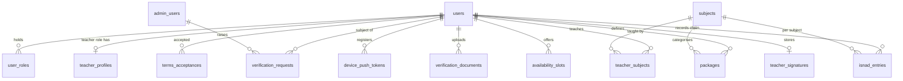
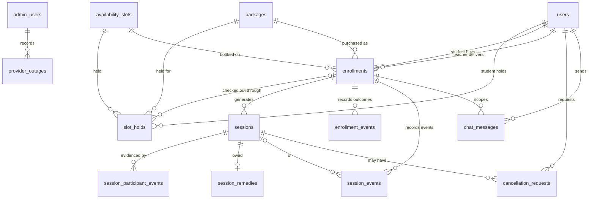
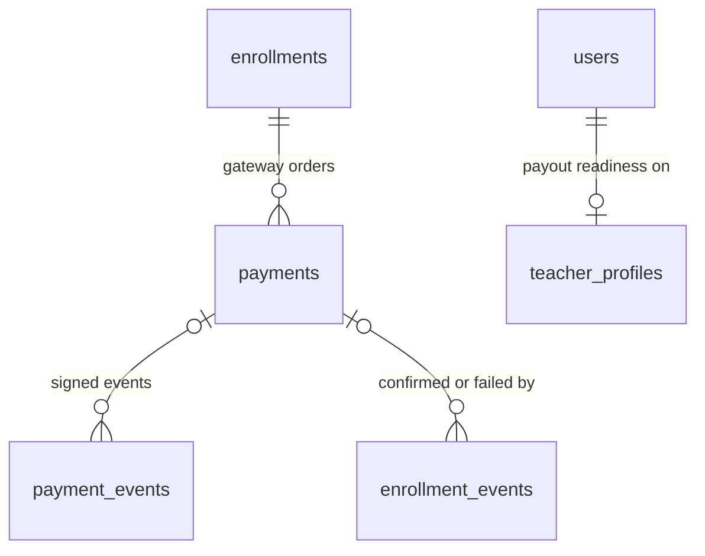
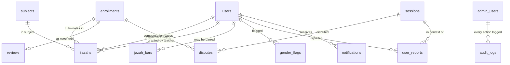

# Ijazah — Entity-Relationship Design

*Version 1.15 · Companion to SRS v1.4, ARCHITECTURE v3.2 and Constitution 2.6.2 · September 2026; v1.4 on 2026-10-18, the Phase 1 ERD pass (`specs/002-identity/data-model.md`, PR #77): six tables and the columns of Phase 1, listed in the "v1.3 → v1.4" changelog at the end; v1.5 on 2026-10-20, `user_session_retired_tokens` (T094), in the "v1.4 → v1.5" changelog; v1.6 on 2026-10-20, `users.timezone_overridden_at` (T049), in the "v1.5 → v1.6" changelog; v1.8 on 2026-10-22, the verification call's day and outcome (T068), in the "v1.7 → v1.8" changelog; v1.7 on 2026-10-21, `verification_documents.size_bytes` and the meaning of `application_decided_at` (T057, T056), in the "v1.6 → v1.7" changelog; v1.9 on 2026-10-26, a deleted person's documents (B16, T082), in the "v1.8 → v1.9" changelog; v1.10 on 2026-10-26, `banned_identifiers` (T097), in the "v1.9 → v1.10" changelog; v1.11 on 2026-11-01, the column checks and the retired-hash index (T140), in the "v1.10 → v1.11" changelog; v1.12 on 2026-11-01, the Phase 2 pass (T004 of `specs/003-booking/tasks.md`): `enrollment_events`, three columns and the name fold, in the "v1.11 → v1.12" changelog; v1.13 on 2026-11-03, a hold's package and session count (T036 of `specs/003-booking/tasks.md`), in the "v1.12 → v1.13" changelog; v1.14 on 2026-11-04, the gateway's member `paymob` (T056 of `specs/003-booking/tasks.md`), in the "v1.13 → v1.14" changelog; v1.15 on 2026-11-05, the Phase 3 pass (T106 of `specs/003-booking/tasks.md`, `specs/004-sessions/data-model.md` §7, with the owner's decisions of 2026-11-05): `session_events`, `provider_outages`, eleven columns and rules 40 to 47, amended the same day on Phase 3's analysis, on its second analysis, on its third analysis and on the owner's decision of no automatic termination ([ADR 0023](adr/0023-no-automatic-termination-complaint-and-restore.md)), then on the decisions of the administrator's control, the control inventory answered and the live channel (thirteen columns and rules 40 to 48 since, superseding «eleven columns and rules 40 to 47»), and on 2026-11-06 on its fourth analysis, in the "v1.14 → v1.15" changelog*

## 0. How to read this

This is the complete data model for the MVP — 44 tables across twelve module domains plus the platform kernel, every one traceable to an SRS requirement. If a feature needs a table that isn't here, the feature is out of spec: stop and raise it (Architecture principle 10), don't add the table silently.

> **Count history.** v1.0 said 36 and defined 35; v1.1 corrected the figure to 35. v1.2 removed the five managed-payment tables (ADR 0005 D1) and defined 30. v1.3 adds `payments` and `payment_events` — records of gateway orders and their signed events, never balances (ADR 0007) — and defined 32. v1.3 addendum (ADR 0008) adds `idempotency_keys` for the kernel and defined 33. v1.4 adds the six tables of the Phase 1 ERD pass (`specs/002-identity/data-model.md` §1) and defines **39**. v1.5 adds `user_session_retired_tokens` (T094) and defines **40**. v1.10 adds `banned_identifiers` (T097) and defines **41**. v1.12 adds `enrollment_events` (Phase 2's T004) and defines **42**. v1.15 adds `session_events` and `provider_outages` (Phase 3's pass) and defines **44**. The domain map below, the table sections and `packages/config/module-tables.json` all agree on that number and on which module owns each table.

Conventions, binding on every table:

- Primary keys are `id` — UUID v7 (time-ordered, index-friendly).
- Money is integer piasters, columns end `_piasters`. Never decimal, never float. The only money columns are package prices, their enrollment snapshot, and the gross, fee and net amounts the gateway reports on a `payments` row. The platform never holds a balance (ADR 0007).
- Timestamps are UTC `timestamptz`, columns end `_at`.
- Local wall-clock values end `_local` and always sit next to a timezone column.
- Booleans read as assertions: `is_minor`, `is_active`.
- Enums are Postgres enums, defined once in `base.prisma`.
- Soft state lives in status enums; nothing that matters is hard-deleted — not ijazahs, not audit entries.
- Where hard deletion is forbidden, the table carries `deleted_at` and removal is a soft deletion. This covers `users`, `sessions`, `enrollments` and `ijazahs`. One table is excepted and has no removal path whatsoever: `audit_logs`, which is strictly append-only.
- A soft-deleted row is excluded from every ordinary read, count and facet. Where a unique constraint covers a value a deleted row still holds, the constraint says explicitly whether the row keeps occupying it — see §15.11.
- Every table carries `created_at`; mutable tables carry `updated_at`.
- Derived values — sessions remaining, minor status, bar status, no-show counts, average ratings — are computed, not stored. The only deliberate cached exceptions are `teacher_profiles.average_rating` with `review_count`; `sessions.scheduled_start_at` with `scheduled_end_at`, derived from the session's stored local time and zone (ADR 0009); and `sessions.teacher_user_id` with `student_user_id`, copied from the enrollment so the database can refuse overlapping sessions (ADR 0010). Another requires an ADR before it exists (R-DB-4). `sessions.simultaneous_connected_seconds` is written once, by the evaluation, as the figure its outcome was decided on, and never recomputed (R-DB-4 names it, [ADR 0022](adr/0022-simultaneous-connected-seconds-as-a-recorded-figure.md); the owner's decision of 2026-11-05, decision 3 of `specs/004-sessions/plan.md`).
- A deleted person is named in the apps by a stand-in text, never by a stored value (T090 of `specs/003-booking/tasks.md`, FR-426 of `specs/004-sessions/spec.md`; the owner's decision of 2026-11-05).
- Secrets are never plaintext. What must be *verified* is hashed (`*_hash`); what must be *recovered or presented to a third party* is encrypted in the column (`*_encrypted`, bytea).

## 1. Domain map

Twelve domains, named exactly as the backend modules that own them (ADR 0005 D2, ADR 0007 D4).

| Domain | Module | Tables |
|---|---|---|
| IDENTITY | `identity` | `users` · `user_roles` · `teacher_profiles` · `otp_codes` · `device_push_tokens` · `terms_acceptances` · `user_sessions` · `user_session_retired_tokens` · `auth_identities` · `banned_identifiers` |
| VERIFICATION | `verification` | `verification_documents` · `verification_requests` |
| CATALOG | `catalog` | `subjects` · `teacher_subjects` · `packages` · `availability_slots` · `isnad_entries` · `teacher_signatures` · `teacher_credentials` |
| BOOKING | `booking` | `slot_holds` · `enrollments` · `enrollment_events` |
| PAYMENTS | `payments` | `payments` · `payment_events` |
| SESSIONS | `sessions` | `sessions` · `session_participant_events` · `cancellation_requests` · `session_remedies` · `session_events` · `provider_outages` |
| CHAT | `chat` | `chat_messages` |
| CERTIFICATION | `certification` | `ijazahs` · `ijazah_bars` |
| REVIEWS | `reviews` | `reviews` |
| MODERATION | `moderation` | `disputes` · `gender_flags` · `user_reports` |
| NOTIFICATIONS | `notifications` | `notifications` |
| ADMIN | `admin` | `admin_users` · `audit_logs` · `settings` · `admin_sessions` · `admin_recovery_codes` |
| PLATFORM | `platform` (kernel, not a module) | `idempotency_keys` |

Forty-four tables: the thirty-three of Phase 0, the six of the Phase 1 ERD pass (`user_sessions`, `auth_identities`, `admin_sessions`, `admin_recovery_codes`, `teacher_credentials`, `session_remedies`; migrations `20261018000000` to `20261018000300`), `user_session_retired_tokens` of Phase 1's T094 (migration `20261020000000`), `banned_identifiers` of T097 (migration `20261026000100`), `enrollment_events` of Phase 2's T004 (migration `20261101120000`), and `session_events` and `provider_outages` of Phase 3's pass (migration `20261108120000_sessions_pass` (B33)). One database, one schema. The grouping above maps 1:1 to the multi-file Prisma layout (`prisma/schema/<module>.prisma`), to backend module ownership, and to `packages/config/module-tables.json`: the owning module is the only module whose repository touches these tables (R-API-6). Discovery is a service inside `catalog` and owns nothing. Session generation is requested by `booking` but the rows are written by `sessions` through its public entry. `payments` confirms an enrollment through `booking`'s public entry and records payout readiness through `identity`'s.

## 2. Identity

### `users`

The root identity. One row per human, with exactly one role (ADR 0016).

| Column | Type | Notes |
|---|---|---|
| id | uuid | PK |
| phone | text, unique, nullable | E.164. At least one of phone/email on a live row — DB check constraint (§15 rule 1, rewritten for deleted rows in the Phase 1 pass). Unused in MVP: phone sign-up is deferred (ADR 0012) |
| email | text, unique, nullable | citext. Present on every MVP account: Google and Apple always return one, and email accounts verify theirs (ADR 0012) |
| password_hash | text, nullable | null for Google and Apple accounts (ADR 0012) |
| gender | enum male · female | Self-declared, FR-AUTH-3. Changed only via admin (FR-GENDER-5) |
| date_of_birth | date, nullable | FR-AUTH-4. Nullable only for a deleted row, so the deletion transaction can erase it; §15 rule 32 keeps it NOT NULL while the row is live (Phase 1 pass, migration `20261018000000`) |
| display_name | text, nullable | Nullable only for a deleted row, as `date_of_birth` (rule 32) |
| certificate_name | text, nullable | The full name printed on certificates; asked once at the first ijazah request (ADR 0019, landed by the Phase 1 pass). Erased on deletion; the names a certificate prints are snapshotted onto `ijazahs` at issue (ADR 0015 D3, ADR 0019 D1) |
| photo_key | text, nullable | The profile photo of either role (decision 46), a storage key served by a signed link; on deletion it is cleared once its file is removed, and a key still held is retried by the `erase-deleted-files` job (v1.9). While the deleted person is a party to an enrollment with an open `disputes` row (a session dispute, a compensation case or a complaint), the file and its key are kept, and removed by that job's first run after the last one closes (SRS FR-AUTH-14 as amended on 2026-11-05; v1.15, changelog row 24); while kept, read only by an administrator inside an open `disputes` row of that enrollment, a signed link per opening, each audited (SRS FR-AUTH-14 as amended on 2026-11-06; changelog row 31). `teacher_profiles.photo_key` is unused since (Phase 1 pass) |
| preferred_language | enum ar · en | |
| timezone | text (IANA) | Device-reported, manual override allowed (FR-AUTH-10) |
| timezone_overridden_at | timestamptz, nullable | When the person chose the zone by hand; while null, the device's report replaces `timezone` (FR-AUTH-10, v1.6) |
| account_status | enum active · suspended · verification_required · banned | |
| banned_at | timestamptz, nullable | The instant of the ban in force: written by every ban, cleared by its lift, which may come at any time (SRS FR-ADMIN-5 as amended on 2026-11-12, DEC-66); set only while `account_status` is `banned` (§15 rule 50). No backfill: the app had never launched (T069; changelog row 36) |
| deleted_at | timestamptz, nullable | Soft deletion. Hard DELETE is revoked (§15.10). Account deletion (FR-AUTH-14, ADR 0015) sets it and erases `display_name`, `email`, `phone`, `password_hash` and `date_of_birth` in the same transaction; history rows that point to the user stay |
| created_at / updated_at | timestamptz | |

The name search folds `display_name` and the typed text through one function, `ijazah_fold(text)` (IMMUTABLE, declared by migration `20261101120000`): lower case; أ, إ and آ to ا; ى and ئ to ي; ؤ to و; ة to ه; diacritics (U+064B–U+065F, U+0670) and tatweel (U+0640) removed (FR-333, `specs/003-booking/` R-203). It runs inside the kernel's query; no column holds a fold and no index is built on it (R-DB-4, R-DB-9; v1.12).

`is_minor` is derived from `date_of_birth` and computed on read, never stored — it would be a cached value beyond the six the constitution permits (R-DB-4). The same applies to the former `ijazah_barred` flag: current bar state is `exists(ijazah_bars where user_id = … and lifted_at is null)`.

A Google or Apple sign-in is keyed by the provider's subject identifier, never by the email (ADR 0012 D2): its table is `auth_identities` below. The `users` row, its `auth_identities` row (or `password_hash`) and its `user_roles` row are written together when onboarding completes (ADR 0012 D4, FR-AUTH-12): no row exists for a sign-in whose onboarding is incomplete, which is why `gender` and `timezone` stay NOT NULL as columns, and `display_name`, `date_of_birth` and `email` NOT NULL for every live row by §15 rule 32 — the columns themselves are nullable since the Phase 1 pass, so the one transaction of FR-141 can erase them.

### `auth_identities`

A Google or Apple account, keyed by the provider's subject (ADR 0012 D2). Added by the Phase 1 pass (migration `20261018000000`; specs/002-identity/data-model.md §1).

| Column | Type | Notes |
|---|---|---|
| id | uuid | PK |
| user_id | FK → users | |
| provider | enum google · apple | |
| provider_subject | text | The token's `sub`; unique with `provider` (§15 rule 22) |
| provider_refresh_token_encrypted | bytea, nullable | Apple only: the refresh token obtained by exchanging the authorization code at the first sign-in, kept so deletion can revoke it (ADR 0015 D3, R-DB-8); null for Google. Reached by the `reencrypt-columns` job through the identity repository |
| created_at | timestamptz | |

Deleted outright on account deletion (ADR 0015 D3): the application role keeps DELETE on this table, and the uniqueness never blocks the person's new account.

### `banned_identifiers`

A banned person's sign-in identifiers, kept past the deletion of their account so the ban outlives it (FR-155; ADR 0015 D1 and D3; T097). Written in the deletion's transaction, before the personal fields and `auth_identities` are erased, only when `users.account_status` is `banned`: one row for the normalized email and one for each linked `(provider, provider_subject)`. Read by `auth.email.verifySignUpCode` after the code, `auth.signInWithProvider` on the new-account path after the token and `onboarding.complete` before the row is written; a match is refused with `ACCOUNT_RESTRICTED`. Added by migration `20261026000100`.

| Column | Type | Notes |
|---|---|---|
| id | uuid | PK |
| kind | enum email · provider | What the hash was made from |
| identifier_hmac | text, unique | HMAC-SHA256, hex, under a subkey of ENCRYPTION_KEY derived by HKDF under `ijazah:banned-identifier:v1`, of `email` NUL the normalized address, or of `provider` NUL the provider NUL the subject (§15 rule 35) |
| created_at | timestamptz | |

Nothing else of the person: no address, subject, name or link to the deleted row, so the table says nothing to anyone without the key. A row never changes, so it carries no `updated_at`. Kept with no end date until OPEN-05 (NFR-COMP-2) settles its retention; the privacy policy must say it. An HMAC cannot be recomputed without the address it was made from, so a rotation of ENCRYPTION_KEY leaves every row unmatched (docs/RUNBOOK.md). The application role keeps the default privileges, DELETE included, for that retention.

### `user_sessions`

A device's session: its refresh token as a hash, rotation, revocation (FR-AUTH-7; specs/002-identity/research.md R-101). Added by the Phase 1 pass (migration `20261018000000`).

| Column | Type | Notes |
|---|---|---|
| id | uuid | PK |
| user_id | FK → users | Plain index, as every foreign key (§14); it serves "revoke every session of the user" |
| refresh_token_hash | text, unique | SHA-256 lookup hash of the current refresh token (R-DB-7; §15 rule 25) |
| previous_refresh_token_hash | text, nullable | The hash the last rotation retired, read for the grace window; every retired hash is also kept in `user_session_retired_tokens` (reuse detection). Plain index (§14, T140) |
| device_label | text, nullable | What the device reported of itself; shown nowhere in Phase 1 |
| issued_at | timestamptz | |
| refreshed_at | timestamptz, nullable | The last rotation |
| expires_at | timestamptz | Absolute: issue plus `session_refresh_ttl_days`; never extended |
| revoked_at | timestamptz, nullable | |
| revoked_reason | enum sign_out · reuse_detected · password_reset · account_deleted · account_suspended · account_banned · admin_action, nullable | |
| created_at / updated_at | timestamptz | |

No `deleted_at`: a session is a credential, destroyed, not a record kept from view; the application role keeps DELETE. Rows are purged by `purge-expired-sessions`: an expired row at once, a revoked row after `session_purge_after_days`, kept that long for reuse detection (research R-118 of Phase 1).

### `user_session_retired_tokens`

Every hash a session's rotations retired, so a retired refresh token presented again names its session and revokes it, whichever rotation retired it (research R-101 of Phase 1; T094). The one `previous_refresh_token_hash` remembers only the last: a stolen token rotated twice would otherwise evict the device's token undetected. Added by migration `20261020000000`.

| Column | Type | Notes |
|---|---|---|
| id | uuid | PK |
| session_id | FK → user_sessions, ON DELETE CASCADE | Plain index, as every foreign key (§14); the retired hashes go with their session |
| token_hash | text, unique | SHA-256 lookup hash of a retired refresh token (R-DB-7; §15 rule 33) |
| retired_at | timestamptz | The rotation that retired it |
| created_at | timestamptz | |

A row never changes, so it carries no `updated_at`. No `deleted_at`: a credential's history, destroyed with the session; the application role keeps DELETE.

### `user_roles`

One row per user in the MVP: an account is a student or a teacher, never both (SRS §2.2, ADR 0016). The table is kept so dual roles can return; the unique index on `user_id` (§15 rule 24) landed with the Phase 1 pass (migration `20261018000000`).

| Column | Type | Notes |
|---|---|---|
| id | uuid | PK |
| user_id | FK → users | |
| role | enum student · teacher | |
| status | enum active · suspended | Stays `active` in the MVP: suspension is per account (`users.account_status`, ADR 0016) |
| granted_at | timestamptz | unique (user_id, role); unique (user_id) since the Phase 1 pass (ADR 0016 D3) |

### `teacher_profiles`

Exists only for users holding the teacher role. 1:1 with the role.

| Column | Type | Notes |
|---|---|---|
| id | uuid | PK |
| user_id | FK → users, unique | |
| bio | text | NOT NULL, so it is written `''` where there is none: the first application creates the profile with an empty bio until the profile editor (Phase 2), and account deletion erases a teacher's bio to `''` (ADR 0015 D3, FR-AUTH-14) |
| photo_key | text, nullable | Unused since the Phase 1 pass: the photo of either role is `users.photo_key`; the column stays |
| qualification_summary | text | Years/type, FR-PROFILE-1 |
| verification_status | enum pending · approved · rejected · suspended · banned · revoked | FR-AUTH-9, FR-VERIFY-8/9. `revoked` (Phase 1 pass, FR-165): a withdrawn approval, the teacher returns only through a new application; `suspended` stays the account-level word and is no longer written here |
| verification_call_completed_on | date, nullable | Gate on approval, FR-VERIFY-5: the day the verification call took place. A call is known by its day, not its instant (v1.8) |
| verification_call_outcome | enum suitable · unsuitable, nullable | FR-161 (v1.8). `unsuitable` does not block approval; the reviewer decides |
| verification_call_notes | text, nullable | |
| approved_by_admin_id | FK → admin_users, nullable | |
| approved_at | timestamptz, nullable | |
| payout_account_ref_encrypted | bytea, nullable | The gateway's recipient reference, encrypted (R-DB-8). Never a raw account number. Set by payout setup after approval (FR-PAYG-13) |
| payout_configured_at | timestamptz, nullable | When the teacher submitted payout setup |
| payout_verified_at | timestamptz, nullable | When the gateway verified the account. NULL means not discoverable, not bookable, cannot publish (FR-PAYG-14, §3.7.1 predicate) |
| average_rating | numeric(3,2), nullable | Cached exception #1 — recomputed on every review write |
| review_count | int, default 0 | Cached with it |
| application_submitted_at | timestamptz, nullable | The current application's submission; reapplying after a rejection sets it again (Phase 1 pass, migration `20261018000200`; specs/002-identity/data-model.md §3: the application is a state of the profile, not a table) |
| application_status | enum in_review · needs_document · rejected · banned · approved, nullable | What the applicant sees, the queue's tab; `verification_status` stays the product's status. Null before the first submission |
| application_note | text, nullable | The reviewer's latest note to the applicant (the request for a document, the rejection) |
| application_decided_at / application_decided_by_admin_id | timestamptz, nullable; FK → admin_users, nullable | The reviewer's latest action on the application: a request for a document, a rejection, an approval or a ban each writes both; it dates the note the applicant reads (v1.7) |
| identity_document_id | FK → verification_documents, nullable | The identity document of the current application |
| identity_document_type | enum national_id · passport, nullable | One type shared with `verification_requests.document_type` |
| approved_shown_at | timestamptz, nullable | The once-only `ApplicationApproved` was shown (FR-152 of Phase 1) |
| payout_account_ref_hash | text, nullable, unique among the profiles not kept | SHA-256 lookup hash of the recipient reference beside the encrypted column; routes recipient events (§15 rule 27). A partial unique `WHERE kept_at IS NULL` since T069: the hash binds the live accounts only, so a new account may register the payout account a deleted teacher's kept profile holds (Q-E (a); changelog row 40) |
| payout_rejected_reason | text, nullable | The gateway's last rejection reason, shown to the teacher; cleared on verification |
| kept_at / kept_erase_at / kept_erased_at | timestamptz, nullable | A teacher ever approved keeps, after the deletion, the identity and credential documents and the payout recipient reference, for fraud prevention, with no end date (SRS FR-AUTH-14 as amended on 2026-11-12, DEC-67): `kept_at` the deletion that kept them, `kept_erase_at` the erasure date an administrator set, `kept_erased_at` their erasure, final (SRS FR-ADMIN-21; T069, T076, T077; changelog row 38) |
| verification_status_before_ban / application_status_before_ban | enum `teacher_verification_status`, nullable; enum `teacher_application_status`, nullable | The two statuses the profile had before a ban, written by every ban and cleared by its lift, which returns the profile to them (SRS FR-ADMIN-5 as amended on 2026-11-12, DEC-66; T069, T072; changelog row 38) |

### `otp_codes`

Signup verification and password reset (FR-AUTH-1/6).

| Column | Type | Notes |
|---|---|---|
| id | uuid | PK |
| destination | text | an email address in MVP; a phone number when phone sign-up returns (ADR 0012) |
| code_hash | text | Never store the code plain |
| purpose | enum signup · login · password_reset · account_deletion | `login` is unused in MVP: email accounts sign in with their password (ADR 0012); `account_deletion` is the web deletion's code (FR-AUTH-15, Phase 1 pass) |
| expires_at | timestamptz | Short TTL |
| consumed_at | timestamptz, nullable | Single-use |
| attempt_count | int, default 0 | Rate-limit companion. Index `(destination, purpose)` since the Phase 1 pass: the lookup every verify and every purge makes |

### `device_push_tokens`

Targets for FR-NOTIF-1.

| Column | Type | Notes |
|---|---|---|
| id | uuid | PK |
| user_id | FK → users | |
| token_encrypted | bytea | Provider push token, encrypted at rest (R-DB-8). Must be presented to the provider, so it cannot be hashed |
| token_hash | text, unique | Deduplication and lookup without decrypting |
| platform | enum ios · android | |
| last_seen_at | timestamptz | Stale tokens pruned |

### `terms_acceptances`

FR-AUTH-11 — versioned, because Terms will change and re-acceptance must be provable.

| Column | Type | Notes |
|---|---|---|
| id | uuid | PK |
| user_id | FK → users | |
| terms_version | text | |
| accepted_at | timestamptz | |

## 3. Verification

### `verification_documents`

Uploaded identity and credential documents (FR-VERIFY-1). Admin: view only, never modify.

| Column | Type | Notes |
|---|---|---|
| id | uuid | PK |
| user_id | FK → users | Teacher applicants and any user under FR-VERIFY-10 |
| document_type | enum national_id · passport · credential · other | |
| storage_key_encrypted | bytea, nullable | Identity-document reference, encrypted in the column itself (R-DB-8). Signed-URL access only (NFR-SEC-2/3). Null only once the file is removed after its person's deletion, never before `erased_at` (§15 rule 34; v1.9) |
| size_bytes | int, nullable | The PDF's size as the upload accepted it; null for a document uploaded before it was recorded. The file's name is never stored (it may carry the person's name) (v1.7) |
| uploaded_at | timestamptz | |
| erased_at | timestamptz, nullable | Set in the account deletion's transaction of the person who uploaded it (ADR 0015 D3); the document is no longer readable from then on, and its key is cleared after the commit once the file is removed. A key still held is retried by the `erase-deleted-files` job (v1.9). While the person is a party to an enrollment with an open `disputes` row (a session dispute, a compensation case or a complaint), the file and its key are kept, the document unreadable by every ordinary path, and removed by that job's first run after the last one closes (SRS FR-AUTH-14 as amended on 2026-11-05; v1.15, changelog row 24); while kept, an administrator may read it only inside an open `disputes` row of that enrollment, through a short signed link per opening, each audited (SRS FR-AUTH-14 as amended on 2026-11-06; changelog row 31) |
| kept_at | timestamptz, nullable | Set at the deletion of a teacher ever approved on each identity (`national_id`, `passport`) and credential document it keeps, in place of `erased_at`; the key and the file stay, read by an administrator only (SRS FR-AUTH-14 as amended on 2026-11-12, DEC-67; FR-ADMIN-21). Never with `erased_at` (§15 rule 34); an erasure clears it and sets `erased_at` (T069, T076, T077; changelog row 39) |

### `verification_requests`

Admin-initiated "provide ID" demands (FR-VERIFY-10) — distinct from the teacher application flow.

| Column | Type | Notes |
|---|---|---|
| id | uuid | PK |
| user_id | FK → users | |
| requested_by_admin_id | FK → admin_users | |
| reason | text | Mandatory |
| status | enum open · satisfied · expired · replaced | Open request ⇒ account_status verification_required. `replaced` (v1.8): closed by a request for another document, which opens a new request; the row keeps the document it held, so the documents sweep leaves it |
| document_id | FK → verification_documents, nullable | The document the user submitted for the request (Phase 1 pass, migration `20261018000200`) |
| document_type | enum national_id · passport, nullable | The same type as `teacher_profiles.identity_document_type` |
| created_at / resolved_at | timestamptz; `resolved_at` nullable | `resolved_at` is set on resolution |

## 4. Catalog

### `subjects`

| Column | Type | Notes |
|---|---|---|
| id | uuid | PK |
| name_ar / name_en | text | Both mandatory (FR-LOC-1). `name_en` is the English display name, required on creation (ADR 0021 D1) |
| is_active | boolean | Admin-managed list |

**Amended by ADR 0021 (D1, a note; no migration).** `name_en` is the English display name: every English page shows it wherever an Arabic page shows `name_ar` (the admin's English boards, the English phone app, the English certificate verification page). The admin's subject list (the "Admin-managed list" above, the subjects board) requires both names on creation and refuses a subject with an empty English name. A subject name is data, never an i18n key; the two catalogue strings that embed subject names as examples take them from this table at render time.

### `teacher_subjects`

| Column | Type | Notes |
|---|---|---|
| id | uuid | PK · teacher_user_id FK · subject_id FK — unique (teacher_user_id, subject_id) |

### `packages`

| Column | Type | Notes |
|---|---|---|
| id | uuid | PK |
| teacher_user_id | FK → users | |
| subject_id | FK → subjects | FK, not enum |
| session_count | int | ≥ 1 (§15 rule 36) |
| session_duration_minutes | int | 30, 45 or 60 (FR-PROFILE-2, §15 rule 36). Must equal slot duration at booking (FR-PROFILE-8) |
| price_piasters | bigint | > 0 (§15 rule 36). Charged in full through the gateway at checkout; the gateway settles the net to the teacher (FR-PAYG-1) |
| currency | char(3), default 'EGP' | |
| is_active | boolean | Deactivation never touches existing enrollments (FR-PROFILE-3) |
| track | enum recitation · ijazah_track | The teacher's choice at creation (ADR 0018 D1; Phase 1 pass, migration `20261018000300`, default `recitation` since no row existed). An ijazah can be requested only from the ijazah track (FR-IJAZAH-1) |

**ADR 0018, landed by the Phase 1 pass (migration `20261018000300`).** `packages.track`; `enrollments.snapshot_track` (§5); `sessions.makeup_for_session_id` and the `session_remedies` table (§5) record what each session not consumed is owed (FR-MAKEUP-1..6); `settings` holds the make-up choice window (seeded by T002).

### `availability_slots`

Recurring weekly, local wall-clock + zone (Architecture §9).

| Column | Type | Notes |
|---|---|---|
| id | uuid | PK |
| teacher_user_id | FK → users | |
| day_of_week | smallint | 0–6, 0 = Sunday (Postgres `EXTRACT(DOW)`; §15 rule 37) |
| start_time_local | time | Local concept — never store UTC here |
| duration_minutes | int | 30, 45 or 60 (FR-PROFILE-4, §15 rule 37) |
| timezone | text (IANA) | The teacher's zone at creation |
| is_active | boolean | Deactivation never affects generated sessions (FR-PROFILE-9) |

### `teacher_credentials`

One ijazah PDF per subject with its transcription; the chain hangs under it (ADR 0017 D5, FR-PROFILE-11). Added by the Phase 1 pass (migration `20261018000200`; specs/002-identity/data-model.md §1). Owned by `catalog`; the document itself is `verification`'s.

| Column | Type | Notes |
|---|---|---|
| id | uuid | PK |
| teacher_user_id | FK → users | |
| subject_id | FK → subjects | |
| document_id | FK → verification_documents | The ijazah PDF |
| holder_name | text, nullable | The teacher's full name as on the PDF, transcribed at approval (ADR 0019 D1) |
| riwaya / tariq | text, nullable | Transcribed at approval, Arabic as typed (ADR 0021 D1) |
| status | enum pending · needs_document · approved · rejected | |
| review_reason | text, nullable | Mandatory on reject and needs_document; the teacher sees it |
| reviewed_by_admin_id / reviewed_at | FK → admin_users, nullable; timestamptz, nullable | |
| submitted_with_application | boolean | Whether it came with an application («عند التقدّم») or was added after approval |
| created_at / updated_at | timestamptz | |

One approved credential per teacher and subject: partial unique `(teacher_user_id, subject_id) WHERE status = 'approved'` (§15 rule 23). A rejected credential stays as history; a new upload for the same subject is a new row. Rejecting an application closes its undecided credentials: each still `pending` or `needs_document` becomes `rejected` with the rejection's note as `review_reason`, its administrator and its moment (T122).

### `isnad_entries`

Chain of transmission — one generation per row under a credential (FR-ISNAD-1…6). Not a graph. Re-keyed by ADR 0017 D5 in the Phase 1 pass (migration `20261018000200`): the chain is transcribed by the admin from the teacher's ijazah PDF, never typed by the teacher, and exists only on an approved credential, so it carries no verification state of its own. The table held no row, so the former columns (`teacher_user_id`, `subject_id`, `transmitter_name`, `verification_status`, `verified_by_admin_id`, `verified_at`) were dropped rather than deprecated; the enum `isnad_verification_status` stays declared (R-API-9).

| Column | Type | Notes |
|---|---|---|
| id | uuid | PK |
| credential_id | FK → teacher_credentials | |
| position | int ≥ 1 | Origin first, counting toward the teacher; unique (credential_id, position) — §15 rule 7, as re-keyed; ≥ 1 by check (§15 rule 28) |
| names | text[] | One generation holding one or more names (ADR 0004 D3), Arabic as typed; never empty (check constraint) |
| created_by_admin_id | FK → admin_users | |
| created_at / updated_at | timestamptz | |

### `teacher_signatures`

Required before Mode A granting (FR-IJAZAH-12).

| Column | Type | Notes |
|---|---|---|
| id | uuid | PK · teacher_user_id FK unique · storage_key text · uploaded_at |

## 5. Booking and sessions

Two modules share this section. `booking` owns `slot_holds`, `enrollments` and `enrollment_events`; `sessions` owns `sessions`, `session_participant_events` and `cancellation_requests` (ADR 0005 D2).

### `slot_holds`

Checkout reservation with TTL (FR-BOOK-9). Enforced against double-booking together with `sessions`. At most one active hold per slot and per student (§15.17–18, ADR 0010).

| Column | Type | Notes |
|---|---|---|
| id | uuid | PK |
| slot_id | FK → availability_slots | |
| student_user_id | FK → users | |
| package_id | FK → packages | The package the hold was placed for, whose sessions its overlap check covered; Pay and the checkout's summary read the package from it, a teacher's several packages of one length being otherwise indistinguishable (FR-351, FR-354; the owner's decision of 2026-11-03) (v1.13) |
| session_count | integer | The package's session count when the hold was placed, the count its overlap check covered; Pay refuses `SUMMARY_CHANGED` when the package's count now differs from it (FR-351; the owner's decision of 2026-11-03) (v1.13) |
| enrollment_id | FK → enrollments, nullable | Set in the transaction that creates the enrollment at Pay; NULL while the student is in checkout before Pay. Conversion, release, the late-payment branch and a new checkout find the hold through it (ADR 0010 D2) |
| expires_at | timestamptz | Gateway checkout TTL plus the hold grace, counted from placement (defaults 10 + 5 min, admin-configurable; FR-BOOK-9, ADR 0010 D4) |
| released_at | timestamptz, nullable | Set on conversion, on expiry (by the expiry jobs, or before a new hold on the same slot or by the same student, ADR 0010 D3), by the student's own new checkout (FR-BOOK-12, ADR 0010 D6), or by the refusal branch of FR-PAYG-19. A failed gateway event does not set it (ADR 0010 D4). A release without conversion cancels the linked enrollment in the same transaction (ADR 0010 D7). NULL means active: §15.17–18 count the row even past `expires_at` |
| release_reason | enum hold_release_reason (converted · expired · checkout_abandoned · slot_unavailable · admin · teacher_suspended · account_deleted), nullable | Why the hold was released, written with `released_at` by every path that writes it: `converted` by the confirmation, the rest by booking's one release under its reason (an expiry, the student's own new checkout, the refusal branch of FR-PAYG-19, an account's end). NULL while active, and on a hold released before the column existed (§15 rule 48). Shown on the payments monitor's order page with the enrollment's holds (SRS FR-ADMIN-20 (a); v1.15, the owner's decision of 2026-11-05; changelog row 26) |

### `enrollments`

The central entity: one student's purchase of one package. Snapshots everything a mutable parent could change (principle 4, FR-PROFILE-3).

| Column | Type | Notes |
|---|---|---|
| id | uuid | PK |
| student_user_id | FK → users | |
| teacher_user_id | FK → users | Denormalised for query sanity; check ≠ student_user_id (FR-BOOK-11) |
| package_id | FK → packages | |
| slot_id | FK → availability_slots | |
| snapshot_price_piasters | bigint | |
| snapshot_session_count | int | |
| snapshot_duration_minutes | int | |
| snapshot_subject_id | FK → subjects | |
| snapshot_slot_timezone | text | Zone frozen at purchase — DST maths uses this |
| snapshot_track | enum recitation · ijazah_track | The package's track at purchase (ADR 0018 D1, DEC-24; Phase 1 pass, migration `20261018000300`, default `recitation` as `packages.track`'s) |
| status | enum pending_payment · confirmed · completed · terminated_no_show · cancelled | `pending_payment` from creation; `confirmed` only by the confirm-enrollment job on the gateway's paid event (FR-PAYG-5), and, for an enrollment that job confirmed and an administrator's decision later closed, by an administrator's restore (below); `cancelled` when its hold is released without conversion (FR-PAYG-6, ADR 0010 D7), and a paid event after that may still confirm it (FR-PAYG-19, ADR 0010 D5); `terminated_no_show` only by an administrator's decision on a student's complaint of the teacher's absence (FR-NOSHOW-4 as rewritten on 2026-11-05, [ADR 0023](adr/0023-no-automatic-termination-complaint-and-restore.md); was: at the teacher no-show threshold, removed); `completed` when every session is settled and not frozen, no remedy is owed, the last session's dispute window has closed and no `student_suspended` compensation case is open on it (FR-449 of `specs/004-sessions/spec.md`; the owner's decision of 2026-11-05). A student's suspension leaves it `confirmed` (SRS FR-ADMIN-5 as amended on 2026-11-05). An administrator's restore (SRS FR-CANCEL-8, ADR 0023) returns to `confirmed`, within `enrollment_restore_window_days` of its closing, a `terminated_no_show` enrollment ended on a complaint or one `cancelled` (`admin`) on a suspended student's confirmed fault: the second exit from a terminal state beside ADR 0010 D5's; nothing in the database forbids either, and it writes no `confirmed_at` |
| confirmed_at | timestamptz, nullable | Set once, by the confirm-enrollment job (FR-PAYG-5). There is no other write path (R-HONEST-1) |
| cancellation_reason | enum payment_expired · payment_failed · admin · gender_correction · teacher_suspended · slot_unavailable · checkout_abandoned · account_deleted, nullable | Why a `cancelled` enrollment was cancelled. `slot_unavailable`: paid, but the database refused its confirmation (FR-PAYG-19); `checkout_abandoned`: its hold was released by the student's own new checkout (FR-BOOK-12). Both added by ADR 0010 D7. `account_deleted`: the student deleted their account (ADR 0015 D4), landed by the Phase 1 pass (migration `20261018000300`). `admin` also for a student's ban (at once) and for a suspended student's fault confirmed (SRS FR-ADMIN-5 as amended on 2026-11-05, the owner's decision of 2026-11-05). Returned to NULL by an administrator's restore, as by ADR 0010 D5's late confirmation (SRS FR-CANCEL-8, ADR 0023) |
| deleted_at | timestamptz, nullable | Soft deletion. Hard DELETE is revoked (§15.10) |
| slot_released_at | timestamptz, nullable | An administrator's release of the weekly slot of a closed enrollment before its hold ended, with a reason, audited, one `enrollment_events` row `slot_released`; the slot is free from then on (SRS FR-CANCEL-9, DEC-66, DEC-69; T069, T070; changelog row 37). The held closings carry a partial index (§14) |
| admin_end_reason | text, nullable | The reason both parties are shown of an Administrator's direct end of the enrollment (`sessions.endEnrollment`), written with the end and cleared by the restore; the internal note is kept in the audit entry only, never here (SRS FR-CANCEL-10, DEC-68; T082; changelog row 45). Only on an enrollment `cancelled` with the reason `admin`, 1 to 500 characters (§15 rule 51) |
| purchased_at | timestamptz | |
| quoted_first_session_local_date | date | The first session's local date the checkout showed, computed at Pay; compared with session 1 to say the first session moved (FR-368, FR-386; `specs/003-booking/` R-209, v1.12). A local calendar date in the zone the row already holds, `snapshot_slot_timezone` |

`sessions_remaining` is derived: `snapshot_session_count − count(sessions where status is terminal-delivered)`. Never stored.

The teacher no-show count that marks an enrollment for repeated absence (FR-NOSHOW-3 as rewritten on 2026-11-05, `repeated_absence_flag_count`; no count ends an enrollment, [ADR 0023](adr/0023-no-automatic-termination-complaint-and-restore.md)) is likewise derived — `count(sessions where status = 'teacher_no_show')`, each session by its final status — not a stored counter. The only cached values in this model are `teacher_profiles.average_rating` and `review_count`, `sessions.scheduled_start_at` and `scheduled_end_at` (ADR 0009), and `sessions.teacher_user_id` and `student_user_id` (ADR 0010); nothing about no-shows is among them (R-DB-4).

### `enrollment_events`

Append-only record of each outcome a later notification needs: an enrollment confirmed, a gateway order failed, an enrollment cancelled (FR-385; `specs/003-booking/` R-216). Owned by `booking`; `payments` appends `order_failed` through booking's public entry. Added by migration `20261101120000` (v1.12).

| Column | Type | Notes |
|---|---|---|
| id | uuid | PK |
| enrollment_id | FK → enrollments | Plain index (§14) |
| kind | enum confirmed · order_failed · cancelled · completed · terminated_no_show · restored · slot_released · slot_hold_ended | `completed` and `terminated_no_show` written by Phase 3 (v1.15, `specs/004-sessions/data-model.md` §2.8); `restored`, an administrator's restore of an enrollment an administrator's decision closed, with no reason and no payment (SRS FR-CANCEL-8; v1.15, [ADR 0023](adr/0023-no-automatic-termination-complaint-and-restore.md)); `slot_released`, an administrator's release of a held slot, and `slot_hold_ended`, a hold's end recorded once by the hourly sweep, each with no reason and no payment (SRS FR-CANCEL-9; T069, T070, T074; changelog row 41) |
| cancellation_reason | enum `cancellation_reason`, nullable | Set exactly when `kind = 'cancelled'` (§15 rule 39) |
| payment_id | FK → payments, nullable | The order that failed (`order_failed`) or that confirmed the enrollment (`confirmed`), so a later paid order is told apart from a replay (FR-375); set exactly for those two kinds (§15 rule 39). A reference only: `booking` never reads a `payments` row (R-API-6) |
| occurred_at | timestamptz | The instant of the transaction that recorded the outcome |
| created_at | timestamptz | |

A row never changes, so it carries no `updated_at`; the application role may not UPDATE, DELETE or TRUNCATE it, and its foreign keys are `ON UPDATE RESTRICT` as rule 21's are (§15 rule 39).

### `sessions`

One scheduled occurrence. Its local date, local start time and zone are the schedule; the UTC instants are derived from them and recomputed when the time zone data changes (Architecture §9, ADR 0009).

| Column | Type | Notes |
|---|---|---|
| id | uuid | PK |
| enrollment_id | FK → enrollments | |
| teacher_user_id | FK → users | Cached exception #3 (ADR 0010 D2, R-DB-4): copied from the enrollment at generation, never changed. Lets §15.19 refuse overlapping sessions for one teacher |
| student_user_id | FK → users | Cached with it: copied from the enrollment at generation, never changed. Lets §15.19 refuse overlapping sessions for one student |
| sequence_number | int ≥ 1 | unique (enrollment_id, sequence_number); ≥ 1 by check (§15 rule 38) |
| scheduled_date_local | date | The calendar date the occurrence was requested for. With the next two columns, the session's schedule and the source of truth; stores what was asked for, never where a DST gap moved it (ADR 0009 D1) |
| scheduled_start_time_local | time | The start time the teacher chose, as requested (the slot's `start_time_local`) |
| timezone | text (IANA) | Zone of the local fields (the enrollment's `snapshot_slot_timezone`) |
| scheduled_start_at / scheduled_end_at | timestamptz | Cached exception #2 (ADR 0009 D2, R-DB-4): the local start resolved in `timezone`, and that instant plus `snapshot_duration_minutes`. Recomputed when the time zone data changes |
| status | enum scheduled · done · student_no_show · teacher_no_show · both_no_show · under_threshold · provider_outage · cancelled_by_agreement · cancelled_by_admin · disputed | Full machine, SRS §3.7.5 + §3.8 (`specs/004-sessions/data-model.md` §3). A `cancelled_by_agreement` session is final at acceptance and never disputed (SRS FR-CANCEL-2 as amended on 2026-11-05) |
| outcome_under_dispute | enum `session_status`, nullable | The outcome frozen while `status = 'disputed'` (FR-DISPUTE-4); cleared by the resolution, which writes the final `status` (v1.15; §15 rule 40) |
| simultaneous_connected_seconds | int, default 0 | Accumulated across reconnections (FR-SESS-18), from the recorded events, and written once by the evaluation as the figure its outcome was decided on; never recomputed (R-DB-4, [ADR 0022](adr/0022-simultaneous-connected-seconds-as-a-recorded-figure.md); v1.15, the owner's decision of 2026-11-05) |
| provider_room_id | text, nullable | Video provider reference. Unused: the video room is named for the session's `id`, so nothing writes this column and it stays NULL; its removal is Not scheduled (`specs/004-sessions/tasks.md`) (v1.15, the owner's decision of 2026-11-06 on Phase 3's sixth analysis) |
| evaluated_at | timestamptz, nullable | When the worker settled it |
| settled_by_admin_id | FK → admin_users, nullable | For review-queue resolutions (FR-SESS-19) and dispute resolutions |
| admin_settled_at | timestamptz, nullable | When an administrator settled it; both NULL or both set with `settled_by_admin_id` (v1.15; §15 rule 40) |
| makeup_for_session_id | FK → sessions, nullable | The session this one makes up for (ADR 0018 D3; Phase 1 pass, migration `20261018000300`) |
| deleted_at | timestamptz, nullable | Soft deletion. Hard DELETE is revoked (§15.10) |

### `session_remedies`

What a session not consumed is owed (ADR 0018 D2 to D5, FR-MAKEUP-1..6). Added by the Phase 1 pass (migration `20261018000300`), columns only; no code of Phase 1 writes it, Phase 3 does. Owned by `sessions`. The row is inserted when the remedy is offered, once the session's outcome is final (FR-MAKEUP-1: its dispute window closed and no dispute on it open, even when an administrator resolved a dispute earlier; the owner's decision of 2026-11-05 on Phase 3's third analysis) and only on a `confirmed` enrollment, so no remedy is offered and then withdrawn; a session owed on an enrollment that ended is covered by the compensation case that ending opened instead (the owner's decision of 2026-11-05 on Phase 3's analysis); it holds the current pending counter-proposal only, and the history of every counter-proposal is in `session_events` (v1.15, the owner's decision of 2026-11-05).

| Column | Type | Notes |
|---|---|---|
| id | uuid | PK |
| session_id | FK → sessions, unique | One row per session not consumed |
| kind | enum makeup · refund | |
| status | enum awaiting_choice · proposed · counter_proposed · frozen · booked · refund_case · lapsed | `refund_case` means handed to a compensation case: a refund choice, a counter-proposal left unanswered, an administrator's termination on a complaint, an account's end, a suspended student's fault confirmed, or an administrator's hand-off of an open remedy to the student's manual case (SRS FR-ADMIN-20 (c); v1.15, the owner's decision of 2026-11-05, changelog row 25) (the case's `reason` says which; `kind` is `refund` only for a refund choice or a counter-proposal left unanswered). `frozen`: the student's account is suspended, so nothing advances; a pending counter-proposal was withdrawn and the proposal's reserved time released; at reinstatement the remedy is offered again with a new choice window and a new proposal (SRS FR-ADMIN-5 as amended on 2026-11-05). `lapsed`: the student deleted their account with the remedy open, so it closes with nothing owed and no case (FR-AUTH-14). `booked`, `refund_case` and `lapsed` are final (`frozen` and `lapsed`: v1.15, the owner's decisions of 2026-11-05 on Phase 3's analysis), except that an administrator's restore of the enrollment (SRS FR-CANCEL-8) offers again, as a new offer with its `case_id` cleared, each `refund_case` remedy of kind `makeup` its closing's case held ([ADR 0023](adr/0023-no-automatic-termination-complaint-and-restore.md)) |
| offered_at | timestamptz | When the outcome became final and the remedy was offered: the dispute window's close, or the resolution of a dispute still open at the close (never before the close, even after an earlier resolution or revision: Phase 3's third analysis), a cancellation's acceptance, or a suspended student's case cleared; written again when a `frozen` remedy is offered again at the student's reinstatement (v1.15) |
| choice_closes_at | timestamptz | `offered_at` + the make-up choice window, fixed at the offer (§3.14 prospective) (v1.15) |
| snapshot_answer_window_hours / snapshot_first_session_lead_hours | int | The counter-proposal answer window and the first-session lead in force when the system's proposal is offered, fixed then, so every counter-proposal of the remedy is answered and placed by the values its proposal was placed by and no answer window runs past the proposal's start (SRS FR-MAKEUP-3 as amended on 2026-11-05; v1.15, the owner's decision of 2026-11-05 on Phase 3's analysis) |
| proposed_date / counter_date | date, nullable | `proposed_date` in the enrollment's `snapshot_slot_timezone`; `counter_date` in `counter_timezone` (v1.15) |
| counter_slot_id | FK → availability_slots, nullable | The teacher's active slot of the pending counter-proposal (v1.15). Plain index `session_remedies_counter_slot_id_idx`, as every foreign key (§14, FR-035; the owner's decision of 2026-11-05 on Phase 3's third analysis) |
| counter_start_time_local / counter_timezone | time / text (IANA), nullable | The pending counter-proposal's time of day and zone, the slot's own (v1.15) |
| counter_proposed_at | timestamptz, nullable | When the pending counter-proposal was made (v1.15). Its answer window closes at `counter_proposed_at` + `snapshot_answer_window_hours`, computed when read through `packages/time` and never stored, so no derived instant is kept (R-DB-4; the owner's decision of 2026-11-05 on Phase 3's second analysis). The five `counter_*` columns are set exactly while `status = 'counter_proposed'` and cleared at the counter-proposal's decline, withdrawal or hand-off to a case (§15 rule 42) |
| decided_at | timestamptz, nullable | |
| case_id | FK → disputes, nullable | The compensation case the remedy was handed to; NULL for a `lapsed` one |
| created_at / updated_at | timestamptz | |

### `session_participant_events`

Raw attendance evidence, from provider webhooks only — never the client (Architecture §11).

| Column | Type | Notes |
|---|---|---|
| id | uuid | PK |
| session_id | FK → sessions | |
| user_id | FK → users, nullable | NULL exactly for `room_ended` (v1.15; §15 rule 41) |
| event_type | enum joined · left · room_ended | `room_ended`: the provider's room-ended event, which closes every connection still open (v1.15) |
| connection_ref | text, nullable | The provider's id of one connection, so a reconnection or a replaced identity is its own interval; NULL exactly for `room_ended` (v1.15; §15 rule 41) |
| occurred_at | timestamptz | The provider's instant |
| provider_event_id | text, unique | Idempotency — a replayed webhook cannot double-insert |

### `cancellation_requests`

Mutual-agreement flow (FR-CANCEL-1…5), either direction.

| Column | Type | Notes |
|---|---|---|
| id | uuid | PK |
| session_id | FK → sessions | |
| requested_by_user_id | FK → users | Student or teacher |
| reason | text | |
| status | enum pending · accepted · declined · expired | Auto-expires at scheduled start (FR-CANCEL-4); one pending per session (§15 rule 45) |
| responded_at | timestamptz, nullable | Set exactly for `accepted` and `declined` (§15 rule 45) |

### `session_events`

Append-only record of each session-level event a later notification needs (FR-495 of `specs/004-sessions/spec.md`): settled, cancellation requested, accepted, declined or expired, cancelled by an administrator, remedy offered, counter-proposed, counter accepted, declined or withdrawn, remedy frozen, make-up booked, handed to a case, lapsed, dispute raised, resolved or its ruling revised, review resolved, outage reclassified, a complaint of the teacher's absence raised or decided, an administrator's correction of an outcome nobody disputed, a session's instants re-resolved. Owned by `sessions`. Added by migration `20261108120000_sessions_pass` (B33) (v1.15; the owner's decision of 2026-11-05, decision 6).

| Column | Type | Notes |
|---|---|---|
| id | uuid | PK |
| enrollment_id | FK → enrollments | Plain index |
| session_id | FK → sessions, nullable | Plain index |
| kind | enum `session_event_kind` | settled · cancellation_requested · cancellation_accepted · cancellation_declined · cancellation_expired · cancelled_by_admin · remedy_offered · counter_proposed · counter_accepted · counter_declined · counter_withdrawn · remedy_frozen · makeup_booked · remedy_handed_to_case · remedy_lapsed · dispute_raised · dispute_resolved · dispute_revised · review_resolved · outage_reclassified · complaint_raised · complaint_decided · outcome_corrected · instants_reresolved · counter_booking_refused (`counter_booking_refused`: a Teacher's acceptance of a counter-proposal that the database refused, the counter released as at a decline, never written as `counter_withdrawn`, which is the Student's acceptance of the proposal while a counter is pending: the owner's decision of 2026-11-06 on Phase 3's fourth analysis, changelog row 29; `dispute_revised`: the owner's decision of 2026-11-05 on Phase 3's third analysis, SRS FR-DISPUTE-7; `complaint_raised` and `complaint_decided`, enrollment-wide rows with no session: [ADR 0023](adr/0023-no-automatic-termination-complaint-and-restore.md), SRS FR-NOSHOW-4; `outcome_corrected`, an administrator's correction of an outcome nobody disputed, and `instants_reresolved`, written by `reresolve-session-instants` for a session it moved or kept back: SRS FR-ADMIN-20, the owner's decision of 2026-11-05, changelog row 26; twenty-five kinds) |
| case_id | FK → disputes, nullable | On a `cancelled_by_admin` row only: the compensation case the cancelling action opened or joined (an administrator's cancellation, an administrator's termination on a complaint, a teacher's end, a student's suspension or ban, and a suspended student's fault confirmed, whose make-ups name the new `student_fault_confirmed` case); NULL where the action opens no case (a student's deletion). On a `dispute_revised` row: the session dispute whose ruling the revision revises, set on every such row. On a `complaint_raised` or `complaint_decided` row: the complaint, set on every such row (ADR 0023). Plain index (v1.15, the owner's decisions of 2026-11-05 on Phase 3's analysis, second analysis and third analysis) |
| counter_slot_id | FK → availability_slots, nullable | The counter-proposal's slot, on a `counter_proposed` row only; plain index |
| counter_date / counter_start_time_local / counter_timezone | date / time / text (IANA), nullable | The counter-proposal's local date, start and zone, on a `counter_proposed` row only: the history of every counter-proposal, `session_remedies` keeping only the pending one |
| outcome_before / outcome_after | enum `session_status`, nullable | On a `dispute_revised` or an `outcome_corrected` row only, both set: the session's outcome the revision or the correction replaced and the one it wrote, each one of `done`, `student_no_show`, `teacher_no_show`, `both_no_show`. The ruling it revises stays as written on its `disputes` row, so this row is the revision's record beside it; the reason and the administrator are in the revision's or the correction's audit entry (SRS FR-DISPUTE-7; v1.15, the owner's decision of 2026-11-05 on Phase 3's third analysis; `outcome_corrected` the owner's decision of 2026-11-05, changelog row 26) |
| previous_start_at | timestamptz, nullable | On an `instants_reresolved` row only, set: for a session the run moved, its start before the run (the session's row holds the new one); for a session kept back, the start it keeps, so the two are told apart by whether the session still starts there (v1.15, the owner's decision of 2026-11-05; changelog row 26) |
| occurred_at | timestamptz | The transaction's instant |
| created_at | timestamptz | |

Every other detail is read from the rows the event names; the row references no account. A `cancelled_by_admin` row's `case_id` is how a case's page finds the sessions the case covers; a `dispute_revised` row's names the dispute revised. No UPDATE, DELETE or TRUNCATE for the application role, foreign keys `ON UPDATE RESTRICT` (§15 rule 43).

### `provider_outages`

A window during which the video provider was out, recorded by an administrator signed in with the second factor (LiveKit sends no outage event, ADR 0003); the evaluation reads it, and a session it overlaps settles Provider-Outage (SRS §3.7.5; FR-445 of `specs/004-sessions/spec.md`). Owned by `sessions`. Added by migration `20261108120000_sessions_pass` (B33) (v1.15).

| Column | Type | Notes |
|---|---|---|
| id | uuid | PK |
| starts_at / ends_at | timestamptz | Resolved on the server from the administrator's local date, time and zone (R-TIME-6); `ends_at > starts_at` (§15 rule 44) |
| reason | text | Mandatory |
| recorded_by_admin_id | FK → admin_users | Plain index |
| created_at | timestamptz | |

A window is evidence: no UPDATE, DELETE or TRUNCATE for the application role (§15 rule 44).

## 6. Chat

### `chat_messages`

Scoped to the enrollment (FR-SESS-6). Persisted; admin-readable only under open dispute/report; purged by the retention job (FR-SESS-13).

| Column | Type | Notes |
|---|---|---|
| id | uuid | PK |
| enrollment_id | FK → enrollments | |
| sender_user_id | FK → users | |
| body | text, nullable | Text message |
| attachment_key | text, nullable | PDF/document only; images rejected by content sniffing (FR-SESS-8) |
| attachment_filename | text, nullable | |
| attachment_mime | text, nullable | Verified server-side, not trusted from client; `application/pdf` or `text/plain` only (§15 rule 47; SRS FR-SESS-7 as amended on 2026-11-05) |
| sent_at | timestamptz | |
| purged_at | timestamptz, nullable | Retention marker; body, `attachment_filename` and `attachment_mime` nulled with it, row kept for counts; `attachment_key` kept until its file is removed after the purge's commit, then cleared, so a failed removal is retried by the next run, as `erase-deleted-files` retries (v1.15, changelog row 35) |

Check constraint: at least one of `body` / `attachment_key`, unless `purged_at` is set: the retention purge nulls the body and the attachment's name and type and keeps the row, its key until the file is removed (note under T051; changelog row 35).

## 7. Payments

Records of what the gateway did. Owned by `payments`. The platform takes 0% commission and holds no funds: the gateway settles the net directly to the teacher (FR-PAYG-1, ADR 0007). Nothing here is a balance; there is no wallet, ledger or escrow table and never will be without a new ADR. *(Amended 2026-11-17, ADR 0025: the platform takes a commission; `payments` records each order's rate and the Teacher's share (B-M1), its refunded total and the releases of the Teacher's share an Administrator marks done (B-M2), records of what the gateway was told and did. Still no wallet, ledger or escrow table.)*

### `payments`

One row per gateway order. An enrollment may have several (a failed or expired attempt, then a paid one); at most one reaches `paid`, which is enforced by the confirm step being idempotent on the enrollment rather than by a partial index.

| Column | Type | Notes |
|---|---|---|
| id | uuid | PK |
| enrollment_id | FK → enrollments | |
| gateway | enum fake, then one value per integrated gateway | Declared in `base.prisma` by T059 with the single member `fake`, the recording stand-in the port carries from day one; production refuses `fake` in config (note under T059 in tasks.md). A real gateway's member is added when it is integrated (OPEN-11): `paymob` since T056 of `specs/003-booking/tasks.md` (migration `20261104120000_payment_gateway_paymob`). The adapter is selected by config (R-API-4), independently of this enum |
| gateway_order_id | text, unique | Created by the platform on the gateway (FR-PAYG-2) |
| gateway_transaction_id | text, unique, nullable | Reported by the paid event |
| gross_piasters | bigint | Gross — the snapshot price charged. Named for what it is, so the R-MONEY-6 confinement rule recognises it by its words (PR #20) |
| gateway_fee_piasters | bigint, nullable | Reported by the gateway on the paid event |
| net_piasters | bigint, nullable | Settled to the teacher; `gross − fee`, as reported, never computed here (R-MONEY-5) |
| teacher_share_rate_percent | smallint, nullable | The teacher's share rate read from the setting `teacher_share_percent` when the order was created, whole percent, kept so a later change of the setting reaches new orders only (SRS FR-PAYG-1 as amended, DEC-80; ADR 0025 D1; T104; changelog row 46). NULL on an order created before the commission; both or neither (§15 rule 52) |
| teacher_share_piasters | bigint, nullable | The teacher's share it gave: the gross times the rate, rounded up to the piaster by `packages/money`'s `teacherShare`, sent to the gateway as the split (ADR 0025 D1; T104; changelog row 46). From 0 to the gross (§15 rule 52) |
| refunded_piasters | bigint, NOT NULL, default 0 | The order's refunded total: the sum, by `packages/money`, of the refunds the gateway's signed child events reported, each added under the order's lock while the order is `paid`; a total past the gross is refused and reported, nothing recorded (SRS DEC-82; ADR 0025 D3; T102; changelog row 56). From 0 to the gross (§15 rule 61) |
| refund_reported_at | timestamptz, nullable | When the gateway first flagged a refund on the original payment (`refund_reported`), which reports no amount; set once, adds no money and moves nothing, so an administrator sees a refund whose child event never came (SRS DEC-82; T102, Q-2 (a); changelog row 56) |
| currency | char(3) | |
| status | enum created · paid · failed · expired · refunded | `refunded` records a refund Platform Administration executed through the gateway after a compensation decision (FR-DISPUTE-6), learned from the gateway's signed event; the platform's code never initiates one (FR-PAYG-10). *(Amended 2026-11-18, T102: an order becomes `refunded` when its `refunded_piasters` reaches the gross; a partial refund leaves it `paid`, DEC-82.)* |
| expires_at | timestamptz | The order's expiry as created: no later than the hold's expiry minus the grace (FR-355). Read by Retry and by FR-BOOK-12's "still payable" (v1.12) |
| checkout_url_encrypted | bytea, nullable | The hosted checkout's address, encrypted (R-DB-8: it may carry a payment token), kept so FR-BOOK-12 (c) can offer "continue the previous payment"; NULL once the order leaves `created`. Decrypted only by `checkout.continue`, for the student who owns the order's enrollment, while the order is `created` and `expires_at` is in the future; never logged (`specs/003-booking/data-model.md` §2.4.1). Reached by the `reencrypt-columns` job through the payments repository (v1.12) |
| created_at / updated_at | timestamptz | |

### `payment_events`

Append-only record of every signed inbound gateway event. Replay safety is the unique provider event id, the same pattern as `session_participant_events` (§15.4, §15.13).

| Column | Type | Notes |
|---|---|---|
| id | uuid | PK |
| payment_id | FK → payments, nullable | NULL exactly when `event_type` is `recipient_verified` or `recipient_rejected`: those report on a teacher's payout account, not a gateway order, and are recorded here so the unique `provider_event_id` makes their replay a no-op too (FR-PAYG-4, FR-PAYG-15, §15.20) |
| provider_event_id | text, unique, NOT NULL | Idempotency — a replayed webhook cannot double-insert (FR-PAYG-4, R-MONEY-8) |
| event_type | enum paid · failed · expired · refunded · recipient_verified · recipient_rejected · refund_reported | `refunded`: a refund child transaction, its signed amount added to the order's `refunded_piasters`. `refund_reported` (T102, changelog row 56): a refund flagged on the original payment, which records no money and sets `payments.refund_reported_at` once (DEC-82) |
| signature_verified_at | timestamptz | Set by the signature guard before the row is written (R-MONEY-9). A row cannot exist for an unverified event |
| payload_hash | text | Hash of the raw body, for audit; the body itself is never stored (R-SEC-2) |
| received_at | timestamptz | |

## 8. Certification

### `ijazahs`

**Amended by ADR 0017 (Phase 4 ERD pass, forward migration).** An ijazah is issued by the admin on the teacher's request: `ijazahs` gains `request_id` FK → `ijazah_requests` (unique) and `issued_by_admin_id` FK → `admin_users`. New table `ijazah_requests`: `id`, `enrollment_id`, `teacher_user_id`, `student_user_id`, `subject_id`, `completion_date` (date), `language` enum ar · en, `status` enum pending · approved · rejected, `reason` (nullable, mandatory on reject), `decided_by_admin_id`, `decided_at`, `created_at`; at most one pending request per enrollment. `chain_snapshot_json` keeps generations (arrays of names) with the teacher appended (FR-ISNAD-7). ADR 0019 D1 (same pass): `student_name_printed` and `teacher_name_printed` text NOT NULL, the names as issued, so the certificate verifies after a deletion erases `users.certificate_name` (ADR 0015 D3).

| Column | Type | Notes |
|---|---|---|
| id | uuid | PK |
| certificate_number | text, unique | Non-sequential, non-guessable |
| enrollment_id | FK → enrollments | |
| student_user_id / teacher_user_id | FK → users | Denormalised for rendering |
| subject_id | FK → subjects | |
| mode | enum generated · uploaded | FR-IJAZAH-2, DEC-42. Always `generated` in the MVP; `uploaded` is kept for a deferred mode and never written (ADR 0013) |
| language | enum ar · en | Mode A template language (FR-LOC-4) |
| chain_snapshot | jsonb, nullable | Ordered names at grant time, teacher appended (FR-ISNAD-7). Immutable from the sign-off (SRS DEC-72): before it, a correction of the chain re-freezes it and the certificate is re-rendered (changelog row 47). Mode A only, so always present in the MVP (ADR 0013) |
| certificate_storage_key | text | The generated PDF (an uploaded scan once Mode B returns, ADR 0013); signed URLs only |
| paper_copy_intended | boolean | Informational (FR-IJAZAH-5). Stays false in the MVP: the flag is deferred (ADR 0016) |
| verification_token_hash | text, unique | Backs the public QR page (FR-IJAZAH-10). The QR carries the plaintext token; the database stores only its hash and looks up by hash (R-DB-7) |
| granted_at | timestamptz | |
| revoked_at | timestamptz, nullable | FR-IJAZAH-8. Revocation, not deletion — a revoked ijazah is never shown as valid |
| revoked_reason | text, nullable | Mandatory when revoked |
| revoked_by_admin_id | FK → admin_users, nullable | |
| deleted_at | timestamptz, nullable | Soft deletion, distinct from revocation. Hard DELETE is revoked (§15.10) |
| request_id | FK → ijazah_requests, nullable, unique | The request it was issued from (ADR 0017; Phase 4, changelog row 47) |
| issued_by_admin_id | FK → admin_users, nullable | The administrator who approved the request (ADR 0017) |
| student_name_printed / teacher_name_printed | text | The names as printed: the student's `users.certificate_name` read at the approval, the teacher's frozen on the request. An issued certificate keeps them from its sign-off, so it verifies after a deletion erases `users.certificate_name` (ADR 0019 D1, as noted 2026-11-17; ADR 0015 D3) |
| riwaya_printed / tariq_printed | text / text, nullable | The credential's riwaya and tariq as printed (FR-IJAZAH-2), copied from the request at approval, re-frozen with the chain before the sign-off, immutable after it; the tariq NULL when the credential names none; never '' on a new row (§15 rule 58; B46, changelog row 52) |
| completion_date | date, nullable | From the request (FR-IJAZAH-15) |
| rendered_at | timestamptz, nullable | Set by `render-certificate` for the payload's `render_generation`; cleared by a re-render (R-402) |
| render_generation | int, default 0 | Raised by each re-render; an older generation's job writes nothing (R-402) |
| signed_off_at / signed_off_by_admin_id | timestamptz, nullable / FK → admin_users, nullable | The administrator's sign-off, set together and never before the rendering (§15 rule 55; SRS DEC-72, FR-629). The parties see the certificate only once signed off |

### `ijazah_requests`

Phase 4 (2026-11-17, `specs/005-certification/data-model.md`; ADR 0017 D5, R-403, R-404; changelog row 47). A teacher's request for a student's ijazah, frozen at send, decided by an Administrator. Owned by `certification`.

| Column | Type | Notes |
|---|---|---|
| id | uuid | PK |
| enrollment_id, teacher_user_id, student_user_id, subject_id | FK → enrollments, users, users, subjects | From the enrollment, never the input |
| completion_date | date | Not in the future (the service's rule) |
| language | enum ar · en, default ar | The certificate's language (FR-LOC-4) |
| status | enum `ijazah_request_status`: awaiting_student_name · pending · approved · rejected · closed | Sent → `awaiting_student_name` (no certificate name yet) or `pending`; the name entered → `pending`; approved (an `ijazahs` row) or rejected by an Administrator; `closed` at the student's deletion |
| chain_snapshot | jsonb | Generations (arrays of names), origin first, the teacher appended; frozen at send, re-frozen on a correction of the chain while open (R-403) |
| teacher_name_printed | text | `teacher_credentials.holder_name` at send |
| riwaya_printed / tariq_printed | text / text, nullable | The credential's riwaya and tariq at send, re-frozen with the chain while open; the tariq NULL when the credential names none; never '' (§15 rule 58; B46, changelog row 52) |
| signature_storage_key | text, nullable | The request's own copy of the teacher's signature; NULL once erased (rejected or closed) |
| reason | text, nullable | Mandatory when rejected (§15 rule 54) |
| decided_by_admin_id / decided_at | FK → admin_users, nullable / timestamptz, nullable | Set together on approve or reject, and only then (§15 rule 54) |
| created_at / updated_at | timestamptz | |

One open request (awaiting the student's name, or pending) per enrollment (§15 rule 53).

### `ijazah_bars`

FR-IJAZAH-9 — barring is explicit and reasoned, and reversible with history. This table is the record, and current bar state is read from it rather than mirrored onto `users`.

| Column | Type | Notes |
|---|---|---|
| id | uuid | PK |
| user_id | FK → users | |
| reason | text | Mandatory |
| barred_by_admin_id | FK → admin_users | |
| barred_at | timestamptz | |
| lifted_at | timestamptz, nullable | |
| lifted_by_admin_id | FK → admin_users, nullable | |

## 9. Community

### `reviews`

One per enrollment, terminal status + ≥1 delivered session (FR-REVIEW-1/2).

| Column | Type | Notes |
|---|---|---|
| id | uuid | PK |
| enrollment_id | FK → enrollments, unique | The one-review rule, at the DB level. Plain unique, never partial (§15.11, ADR 0006) |
| student_user_id / teacher_user_id | FK → users | |
| rating | smallint | 1–5, check |
| comment | text, nullable | |
| comment_removed_at | timestamptz, nullable | Moderation removes the comment; the star still counts (FR-REVIEW-5) |
| moderated_by_admin_id | FK → admin_users, nullable | |
| created_at / updated_at | timestamptz | `updated_at` because moderation changes the row (§0) |

## 10. Moderation

### `disputes`

| Column | Type | Notes |
|---|---|---|
| id | uuid | PK |
| enrollment_id | FK → enrollments | Every case belongs to one enrollment |
| session_id | FK → sessions, nullable | Set for a session dispute; NULL for an enrollment-level compensation case (FR-DISPUTE-5) |
| kind | enum session_dispute · compensation_case · absence_complaint | `compensation_case` rows are opened automatically by termination flows (FR-DISPUTE-5), or manually by an administrator on any enrollment, for either party (SRS FR-ADMIN-20 (c); v1.15, the owner's decision of 2026-11-05); `absence_complaint`, a student's complaint of the teacher's absence on a confirmed enrollment, raised by the student, with no session, one open per enrollment (§15 rule 46; SRS FR-NOSHOW-4; v1.15, [ADR 0023](adr/0023-no-automatic-termination-complaint-and-restore.md)). Phase 2's covering rule reads `compensation_case` rows only, and of them only Phase 2's three reasons, `slot_unavailable`, `party_restricted` and `duplicate_payment`, so no case Phase 3 opens, a manual one included, moves a paid order's confirmation (v1.15, the owner's decision of 2026-11-05; `specs/004-sessions/research.md` R-326) |
| raised_by_user_id | FK → users, nullable | Within the dispute window only (FR-DISPUTE-1); NULL when opened by the system; the student on every `absence_complaint` (rule 46) |
| reason | text | A compensation case: one of the closed list of compensation reasons (Phase 3 adds `absence_termination` (the case an administrator's termination on a complaint opens; it replaces `teacher_no_show_threshold`, removed with the threshold on 2026-11-05, ADR 0023), `admin_cancellation`, `teacher_ended`, `student_suspended`, `student_banned`, `student_fault_confirmed`, `refund_choice`, `counter_unanswered`, `makeup_refused`, and `admin_opened_for_student` and `admin_opened_for_teacher`, an administrator's manual case, whose party its reason names and whose written reason is its audit entry's); a session dispute or an `absence_complaint`: the participant's text (v1.15; `student_fault_confirmed` the owner's decision of 2026-11-05 on Phase 3's second analysis; the two manual reasons the owner's decision of 2026-11-05, changelog row 25; Phase 4 adds `gender_correction`, the case each confirmed enrollment a gender correction ends opens, changelog row 54) |
| status | enum open · resolved · dismissed | An open session dispute freezes the session's outcome (FR-DISPUTE-4), kept in `sessions.outcome_under_dispute`; one open session dispute per session (§15 rule 46). A `student_suspended` case resolved clears the student, dismissed confirms the fault: in that transaction the enrollment is cancelled `admin`, every make-up still scheduled on it is cancelled, and every remedy owed on it, but none for the ordinary sessions the suspension cancelled (a make-up session it cancelled stays owed), is handed to a new `student_fault_confirmed` case, never to the case dismissed; on an enrollment that ended another way while the case was open, the case decides only the sessions the suspension cancelled, which join the first end's case if the student is cleared (SRS FR-ADMIN-5 as amended on 2026-11-05, three times). An `absence_complaint` closes `resolved` when the administrator ends the enrollment (`enrollment_ended`) or suspends the teacher (`party_suspended`), `dismissed` when they close it; an administrator's restore closes the case its enrollment's closing opened (`absence_termination` or `student_fault_confirmed`) `dismissed`, with the note `restored` (SRS FR-NOSHOW-4, FR-CANCEL-8; ADR 0023) |
| resolution | enum upheld · re_marked · no_show_recorded · compensation_ordered · party_suspended · party_banned · enrollment_ended, nullable | `enrollment_ended` on an `absence_complaint` only, the administrator having ended the enrollment on it (rule 46; ADR 0023). `compensation_ordered` records the decision only; execution is by Platform Administration outside the code path and the outcome lands on `payments` when the gateway reports it (FR-DISPUTE-6). Written once, with `resolution_notes`, `resolved_by_admin_id` and `resolved_at`, and never rewritten: an administrator's revision of the ruling (SRS FR-DISPUTE-7) is a `session_events` row `dispute_revised` beside it (v1.15, the owner's decision of 2026-11-05 on Phase 3's third analysis) |
| resolution_notes | text, nullable | Mandatory on resolve |
| resolved_by_admin_id | FK → admin_users, nullable | |
| created_at / resolved_at | timestamptz; `resolved_at` nullable | `resolved_at` is set on resolution, by the database's `clock_timestamp()` in the update that closes the row, the enrollment's row locked first (note under T082 of `specs/003-booking/tasks.md`; v1.15) |
| covered_by_case_id | FK → disputes, nullable | On a closed `student_suspended` case only: the case that owes the sessions its suspension cancelled, written with the closing (rule 49). Dismissed on a confirmed enrollment, the fault confirmed: the `student_fault_confirmed` case opened or joined then, which covers only the make-ups among them. Resolved on an enrollment that had already ended: the case that end opened, which covers all of them, owed as refunds. NULL otherwise. The link sits on the suspension case because each closed suspension case owes its sessions to one case (the sentence first written here, «a joined fault case after a restore», was wrong: a restore closes the fault case `dismissed` `restored` and refuses a closed one, so a fault case is never joined twice; PR #133's review, round 2, nit 2; changelog row 35). Plain index (§14). `cases.get`'s `covers` reads it, so no instant is compared (v1.15, the owner's decision of 2026-11-11 on PR #133's review; changelog row 34). Since T069, also on a closed `teacher_suspended` case: the case of the end that closed it, owing the sessions the teacher's suspension cancelled (SRS FR-SESS-16 as amended on 2026-11-12; T071; changelog row 43) |

### `gender_flags`

| Column | Type | Notes |
|---|---|---|
| id | uuid | PK |
| flagged_user_id | FK → users | |
| raised_by_user_id | FK → users, nullable | Null when admin-initiated (FR-GENDER-3) |
| status | enum open · corrected · fraud_ban · dismissed | Outcomes per FR-GENDER-6/7. One open flag per user (§15 rule 57; Phase 4) |
| reason | text | The raiser's reason (Phase 4, changelog row 49) |
| report_id | FK → user_reports, nullable | The report an Administrator raised it from (Phase 4, changelog row 49) |
| resolution_notes | text, nullable | |
| resolved_by_admin_id | FK → admin_users, nullable | |
| created_at / resolved_at | timestamptz; `resolved_at` nullable | `resolved_at` is set on resolution |

### `user_reports`

FR-SESS-15 — report from any session or profile.

| Column | Type | Notes |
|---|---|---|
| id | uuid | PK |
| reported_user_id | FK → users | |
| reporter_user_id | FK → users | |
| context | enum session · profile · chat | |
| session_id | FK → sessions, nullable | Extends chat retention while open (FR-SESS-13) |
| enrollment_id | FK → enrollments, nullable | The enrollment of a session or chat report, set by the server; the chat purge reads it (R-408; Phase 4, changelog row 49). Required unless the context is `profile`, and `session_id` required for a session report (§15 rule 56) |
| reason | text | |
| status | enum open · actioned · dismissed | One open report per reporter, reported user and context; never on oneself (§15 rule 56; Phase 4) |
| resolution_notes | text, nullable | The administrator's note on `reports.resolve` (FR-612; B47, changelog row 53) |
| resolved_by_admin_id | FK → admin_users, nullable | Set on resolution, with `resolved_at` (§15 rule 59) |
| created_at / resolved_at | timestamptz; `resolved_at` nullable | `resolved_at` is set on resolution: an open report has neither it nor `resolved_by_admin_id`, a resolved one both (§15 rule 59) |

## 11. Notifications

### `notifications`

Backs both push delivery and the notification centre (FR-NOTIF-1/2).

| Column | Type | Notes |
|---|---|---|
| id | uuid | PK |
| user_id | FK → users | |
| type | enum teacher_application_status_changed · new_booking · session_reminder · no_show_recorded · cancellation_requested · cancellation_request_accepted · cancellation_request_declined · payment_confirmed · payment_failed · payment_expired · payout_account_verified · dispute_resolved · gender_flag_resolved · ijazah_granted · ijazah_revoked · new_review | One member per FR-NOTIF-1 event, in the order the SRS states them (DEC-13c). Twelve members are appended by ADR 0021, and fourteen Phase 3 names on 2026-11-05, below |
| title_key / body_key | text | i18n keys — rendered in the user's language at display time (FR-NOTIF-3) |
| payload | jsonb | Deep-link data (enrollment_id, session_id, …) |
| read_at | timestamptz, nullable | Unread state for the centre |
| pushed_at | timestamptz, nullable | Set by the delivery job (FR-NOTIF-4) |
| created_at | timestamptz | |

**Amended by ADR 0021 (Phase 2 notifications pass, forward migration).** `type` gains the twelve members the accepted ADRs imply and the design draws, appended in this order after `new_review`: `makeup_proposed`, `makeup_counter_proposed`, `makeup_booked` (ADR 0018 D3), `certificate_name_requested` (ADR 0019 D1), `enrollment_terminated` (FR-NOSHOW-4), `session_cancelled_by_admin` (FR-CANCEL-6), `session_outcome_confirmed` (FR-SESS-19), `ijazah_request_rejected` and `credential_reviewed` (ADR 0017 D1/D3), `payout_account_rejected` (FR-PAYG-15; `recipient_rejected` is a webhook event, not a notification), `account_suspended` and `account_reinstated` (FR-ADMIN-5, ADR 0018 D5). The existing members stay in place; `teacher_application_status_changed` keeps covering approval, rejection, ban and the request for another document, with the status in `payload`. FR-NOTIF-1 lists the same members by name, so the requirement and this enum say one list (ADR 0021 D3).

**Amended 2026-11-05 (v1.15, the owner's decision; SRS FR-NOTIF-1).** `type` gains, by name only, fourteen Phase 3 members appended after `account_reinstated`, in this order: `enrollment_restored`, `dispute_ruling_revised`, `absence_complaint_decided`, `dispute_raised`, `cancellation_request_expired`, `makeup_counter_declined`, `makeup_frozen`, `makeup_lapsed`, `makeup_offered_again`, `makeup_handed_to_case`, `session_outage_reclassified`, `enrollment_completed`, `enrollment_cancelled`, `compensation_case_opened` (their recipients in FR-NOTIF-1; `absence_complaint_decided` is told to both parties, the student and the teacher, as SRS FR-NOSHOW-5 says: the owner's decision of 2026-11-05, changelog row 27). Phase 4 reads each from the durable record Phase 3 writes: `enrollment_events` `restored`, `completed` and `cancelled` (with its `cancellation_reason`, for `enrollment_cancelled`); `session_events` `dispute_revised`, `complaint_decided`, `dispute_raised`, `cancellation_expired`, `counter_declined`, `remedy_frozen`, `remedy_lapsed`, `remedy_offered` (a session's second or later, for `makeup_offered_again`), `remedy_handed_to_case` and `outage_reclassified`. `compensation_case_opened` is read from the manual compensation case's own `disputes` row (SRS FR-ADMIN-20 (c); reason `admin_opened_for_student` or `admin_opened_for_teacher`, naming the party told, and its `created_at`) and its audit entry `case.opened_manually`; a joined opening writes no row and is told again to nobody (the owner's decision of 2026-11-05, changelog row 25; `specs/004-sessions/research.md` R-326). **Amended 2026-11-06 (the owner's decision on Phase 3's fourth analysis; changelog row 30):** a fifteenth member, `session_outcome_corrected`, after `compensation_case_opened`: an Administrator's correction of an outcome nobody disputed (SRS FR-ADMIN-20 (b)), told to both parties, read from the `session_events` row `outcome_corrected`. `makeup_offered_again` stays read from a session's second or later `remedy_offered` row, with no kind of its own; Phase 4's cycle settles its reading. The migration stays in Phase 4's notifications pass, as for ADR 0021's twelve (`PLAN.md`, Phase 4); Phase 3's migration adds none.

**Re-pointed 2026-11-17 (Phase 4, `specs/005-certification` R-406; SRS DEC-70, DEC-71; changelog row 50).** v1.0 sends seven kinds, all already in `type`: `session_reminder`, `cancellation_requested`, `cancellation_request_accepted`, `cancellation_request_declined`, `payment_confirmed`, `payment_failed`, `payment_expired`. So v1.0 runs no enum migration. The twelve members of ADR 0021 and the fourteen of Phase 3 named above (changelog rows 2, 22, 27 and 30) are named here only; their enum migration moves to v1.1 with the notification centre (`specs/005-certification/tasks.md` T029).

### `session_reminders`

Phase 4 (2026-11-17, `specs/005-certification/data-model.md`; R-407; changelog row 48). The reminder sweep's record: each (session, user, offset) is reminded once, and a run after downtime catches up. Owned by `notifications`. The sweep reads `sessions` through §14's `sessions (scheduled_end_at) WHERE status = 'scheduled'` index, so this table adds no index beyond its key and its foreign keys'.

| Column | Type | Notes |
|---|---|---|
| session_id | FK → sessions | Primary key (`session_id`, `user_id`, `offset_minutes`) |
| user_id | FK → users | |
| offset_minutes | int | One of the setting `reminder_offsets_minutes` |
| notification_id | FK → notifications | The `session_reminder` notification it recorded |
| created_at | timestamptz | |

## 12. Admin and platform kernel

### `admin_users`

Separate from `users` entirely (FR-ADMIN-1) — different auth, different tables, no crossover.

| Column | Type | Notes |
|---|---|---|
| id | uuid | PK |
| email | text, unique | |
| password_hash | text, nullable | Null from invite until the password-set link is used; sign-in refused while null (Phase 1 pass, migration `20261018000100`) |
| mfa_secret_encrypted | bytea | MFA mandatory (NFR-SEC-6). One admin role in the MVP, no role column (ADR 0019); single-use recovery codes live in `admin_recovery_codes` below |
| mfa_last_accepted_step | bigint, nullable | The last TOTP step accepted, so a code is never accepted twice within its step (RFC 6238 §5.2). A counter, not a secret: the schema check's allow-list names it |
| mfa_enrolled_at | timestamptz, nullable | Null until the first code is confirmed at setup; the secret exists from invite |
| failed_sign_in_count / locked_until_at | int, default 0; timestamptz, nullable | The lockout pair (settings `admin_lockout_attempts`, `admin_lockout_minutes`, ADR 0019 D3); a lock never exists without the count that caused it (§15 rule 30) |
| invited_by_admin_id / invited_at | FK → admin_users, nullable; timestamptz, nullable | `invited_by_admin_id` NULL means made without an administrator: the seed, or the development script of `specs/003-booking/tasks.md` T097 (`scripts/dev/admin-invite.ts --email --name`) |
| password_set_at / disabled_at / last_sign_in_at | timestamptz, nullable | `is_active` is held equal to `disabled_at IS NULL` by §15 rule 31 |
| display_name | text | |
| is_active | boolean | |
| created_at | timestamptz | |

### `admin_sessions`

An administrator's session, a different principal in a different table (R-SEC-8). Added by the Phase 1 pass (migration `20261018000100`).

| Column | Type | Notes |
|---|---|---|
| id | uuid | PK |
| admin_id | FK → admin_users | |
| token_hash | text, unique | SHA-256 lookup hash of the bearer (R-DB-7; §15 rule 25) |
| mfa_verified_at | timestamptz, nullable | Null until the second factor passes on this session; the admin kind refuses a null |
| issued_at / last_seen_at | timestamptz | Idle limit from `admin_session_idle_minutes` |
| expires_at | timestamptz | Absolute, `admin_session_max_hours` |
| revoked_at | timestamptz, nullable | |
| created_at / updated_at | timestamptz | |

A credential, not a record: the application role keeps DELETE.

### `admin_recovery_codes`

Ten single-use codes per administrator, hashed (ADR 0019 D3). Added by the Phase 1 pass (migration `20261018000100`).

| Column | Type | Notes |
|---|---|---|
| id | uuid | PK |
| admin_id | FK → admin_users | |
| code_hash | text | Peppered Argon2id, the one-time-code regime |
| used_at | timestamptz, nullable | Single use |
| created_at | timestamptz | |

Regeneration deletes the administrator's unused rows and inserts ten; the application role keeps DELETE.

### `audit_logs`

Every admin action (FR-ADMIN-17). Append-only.

**Amended by ADR 0021 (forward migration before the first admin action is written; the table holds no row).** `audit_logs` gains `target_label text NOT NULL`: the target's kind word followed by its stable identifier or public number («طلب انضمام · {application id}», «إجازة · 7K3M-Q9TD-2XWB-8HRN», «حساب · {user id}»), never a person's name and never anything a user or an admin typed. The audit writer renders it in Arabic once, at write time, from `target_type` and `target_id`, and refuses an empty label or one over 200 characters. Because the label is non-personal by construction, it is written once and never rewritten: §15 rule 21 (no UPDATE) is untouched, ADR 0015 D3 needs no exception, and an entry outlives a renamed or deleted target unchanged. The admin pages resolve the target's current display name at read time, beside the stored label; `target_type` and `target_id` stay as they are (ADR 0011 D5).

| Column | Type | Notes |
|---|---|---|
| id | uuid | PK |
| admin_id | FK → admin_users | |
| action | text | Stable machine string |
| target_type / target_id | text / text | Polymorphic reference: a row's uuid, or a settings key, since settings are keyed by text and every settings change is audited (FR-ADMIN-17, ADR 0011 D5) |
| target_label | text | Non-personal label of the target at write time: kind word and identifier or public number, never empty and at most 200 characters, never a name (ADR 0021 D2, forward migration; §15 rule 29) |
| reason | text, nullable | Mandatory for destructive actions |
| before / after | jsonb, nullable | State snapshot |
| occurred_at | timestamptz | Never edited, never deleted. Strictly append-only — no `deleted_at`, no removal path at all (§15.10) |

### `settings`

Backs SRS §3.14. Changes are prospective-only and audit-logged.

| Column | Type | Notes |
|---|---|---|
| key | text | PK — e.g. `attendance_threshold_pct`, `join_window_minutes`, `dispute_window_hours`, `slot_hold_ttl_minutes`, `reminder_offsets_minutes`, `chat_retention_days` (default 30 days since 2026-11-05, the owner's decision: was 0; SRS §3.14, FR-SESS-13; changelog row 24); Phase 3 adds, among its rows, `video_empty_timeout_seconds` (300) and `video_departure_timeout_seconds` (20), the video room's two timeouts (SRS §3.14; v1.15, the owner's decision of 2026-11-05 on Phase 3's analysis), and `repeated_absence_flag_count` (5), `enrollment_restore_window_days` (7) and `rate_limit_absence_complaint` (5 per 3600 s), while `teacher_no_show_threshold` is removed (SRS §3.14; v1.15, [ADR 0023](adr/0023-no-automatic-termination-complaint-and-restore.md)); and four rate limits, each `{ limit, window_seconds }`: `rate_limit_signed_in_default` (seeded 150 per 60 s per research R-325 of `specs/004-sessions/research.md`, the owner's decision of 2026-11-06, changelog row 32, by SRS NFR-SEC-12's rule, its reason: the larger of 120 per 60 s and the heaviest normal minute times 2 to 3, never a number above 200; every signed-in call that declares no limit of its own; changelog row 23), `rate_limit_dispute_revision`, `rate_limit_enrollment_restore` and `rate_limit_manual_compensation_case` (10 per 60 s each, per administrator) (SRS NFR-SEC-12, FR-ADMIN-20, §3.14; v1.15, the owner's decision of 2026-11-05); and `rate_limit_outcome_correction` (10 per 60 s, per administrator: an administrator's correction of an outcome nobody disputed; SRS §3.14, the owner's decision of 2026-11-05, changelog row 26); and the live channel's two, `rate_limit_live_channel` (10 per 60 s, per user, the channel's opening) and `live_channel_max_connections_per_user` (3) (SRS §3.14, NFR-SEC-12; amended 2026-11-05, the owner's decision; changelog row 28); and, since the owner's decisions of 2026-11-12 (SRS DEC-66, DEC-67; T069; changelog row 44), `enrollment_restore_window_days` at 14 (was 7; an existing row moved by the migration only while it held 7), `ban_restore_window_days` (14), and six limits of 10 per 60 s each, per administrator: `rate_limit_ban_lift`, `rate_limit_slot_release`, `rate_limit_kept_data_erase_date`, `rate_limit_kept_data_erase_now`, `rate_limit_kept_document_link` and `rate_limit_admin_user_delete` |
| value | jsonb | |
| updated_by_admin_id | FK → admin_users | |
| updated_at | timestamptz | |

### `idempotency_keys`

Owned by the platform kernel (`apps/api/src/platform/idempotency`), not by `admin`. Backs FR-042 and R-API-14 for client-retried mutations: the key and the effect commit in one transaction (research R-14). This is **not** the webhook replay mechanism — that is the unique provider event id on `payment_events` and `session_participant_events` (§15.4, §15.13). Added by ADR 0008 D2.

| Column | Type | Notes |
|---|---|---|
| id | uuid | PK |
| scope | text | The procedure or job the key applies to |
| actor_id | text | The server-resolved principal the key belongs to, never the client's word; the key is unique with `scope` and `actor_id` (§15.26; Phase 1, T018) |
| key | text | Client-supplied idempotency key; unique with `scope` and `actor_id` (§15.26, which replaced §15.16) |
| request_hash | text | Hash of the canonical request; a reuse with a different hash is refused |
| response | jsonb, nullable | The first outcome, replayed on repeat |
| status | enum in_progress · completed | `in_progress` blocks a concurrent duplicate |
| created_at | timestamptz | |
| expires_at | timestamptz | `created_at` plus the retention setting (§3.14); swept by `expire-idempotency-keys` |

## 13. Relationship diagrams

Four domain-scoped diagrams rather than one unreadable wall. Cardinality: `||` one, `o{` many.

### 13.1 Identity, catalog and verification

### 13.2 Booking and sessions

### 13.3 Payments

### 13.4 Certification, reviews and moderation

## 14. Indexes that matter

Beyond PKs, uniques and FK indexes, these carry the hot paths and the booking guards (ADR 0010). The FK indexes are real, not assumed: PostgreSQL creates none, so every foreign-key column carries a plain index declared in the schema, unless a full unique or index already starts with it (FR-035). A partial index does not count, since it serves only the rows its predicate admits.

| Index | Serves |
|---|---|
| `sessions (enrollment_id, sequence_number)` unique | Ordered session lists |
| `sessions (scheduled_end_at) WHERE status = 'scheduled'` partial | The `evaluate-sessions` sweep |
| `cancellation_requests (session_id) WHERE status = 'pending'` partial unique | One pending request per session (§15 rule 45; v1.15) |
| `disputes (session_id) WHERE kind = 'session_dispute' AND status = 'open'` partial unique | One open session dispute per session (§15 rule 46; v1.15) |
| `disputes (enrollment_id) WHERE kind = 'absence_complaint' AND status = 'open'` partial unique | One open complaint of the teacher's absence per enrollment (§15 rule 46; v1.15, ADR 0023) |
| `slot_holds (slot_id) WHERE released_at IS NULL` partial unique | Availability checks; one active hold per slot (§15.17). Replaces the plain partial index v1.3 listed here |
| `slot_holds (student_user_id) WHERE released_at IS NULL` partial unique | One active checkout per student (§15.18) |
| `sessions` GiST exclusion `(teacher_user_id WITH =, tstzrange(scheduled_start_at, scheduled_end_at) WITH &&)`, partial, deferrable | No overlapping sessions for one teacher (§15.19); the teacher's calendar |
| `sessions` GiST exclusion `(student_user_id WITH =, tstzrange(scheduled_start_at, scheduled_end_at) WITH &&)`, partial, deferrable | No overlapping sessions for one student (§15.19); the reservation check against the student's sessions |
| `notifications (user_id, read_at)` | Notification centre badge |
| `ijazah_requests (status, created_at)` | The administrators' queue of requests (Phase 4, changelog row 47) |
| `ijazah_requests (enrollment_id) WHERE status IN ('awaiting_student_name', 'pending')` partial unique | One open request per enrollment (§15 rule 53; Phase 4) |
| `user_reports (reporter_user_id, reported_user_id, context) WHERE status = 'open'` partial unique | One open report per reporter, reported user and context (§15 rule 56; Phase 4) |
| `gender_flags (flagged_user_id) WHERE status = 'open'` partial unique | One open flag per user (§15 rule 57; Phase 4) |
| `user_sessions (refresh_token_hash)` unique | Session resolution on every authenticated request (§15.25; Phase 1 pass) |
| `user_sessions (previous_refresh_token_hash)` | The grace window’s lookup by the hash the last rotation retired; without it a presented token that matches no current hash scans the table (T140, T047’s and T094’s notes) |
| `user_sessions (user_id)` | The foreign key's plain index; "revoke every session of the user" (Phase 1 pass; the partial index on live rows was not kept, R-DB-9) |
| `user_session_retired_tokens (token_hash)` unique | A retired refresh token presented again names its session (§15.33; Phase 1, T094) |
| `user_session_retired_tokens (session_id)` | The foreign key's plain index; the cascade from a purged session (Phase 1, T094) |
| `auth_identities (provider, provider_subject)` unique | The provider sign-in lookup; one provider account is one platform account (§15.22) |
| `idempotency_keys (scope, actor_id, key)` unique | The key is the actor's: the claim and the replay of a retried mutation (§15.26, replacing the `(scope, key)` unique of §15.16; Phase 1, T018) |
| `otp_codes (destination, purpose)` | The lookup every code verification and every purge makes (Phase 1 pass) |
| `admin_sessions (token_hash)` unique | Administrator session resolution (§15.25) |
| `teacher_credentials (teacher_user_id, subject_id) WHERE status = 'approved'` partial unique | One approved credential per teacher and subject (§15.23); the credentials page |
| `teacher_profiles (payout_account_ref_hash) WHERE kept_at IS NULL` partial unique | One recipient reference per live teacher, a kept profile's left out (§15 rule 27 as widened; T069, changelog row 40). Replaces the full unique of the Phase 1 pass, under the same name |
| `enrollments (id) WHERE confirmed_at IS NOT NULL AND (status = 'terminated_no_show' OR (status = 'cancelled' AND cancellation_reason IN ('admin', 'teacher_suspended')))` partial, `enrollments_held_closing_idx` | The hourly sweep that records a hold's end (T074; SRS FR-CANCEL-9): every held closing, none a deletion or a gender correction ended (DEC-69), read a page at a time in id order. It keeps every held closing after its hold too, so the read grows with history; accepted, re-checked at Phase 6's load pass (Q11 (a) of B42a; T069, changelog row 42) |

Add nothing else until a query is measurably slow (Architecture §17).

## 15. Integrity rules the database itself enforces

Rules that must hold even if application code is buggy — so they live in the schema, not just the service:

1. `users`: at least one of phone/email on a live row — check constraint `deleted_at IS NOT NULL OR phone IS NOT NULL OR email IS NOT NULL`, rewritten in the Phase 1 pass so the deletion transaction can erase both (FR-141). Every live MVP account has an email (ADR 0012), which rule 32 now holds.
2. `enrollments`: `student_user_id ≠ teacher_user_id` — check constraint (FR-BOOK-11).
3. `reviews.enrollment_id` unique — one review per enrollment, unbypassable.
4. `session_participant_events.provider_event_id` unique — webhook replay safety (attendance).
5. *Retired (ADR 0005 D1).* Was `ledger_entries.idempotency_key` unique. Number kept so old citations resolve.
6. *Retired (ADR 0005 D1).* Was UPDATE/DELETE revoked on `ledger_entries`. Number kept so old citations resolve.
7. `isnad_entries (credential_id, position)` unique (ADR 0017) — a chain cannot have two generations at one position.
8. `chat_messages`: body or attachment, or a purged row — check constraint (FR-SESS-13).
9. `reviews.rating` between 1 and 5 — check constraint.
10. `users`, `sessions`, `enrollments`, `ijazahs`, `audit_logs`: no DELETE — revoked at the Postgres role level (R-DB-3). For the first four, removal is `deleted_at` and the row survives. `audit_logs` has no `deleted_at` either: it is strictly append-only, with no removal path at all. The app's DB user physically cannot destroy a person, a lesson, a purchase, a certificate, or any record of what an administrator did.
11. Unique constraints that a soft-deleted row would otherwise keep occupying are partial, `WHERE deleted_at IS NULL`: `users.phone`, `users.email`. A deleted account releases its phone number so the person can sign up again. `reviews.enrollment_id` is **not** partial: `reviews` carries no `deleted_at`, and a soft-deleted enrollment is absent from ordinary reads so it cannot be reviewed at all — rule 3 stands unconditionally (ADR 0006 D3).
12. *Retired (ADR 0005 D1).* Was the NOT NULL requirement on money idempotency keys. Number kept so old citations resolve.
13. `payment_events.provider_event_id` unique and NOT NULL — gateway webhook replay safety (FR-PAYG-4, R-MONEY-8, ADR 0007).
14. `payments.gateway_order_id` unique; `payments.gateway_transaction_id` unique where present — one platform record per gateway order.
15. `enrollments.confirmed_at` is written only by the confirm-enrollment job; no application path sets `status = 'confirmed'` without a `paid` event row for that enrollment. Held at the service layer and by the CI test of R-HONEST-1, since the database cannot express the cross-table dependency without a trigger (research R-5).
16. `idempotency_keys (scope, key)` unique — a repeated client mutation returns the first outcome and never repeats the effect (FR-042, R-API-14, ADR 0008). Replaced by rule 26 (Phase 1, T018): the key is the actor's.
17. `slot_holds (slot_id)` unique `WHERE released_at IS NULL` — one active hold per slot, so two students cannot hold the same slot at once (FR-BOOK-9, ADR 0010 D1). An expired hold still counts until `released_at` is set; the service releases the expired holds on the slot, and the student's own expired hold, in the same transaction before it inserts, then checks the existing sessions after the insert (ADR 0010 D3).
18. `slot_holds (student_user_id)` unique `WHERE released_at IS NULL` — a student is in at most one checkout at a time; a new checkout ends the student's own unexpired hold first, at once when no order on it is still payable (`created`) and otherwise only once the gateway has cancelled that order (FR-BOOK-12, ADR 0010 D6).
19. `sessions`: no two sessions overlap in time for the same teacher, nor for the same student — two exclusion constraints, `EXCLUDE USING gist (teacher_user_id WITH =, tstzrange(scheduled_start_at, scheduled_end_at) WITH &&) WHERE (deleted_at IS NULL AND status NOT IN ('cancelled_by_agreement', 'cancelled_by_admin')) DEFERRABLE INITIALLY IMMEDIATE` and the same with `student_user_id`, on the `btree_gist` extension (FR-BOOK-5, ADR 0010 D1). Every other status occupies its time. The remaining sessions cancelled by a termination (FR-NOSHOW-4, an administrator's decision since 2026-11-05; FR-SESS-16; FR-GENDER-6/7) take `cancelled_by_admin`, so they free both parties' time. The range includes its start and excludes its end, so back-to-back sessions are allowed. Both constraints are checked as each transaction writes; only the re-resolution job of ADR 0009 defers them, inside one transaction for the whole run with `SET CONSTRAINTS … DEFERRED` (raw SQL behind a kernel helper in `apps/api/src/platform/db/`, R-API-6), so a uniform time zone shift of back-to-back sessions commits and only a true overlap is refused. Before committing, the job finds the moved sessions that overlap another session of the same teacher or the same student that these constraints count, restores them to their previous instants and reports them to error tracking (FR-051) for an operator, so the rest of the run commits; a commit still refused by a concurrent write reruns the run, and reminders are rescheduled only after the commit (ADR 0010).
20. `payment_events`: `payment_id IS NULL` exactly when `event_type` is `recipient_verified` or `recipient_rejected` — check constraint. An order event always names its gateway order; a payout-recipient event never does (FR-PAYG-4, FR-PAYG-15, PR #39).
21. `audit_logs`, `payment_events`, `session_participant_events`: no UPDATE, no DELETE and no TRUNCATE, revoked at the Postgres role level. Each row records something that happened: an administrator's action, a gateway's signed event, a provider's attendance evidence. It is written once and never rewritten, which restores for these tables the guarantee retired rule 6 gave the ledger. Rule 10 already revokes DELETE on `audit_logs`; this rule adds UPDATE and TRUNCATE there, and all three on the two event tables (PR #39). Their foreign keys are `ON UPDATE RESTRICT`, so an update of a referenced key is refused rather than cascaded into these rows (T135, migration `20261101050220_append_only_foreign_keys_restrict`, 2026-11-01).
22. `auth_identities (provider, provider_subject)` unique — one provider account is one platform account (ADR 0012 D2; Phase 1 pass).
23. `teacher_credentials (teacher_user_id, subject_id)` unique `WHERE status = 'approved'` — one approved credential per teacher and subject; a rejected one stays as history (ADR 0017 D5; Phase 1 pass).
24. `user_roles (user_id)` unique — one role row per user in the MVP (ADR 0016 D3; Phase 1 pass).
25. `user_sessions.refresh_token_hash` and `admin_sessions.token_hash` unique — a presented token names one session (Phase 1 pass).
26. `idempotency_keys (scope, actor_id, key)` unique with `actor_id` NOT NULL — replaces rule 16's `(scope, key)`; lands with the kernel batch of Phase 1 (B4), beside the service that writes the actor.
27. `teacher_profiles.payout_account_ref_hash` unique where present — one recipient reference routes to one teacher (Phase 1 pass). Widened by T069: unique among the profiles not kept, a partial unique `teacher_profiles_payout_account_ref_hash_key` `WHERE kept_at IS NULL`, so a new account may register the payout account a deleted teacher's kept profile holds (SRS FR-AUTH-14 as amended on 2026-11-12, DEC-67; Q-E (a); changelog row 40).
28. `isnad_entries (credential_id, position)` unique — rule 7 as re-keyed by ADR 0017; and `names` is never null or empty (Phase 1 pass); and `position >= 1` — check constraint `isnad_entries_position_positive_check`, the origin first (T140).
29. `audit_logs.target_label` NOT NULL, not empty and at most 200 characters — NOT NULL and the bound landed with the kernel batch of Phase 1 (B4), beside the writer that renders the label (ADR 0021 D2); not empty is check constraint `audit_logs_target_label_not_empty_check` (T140), so the database refuses an empty label the writer already refuses.
30. `admin_users`: `locked_until_at IS NULL OR failed_sign_in_count > 0` — check constraint, so a lock never exists without the count that caused it (ADR 0019 D3; Phase 1 pass).
31. `admin_users`: `is_active = (disabled_at IS NULL)` — check constraint, so the flag cannot drift from its source (Phase 1 pass).
32. `users`: `deleted_at IS NOT NULL OR (display_name IS NOT NULL AND date_of_birth IS NOT NULL AND email IS NOT NULL)` — check constraint: a live row keeps its NOT NULL columns, a deleted row may have them erased (FR-141; Phase 1 pass). The five credential tables (`auth_identities`, `user_sessions`, `admin_sessions`, `admin_recovery_codes`, `otp_codes`) keep DELETE for the application role: each is a credential or a key, not a record of something that happened. `teacher_credentials` and `session_remedies` keep it too by the default privileges, as every table without `deleted_at` that is not append-only does (`isnad_entries` is the precedent).

33. `user_session_retired_tokens.token_hash` unique — a retired refresh token names one session, so a presentation of it after the grace finds the session to revoke (research R-101; Phase 1, T094).

34. `verification_documents`: `storage_key_encrypted IS NOT NULL OR erased_at IS NOT NULL` — check constraint `verification_documents_erased_key_check`: a document loses its key only once it is erased, so a stored identity document never goes missing unseen (ADR 0015 D3; B16, T082). Widened by T069: `kept_at IS NULL OR erased_at IS NULL` — check constraint `verification_documents_kept_or_erased_check`: a document is kept or erased, never both, so a kept document holds its key. That every document of a deleted person still holding its key is kept or erased spans `users`, so no check can say it: the deletion holds it, and `tests/db-integrity/ban-restorable-kept-data.spec.ts` proves it through the real deletion (SRS DEC-67; changelog row 39).

35. `banned_identifiers.identifier_hmac` unique — a kept identifier is one row, so a deletion written twice keeps one (FR-155; T097).

36. `packages`: `session_count >= 1`, `price_piasters > 0` and `session_duration_minutes IN (30, 45, 60)` — check constraints `packages_session_count_positive_check`, `packages_price_positive_check` and `packages_session_duration_allowed_check` (FR-PROFILE-2 as amended 2026-10-31; T140).

37. `availability_slots`: `day_of_week BETWEEN 0 AND 6` and `duration_minutes IN (30, 45, 60)` — check constraints `availability_slots_day_of_week_range_check` and `availability_slots_duration_allowed_check` (FR-PROFILE-4 as amended 2026-10-31; T140).

38. `sessions.sequence_number >= 1` — check constraint `sessions_sequence_number_positive_check` (T140).

39. `enrollment_events`: `(kind = 'cancelled') = (cancellation_reason IS NOT NULL)` and `(kind IN ('order_failed', 'confirmed')) = (payment_id IS NOT NULL)` — check constraints `enrollment_events_cancellation_reason_check` and `enrollment_events_payment_check`; and no UPDATE, no DELETE and no TRUNCATE for the application role, rule 21's pattern, with its foreign keys `ON UPDATE RESTRICT` (FR-375, FR-385; Phase 2's T004, migration `20261101120000`).

40. `sessions`: `outcome_under_dispute IS NULL` unless `status = 'disputed'`, and when set one of `done`, `student_no_show`, `teacher_no_show`, `both_no_show`, `under_threshold`, `provider_outage`; `settled_by_admin_id` and `admin_settled_at` both NULL or both set — check constraints (FR-DISPUTE-4, FR-SESS-19; Phase 3's pass, v1.15).

41. `session_participant_events`: `(event_type = 'room_ended') = (user_id IS NULL)` and `(event_type = 'room_ended') = (connection_ref IS NULL)` — check constraints; the table stays append-only under rule 21 (Phase 3's pass, v1.15).

42. `session_remedies`: the five `counter_*` columns all NULL or all set, and set exactly when `status = 'counter_proposed'`; `(status = 'refund_case') = (case_id IS NOT NULL)`, so a `lapsed` remedy, closed by a student's deletion with nothing owed, has no case; `choice_closes_at > offered_at`; `snapshot_answer_window_hours > 0` and `snapshot_first_session_lead_hours >= 0` — check constraints (FR-MAKEUP-3; Phase 3's pass, v1.15, the owner's decision of 2026-11-05; `lapsed`, `frozen` and the two snapshots the owner's decisions of the same day on Phase 3's analysis).

43. `session_events`: the four `counter_*` columns all set exactly when `kind = 'counter_proposed'`; `case_id IS NULL OR kind IN ('cancelled_by_admin', 'dispute_revised', 'complaint_raised', 'complaint_decided')`, and `case_id` set on every `dispute_revised`, `complaint_raised` and `complaint_decided` row (the complaint's: ADR 0023); `session_id` NULL exactly on the two complaint kinds; `outcome_before` and `outcome_after` both set exactly when `kind IN ('dispute_revised', 'outcome_corrected')`, each one of `done`, `student_no_show`, `teacher_no_show`, `both_no_show`; `previous_start_at` set exactly when `kind = 'instants_reresolved'` — check constraints (the revision's: the owner's decision of 2026-11-05 on Phase 3's third analysis; `outcome_corrected` and `previous_start_at`: the owner's decision of 2026-11-05, changelog row 26); no UPDATE, no DELETE and no TRUNCATE for the application role, foreign keys `ON UPDATE RESTRICT`, rule 21's pattern (Phase 3's pass, v1.15).

44. `provider_outages`: `ends_at > starts_at` — check constraint; no UPDATE, no DELETE and no TRUNCATE for the application role (Phase 3's pass, v1.15).

45. `cancellation_requests`: one pending request per session, partial unique `cancellation_requests_one_pending_key` on `(session_id) WHERE status = 'pending'`; `(status IN ('accepted', 'declined')) = (responded_at IS NOT NULL)`; `length(btrim(reason)) > 0` (FR-CANCEL-1; Phase 3's pass, v1.15).

46. `disputes`: one open session dispute per session, partial unique `disputes_one_open_per_session_key` on `(session_id) WHERE kind = 'session_dispute' AND status = 'open'`; `(kind = 'session_dispute') = (session_id IS NOT NULL)`; `(status = 'open') = (resolved_at IS NULL)`; `status = 'open' OR (resolution_notes IS NOT NULL AND resolved_by_admin_id IS NOT NULL)`; one open complaint of the teacher's absence per enrollment, partial unique `disputes_one_open_complaint_per_enrollment_key` on `(enrollment_id) WHERE kind = 'absence_complaint' AND status = 'open'`; `kind <> 'absence_complaint' OR raised_by_user_id IS NOT NULL`; `resolution IS DISTINCT FROM 'enrollment_ended' OR kind = 'absence_complaint'` (FR-DISPUTE-1, FR-DISPUTE-3; Phase 3's pass, v1.15; the complaint's three: SRS FR-NOSHOW-4, ADR 0023).

47. `chat_messages`: `attachment_mime IS NULL OR attachment_mime IN ('application/pdf', 'text/plain')`; the three attachment columns all NULL or all set unless `purged_at` is set (FR-SESS-7, FR-SESS-8; Phase 3's pass, v1.15).

48. `slot_holds`: `release_reason IS NULL OR released_at IS NOT NULL` — check constraint; a release reason only on a released hold (SRS FR-ADMIN-20 (a); Phase 3's pass, v1.15, the owner's decision of 2026-11-05).

49. `disputes`: `covered_by_case_id IS NULL OR (kind = 'compensation_case' AND reason = 'student_suspended' AND status <> 'open' AND covered_by_case_id <> id)` — check constraint `disputes_covered_by_check`; the link only on a closed suspension case, never to itself (v1.15, the owner's decision of 2026-11-11 on PR #133's review). Widened by T069: `reason IN ('student_suspended', 'teacher_suspended')`, the link also on a closed `teacher_suspended` case, the rest unchanged (SRS FR-SESS-16 as amended on 2026-11-12, DEC-66; T071; changelog row 43).

50. `users`: `banned_at IS NULL OR account_status = 'banned'` — check constraint `users_banned_at_check`: a ban's instant only on a banned account, so a lift that forgets to clear it is refused (SRS FR-ADMIN-5 as amended on 2026-11-12, DEC-66; T069, changelog row 36).

51. `enrollments`: `admin_end_reason IS NULL OR (char_length(admin_end_reason) BETWEEN 1 AND 500 AND status = 'cancelled' AND cancellation_reason = 'admin')` — check constraint `enrollments_admin_end_reason_check`: the direct end's reason only on an enrollment an Administrator cancelled, so a restore that forgets to clear it is refused (SRS FR-CANCEL-10, DEC-68; T082, changelog row 45).

52. `payments`: three check constraints on the teacher's share (T104; ADR 0025 D1; changelog row 46): `payments_teacher_share_rate_check`, `teacher_share_rate_percent IS NULL OR teacher_share_rate_percent BETWEEN 0 AND 100`; `payments_teacher_share_piasters_check`, `teacher_share_piasters IS NULL OR (teacher_share_piasters >= 0 AND teacher_share_piasters <= gross_piasters)`; `payments_teacher_share_both_check`, `(teacher_share_rate_percent IS NULL) = (teacher_share_piasters IS NULL)`. An order created before the commission keeps neither.

53. `ijazah_requests`: one open request per enrollment — partial unique `ijazah_requests_one_open_per_enrollment_key` on `(enrollment_id) WHERE status IN ('awaiting_student_name', 'pending')` (R-404; Phase 4, `specs/005-certification/data-model.md`; changelog row 47).

54. `ijazah_requests`: `status <> 'rejected' OR (reason IS NOT NULL AND length(btrim(reason)) > 0)` — check `ijazah_requests_reason_check`: a rejection names its reason; and `(decided_by_admin_id IS NULL) = (decided_at IS NULL) AND (decided_at IS NOT NULL) = (status IN ('approved', 'rejected'))` — check `ijazah_requests_decided_check`: the decider and the instant are set together, on approve or reject and only then (changelog row 47).

55. `ijazahs`: `(signed_off_at IS NULL) = (signed_off_by_admin_id IS NULL) AND (signed_off_at IS NULL OR (rendered_at IS NOT NULL AND signed_off_at >= rendered_at))` — check `ijazahs_signed_off_check`: the sign-off's instant and administrator set together, never before the rendering (SRS DEC-72, FR-629; changelog row 47).

56. `user_reports`: `reporter_user_id <> reported_user_id` — check `user_reports_not_self_check`; `(context <> 'session' OR session_id IS NOT NULL) AND (context = 'profile' OR enrollment_id IS NOT NULL)` — check `user_reports_context_check`: a session report names its session, and a session or chat report its enrollment; one open report per reporter, reported user and context — partial unique `user_reports_one_open_key` on `(reporter_user_id, reported_user_id, context) WHERE status = 'open'` (R-408; changelog row 49).

57. `gender_flags`: one open flag per user — partial unique `gender_flags_one_open_per_user_key` on `(flagged_user_id) WHERE status = 'open'` (R-409; changelog row 49).

58. `ijazah_requests` and `ijazahs`: `riwaya_printed <> ''` — checks `ijazah_requests_riwaya_printed_check`, `ijazahs_riwaya_printed_check`; `tariq_printed IS NULL OR tariq_printed <> ''` — checks `ijazah_requests_tariq_printed_check`, `ijazahs_tariq_printed_check`. The two on `ijazahs` are NOT VALID: the test databases' `probe-` rows written before them hold the backfilled '' (B46; changelog row 52).

59. `user_reports`: `(status = 'open') = (resolved_at IS NULL) AND (resolved_at IS NULL) = (resolved_by_admin_id IS NULL)` — check `user_reports_resolved_check`: an open report has no resolution instant and no resolving administrator, an `actioned` or `dismissed` one both (B47, the owner's Q-R3 (a); changelog row 53).

61. `payments`: `refunded_piasters >= 0 AND refunded_piasters <= gross_piasters` — check `payments_refunded_check`: the refunded total from 0 to the order's gross, so a refund that would pass it cannot be recorded even if the service's refusal were skipped (SRS DEC-82; T102; changelog row 56).

Rule 10 is the one to appreciate: the guarantee that a person, a lesson, a purchase, a certificate or an administrator's action cannot be destroyed stops being a code-review item and becomes physics.

Rule 10 treats `audit_logs` differently on purpose. Every other table on that list holds something a person might legitimately need removed — an account, a purchase, a lesson, a certificate. An audit log holds the record of what administrators did, and its only reader is someone checking whether an administrator acted properly. There is no operational need to remove a row, so the table gets no removal mechanism at all rather than one guarded by convention.

*End of document. 46 tables. Every table cites the SRS requirement it serves; every SRS entity in §6 of the spec resolves to a table here.*

## Changelog — v1.3 → v1.4 (the Phase 1 ERD pass, 2026-10-18)

The design is `specs/002-identity/data-model.md`; the batch is PR #77 (tasks T003, T008 to T013 of `specs/002-identity/tasks.md`). Every item below is a forward migration generated from the schema and extended by hand only where the schema language cannot speak.

| # | Change | Migration |
|---|---|---|
| 1 | §2 `user_sessions` (a device's session, the refresh token as a hash, rotation and revocation; R-101) and `auth_identities` (a Google or Apple account keyed by the provider's subject; ADR 0012 D2); `users.certificate_name` (ADR 0019 D1) and `users.photo_key`; `display_name` and `date_of_birth` nullable for deleted rows with §15 rule 32 holding them for live rows, and rule 1 rewritten for deleted rows (FR-141); `account_deletion` on `otp_purpose`; `user_roles (user_id)` unique (rule 24, ADR 0016 D3); the `otp_codes (destination, purpose)` index; rules 22 and 25 | `20261018000000_identity_sessions_and_providers` |
| 2 | §12 `admin_sessions` and `admin_recovery_codes` (ADR 0019 D3, R-107); `admin_users`: `password_hash` nullable from invite, `mfa_last_accepted_step`, `mfa_enrolled_at`, the lockout pair, the invite, password-set, disabled and last sign-in instants; rules 30 and 31 | `20261018000100_admin_sessions_mfa_lockout` |
| 3 | §4 `teacher_credentials` (ADR 0017 D5) and `isnad_entries` re-keyed under the credential (`credential_id`, `names text[]`, `created_by_admin_id`; the former columns dropped, the table held no row); §2 `teacher_profiles`: the application columns, `identity_document_id` and `identity_document_type`, `approved_shown_at`, `payout_account_ref_hash` (rule 27), `payout_rejected_reason`; `revoked` on `teacher_verification_status`; §3 `verification_requests.document_id` and `document_type`; rules 23 and 28 | `20261018000200_teacher_credentials` |
| 4 | §4 `packages.track` and §5 `enrollments.snapshot_track` (ADR 0018 D1, default `recitation` for the migration), `sessions.makeup_for_session_id` (ADR 0018 D3), `session_remedies` (ADR 0018 D2 to D5, columns only), `account_deleted` on `cancellation_reason` (ADR 0015 D4) | `20261018000300_tracks_remedies_account_deleted` |
| 5 | §12 `audit_logs.target_label` (rule 29, ADR 0021 D2) and `idempotency_keys.actor_id` with the `(scope, actor_id, key)` unique (rule 26) land with their writers in batch B4 of Phase 1, as `20261018000500_audit_target_label` and `20261018000400_idempotency_actor` | B4 (T021, T018) |
| 6 | §1 counts thirty-nine tables; §14 lists the new indexes; §15 rules 22 to 32 | this document pass (T014) |

## Changelog — v1.3 addendum (ADR 0021)

| # | Change | Decision |
|---|---|---|
| 1 | §4 `subjects`: `name_en` is the English display name, shown wherever an Arabic page shows `name_ar`, required on creation; subject names are data, never i18n keys. Note only, no migration. | ADR 0021 D1 |
| 2 | §11 `notifications.type` gains twelve members after `new_review`: `makeup_proposed`, `makeup_counter_proposed`, `makeup_booked`, `certificate_name_requested`, `enrollment_terminated`, `session_cancelled_by_admin`, `session_outcome_confirmed`, `ijazah_request_rejected`, `credential_reviewed`, `payout_account_rejected`, `account_suspended`, `account_reinstated`. Forward migration in the Phase 2 notifications pass; FR-NOTIF-1 names the same list. | ADR 0021 D3 |
| 3 | §12 `audit_logs` gains `target_label text NOT NULL`, the target's non-personal label (kind word and identifier or public number, at most 200 characters) rendered at write time and never rewritten; §15 rule 21 is untouched. Forward migration before the first admin action is written; the table holds no row. | ADR 0021 D2 |

## Changelog — v1.3 addendum (ADR 0011)

| # | Change | Decision |
|---|---|---|
| 1 | §12 `audit_logs.target_id` becomes `text`: a polymorphic reference must hold a settings key as well as a row's uuid, since every settings change is audited (FR-ADMIN-17). Migration `20261014000000_audit_target_id_text`; the table held no row. | ADR 0011 D5, T172 |

## Changelog — v1.3 addendum (PR #39)

| # | Change | Decision |
|---|---|---|
| 1 | §7 `payments.gateway`: the enum is declared with the single member `fake`, the recording stand-in; real members are added when a gateway is integrated. | Note under T059, owner's choice after review |
| 2 | §7 `payment_events.payment_id` becomes nullable, NULL exactly for `recipient_verified` and `recipient_rejected`; §13.3 cardinality follows; §15 rule 20. | Note under T059, approved in the review of PR #39 |
| 3 | §9 `reviews` lists `updated_at`; §3 and §10 mark the four `resolved_at` columns nullable. Wording only: the model already followed §0. | Review of PR #39 |
| 4 | §14 states that the FK indexes exist and how they are declared. | Review of PR #39, FR-035 |
| 5 | §15 rule 21: UPDATE, DELETE and TRUNCATE revoked on the three append-only tables. | Review of PR #39, task T147 |
| 6 | §6 and §15 rule 8: the chat check also accepts a purged row, as the retention purge requires. | Note under T051, T064 |

## Changelog — v1.3 addendum (ADR 0010)

| # | Change | Decision |
|---|---|---|
| 1 | `sessions` gains `teacher_user_id` and `student_user_id`, copied from the enrollment at generation and declared caches under R-DB-4. `slot_holds` gains `enrollment_id`, a nullable link to the enrollment created at Pay (§13.2). | ADR 0010 D2 |
| 2 | §14: the `slot_holds (slot_id)` partial index becomes a partial unique index; a `slot_holds (student_user_id)` partial unique index and two deferrable GiST exclusion constraints on `sessions` are added. §15: rules 17, 18 and 19. | ADR 0010 D1, D6 |
| 3 | `slot_holds.expires_at` is the gateway checkout TTL plus the hold grace; `released_at` is set on conversion, on expiry, by the student's own new checkout and by the refusal branch, never by a failed gateway event. | ADR 0010 D3, D4, D6 |
| 4 | `enrollments.cancellation_reason` gains `slot_unavailable` and `checkout_abandoned`; a hold released without conversion cancels its enrollment. | ADR 0010 D7 |

## Changelog — v1.3 addendum (ADR 0008)

| # | Change | Decision |
|---|---|---|
| 1 | Added `idempotency_keys`, owned by the platform kernel, under §12; integrity rule 16; `PLATFORM` row in the domain map. Table count 32 → 33. | ADR 0008 D2 |

## Changelog — v1.2 → v1.3 (ADR 0007)

| # | Change | Decision |
|---|---|---|
| 1 | Added the `PAYMENTS` domain: `payments` (one row per gateway order: gross, fee, net, gateway ids, status) and `payment_events` (append-only signed events, unique provider event id). Table count 30 → 32. | ADR 0007 D1, D4 |
| 2 | `teacher_profiles` gains `payout_account_ref_encrypted`, `payout_configured_at`, `payout_verified_at`. `payout_verified_at IS NOT NULL` joins the visibility predicate. | ADR 0007 D3 |
| 3 | `enrollments`: `active` → `confirmed`; `marked_paid_at` removed; `confirmed_at` and `cancellation_reason` added. | ADR 0007 D2 |
| 4 | `users.ban_hold_expires_at` removed (a Mode B hold that outlived ADR 0005). | ADR 0007 |
| 5 | Integrity rules 13, 14, 15 added. | ADR 0007 D2 |
| 6 | `disputes` becomes the moderation case table: `enrollment_id` added, `session_id` nullable, `kind` added, `resolution` enum replaces the escrow-era `release · refund · split`. No new table. | ADR 0007 D5 |

## Changelog — v1.2 addendum (ADR 0006)

| # | Change | Decision |
|---|---|---|
| 1 | §15.11 no longer lists `reviews.enrollment_id`; that constraint is a plain unique (§15.3). `reviews` has no `deleted_at`, so the partial form could not exist. | ADR 0006 D3 |

## Changelog — v1.1 → v1.2

All per [ADR 0005](adr/0005-phase-0-document-amendments.md).

| # | Change | Decision |
|---|---|---|
| 1 | Removed the five managed-payment tables: `wallets`, `ledger_entries`, `payments`, `payout_destinations`, `withdrawal_requests`. Removed `enrollments.payment_mode` and `sessions.escrow_share_piasters`. §7 now records that payment is arranged directly and the model holds only `enrollments.marked_paid_at`. Integrity rules 5, 6 and 12 and the ledger index are retired. Table count 35 → 30. | D1 |
| 2 | Enrollment status `refunded_remaining` → `terminated_no_show`. | D1 |
| 3 | Domain map now names the owning module per row; `SESSIONS` added (owns `sessions`, `session_participant_events`, `cancellation_requests`), `COMMUNITY` → `REVIEWS`, `NOTIFICATION` → `NOTIFICATIONS`, `MONEY` removed. | D2 |

## Changelog — v1.0 → v1.1

Six deltas, all reconciling this model with `.specify/memory/constitution.md`, which governs where the two disagree (R-PROC-2).

| # | Change | Rule |
|---|---|---|
| 1 | Dropped `users.is_minor`, `users.ijazah_barred` and `enrollments.teacher_no_show_count`. All three were stored derived values; the model permits exactly two cached values and both are on `teacher_profiles`. Each is now computed on read. | R-DB-4 |
| 2 | `ledger_entries.idempotency_key` and `withdrawal_requests.client_reference` are now NOT NULL as well as unique. | R-MONEY-8 |
| 3 | DELETE revoked at role level on `users`, `sessions`, `enrollments`, `ijazahs`, `audit_logs`. The first four gain `deleted_at` and affected unique constraints become partial. Two tables get no removal path at all: `ledger_entries`, where a marker would be an UPDATE, and `audit_logs`, which stays strictly append-only. | R-DB-3 |
| 4 | `ijazahs.verification_token` → `verification_token_hash`; the QR carries the plaintext, the database stores only the hash. `device_push_tokens.token` → `token_encrypted` (bytea) plus `token_hash` for lookup, since a push token must be presented to the provider and so cannot be hashed alone. | R-DB-7, R-DB-8 |
| 5 | `verification_documents.storage_key` → `storage_key_encrypted` (bytea). It references an identity document, so the column itself is encrypted rather than only the object behind it. | R-DB-8 |
| 6 | Table count corrected from 36 to 35, matching what the document has always defined. | — |

One conflict raised during review was **withdrawn**: the `settings` table was read as failing R-PROC-11's word "prospectively" by holding a single current value per key with no effective-dating or history. That was an over-reading. The rule requires only that no operational number is hardcoded, that values are read from this table, and that changes go through the admin surface and are audit-logged. A change applies from when it is made, and terms already agreed are protected by the snapshot columns on `enrollments`. `settings` is unchanged.

## Changelog — v1.4 → v1.5 (refresh-token reuse detection, 2026-10-20)

The decision is the owner's on the review of PR #84 (observation 9): research R-101 promises that a retired refresh token presented after a later rotation revokes the session, which one retired-hash column cannot keep. The task is T094 of `specs/002-identity/tasks.md`, batch B9a.

| # | Change | Migration |
|---|---|---|
| 1 | §2 `user_session_retired_tokens`; `user_sessions.previous_refresh_token_hash` reads for the grace window only | `20261020000000_user_session_retired_tokens` |
| 2 | §1 counts forty tables (forty-one since v1.10, `banned_identifiers`; forty-two since v1.12, `enrollment_events`); §14 lists the two new indexes; §15 rule 33 | this document pass (T094) |

## Changelog — v1.5 → v1.6 (the manual time zone kept, 2026-10-20)

FR-131 keeps a zone the person chose by hand while the device's zone is re-read on every launch (FR-AUTH-10), and no column recorded which of the two `users.timezone` holds. The decision is the owner's (2026-10-20, the conflict check of batch B10): a column, so the choice survives a reinstall and another device. The task is T049 of `specs/002-identity/tasks.md`; the count of tables is unchanged.

| # | Change | Migration |
|---|---|---|
| 1 | §2 `users.timezone_overridden_at`: set by `account.setTimezone`; `account.reportDeviceTimezone` writes `timezone` only while it is null | `20261020000100_users_timezone_overridden_at` |

## Changelog — v1.6 → v1.7 (the credentials page and the reviewer's note, 2026-10-21)

The teacher's credentials page shows each PDF with its size (FR-153), and no column held one; the application's status screen dates the reviewer's note, and no column said what `application_decided_at` records. The decisions are the owner's (2026-10-21, the conflict check of batch B11): the size in a nullable column the upload route fills, the file's name never stored (the phone names the PDF after its subject), and the decision instant as the note's date. The tasks are T056 and T057 of `specs/002-identity/tasks.md`; the count of tables is unchanged.

| # | Change | Migration |
|---|---|---|
| 1 | §2 `verification_documents.size_bytes`: written by the documents upload route, read by `teacher.credentials.list` | `20261021000000_verification_documents_size_bytes` |
| 2 | §2 `teacher_profiles.application_decided_at`: the reviewer's latest action (request for a document, rejection, approval, ban) | this document pass (T056) |

## Changelog — v1.7 → v1.8 (the verification call, 2026-10-22)

FR-161 and `applications.recordCall` record the verification call's day, outcome and notes, and no column held the outcome. The column for the call's moment held an instant, while a call is known by its day: a midnight stored as an instant reads as another day in another zone. The decisions are the owner's (2026-10-22, the conflict check of batch B13). Nothing wrote the old column, so it is dropped rather than converted.

| # | Change | Migration |
|---|---|---|
| 1 | §2 `teacher_profiles.verification_call_completed_on date` replaces `verification_call_completed_at timestamptz` | `20261022000000_verification_call_day_and_outcome` |
| 2 | §2 `teacher_profiles.verification_call_outcome`, the new enum `verification_call_outcome` (`suitable · unsuitable`), nullable | the same |
| 3 | §2 `verification_requests.status` gains `replaced`: a request for another document closes the request and opens a new one, so a document an administrator turned away is never swept (B13b review, owner's decision 2026-10-22) | the same |

## Changelog — v1.8 → v1.9 (a deleted person's documents, 2026-10-26)

An account deletion erases a teacher's documents (ADR 0015 D3), and the rows must stay, since profiles and credentials point at them. The owner decided at the conflict check of batch B16 (decision 1, on the reviewer's advice): the deletion's transaction marks the documents erased and keeps each key; after the commit each file is removed and its key cleared only once the removal succeeded; a job retries every erased document still holding a key.

| # | Change | Migration |
|---|---|---|
| 1 | §3 `verification_documents.storage_key_encrypted` becomes nullable | `20261026000000_verification_documents_erased_at` |
| 2 | §3 `verification_documents.erased_at timestamptz`, nullable | the same |
| 3 | §15 rule 34: no key without `erased_at` | the same |

## Changelog — v1.9 → v1.10 (a banned person's identifiers, 2026-10-26)

A deletion freed the email and deleted the provider identities (ADR 0015 D3), so a banned person could delete and sign up again with the same address or provider account, and FR-155 says a banned account must reach neither the application nor sign-in. The owner decided on 2026-10-26 (B16 review, round 1, question 1; the note under T097): a banned person's deletion keeps their identifiers as keyed hashes, and the three sign-up paths refuse them after the proof of ownership.

| # | Change | Migration |
|---|---|---|
| 1 | §2 `banned_identifiers` (`id`, `kind`, `identifier_hmac`, `created_at`), with the new enum `banned_identifier_kind` (`email · provider`); §1 lists it under identity, 41 tables (42 since v1.12, `enrollment_events`) | `20261026000100_banned_identifiers` |
| 2 | §15 rule 35: `identifier_hmac` unique | the same |

## Changelog — v1.10 → v1.11 (the column checks, 2026-11-01)

The ERD noted column limits the database did not hold, and a random refresh token presented for the grace window scanned `user_sessions` (the full review of 2026-10-24 on ecb0388, W15 and W16; T047’s and T094’s notes). The owner decided on 2026-10-29 that the checks land in Phase 2’s first batch, since Phase 2 writes those tables first, and on 2026-10-31 that a package’s price is above zero and a package’s or a slot’s length is 30, 45 or 60 minutes (SRS FR-PROFILE-2 and FR-PROFILE-4 as amended; `specs/003-booking/data-model.md` §2.1 and §5). The task is T140 of `specs/002-identity/tasks.md`; the count of tables is unchanged.

| # | Change | Migration |
|---|---|---|
| 1 | §15 rules 36 to 38: the checks on `packages`, `availability_slots` and `sessions.sequence_number`; §4 and §5 cite them | `20261101083800_column_checks` |
| 2 | §15 rule 28 gains `isnad_entries.position >= 1` | the same |
| 3 | §15 rule 29 becomes “not empty” as well, and the database refuses an empty `audit_logs.target_label` | the same |
| 4 | §14 `user_sessions (previous_refresh_token_hash)` | the same |

## Changelog — v1.11 → v1.12 (the Phase 2 pass, 2026-11-01)

Phase 2 writes the booking and payment tables for the first time, and three things it needs had no column or table: what the checkout told the student about the first session, an order's expiry and its hosted page, and the outcomes a later notification reads (`specs/003-booking/data-model.md` §2.2 to §2.5 and §6 item 2; research R-203, R-209, R-216). The name search's fold is a function, not a column: a stored fold would be a derived value R-DB-4 does not list (PR #109's review, M5; the owner's decision of 2026-11-01), and no index is built on it until a measured slow query asks for one (analysis C1, R-DB-9). The task is T004 of `specs/003-booking/tasks.md`; the count of tables rises to 42.

| # | Change | Migration |
|---|---|---|
| 1 | §5 `enrollment_events` (`id`, `enrollment_id`, `kind`, `cancellation_reason`, `payment_id`, `occurred_at`, `created_at`) with the new enum `enrollment_event_kind` (`confirmed · order_failed · cancelled`), owned by `booking`; its foreign keys `ON UPDATE RESTRICT` (T135's rule); §1 lists it under booking, 42 tables | `20261101120000_booking_pass` |
| 2 | §15 rule 39: the two kind checks, and UPDATE, DELETE and TRUNCATE revoked from the application role | the same |
| 3 | §5 `enrollments.quoted_first_session_local_date date NOT NULL` (R-209) | the same |
| 4 | §7 `payments.expires_at timestamptz NOT NULL` and `payments.checkout_url_encrypted bytea`, nullable, which joins the `reencrypt-columns` job's list (`002:T134`) | the same |
| 5 | §2 `ijazah_fold(text)`, IMMUTABLE and PARALLEL SAFE, the one fold of FR-333 on both sides of the name search; no column, no index | the same |
| 6 | §13.2 and §13.3 draw `enrollment_events` | this document pass (T004) |

## Changelog — v1.12 → v1.13 (a hold's package, 2026-11-03)

Nothing recorded which package a hold was placed for, while a teacher may offer several active packages of one session length, so Pay and the checkout's summary before Pay could not know it; and a package edited between the hold and Pay could change the session count the hold's overlap check covered. The decisions are the owner's (2026-11-03, B29's integration; `specs/003-booking/tasks.md`, the notes under T036).

| # | Change | Migration |
|---|---|---|
| 1 | §5 `slot_holds.package_id` (FK → `packages`, NOT NULL, `ON DELETE RESTRICT ON UPDATE CASCADE` as the table's other foreign keys, with its plain index `slot_holds_package_id_idx`) and `slot_holds.session_count integer NOT NULL`; existing rows filled from their enrollment (`package_id`, `snapshot_session_count`) | `20261103120000_slot_hold_package` |
| 2 | §13.2 draws `packages ||--o{ slot_holds` | this document pass |

No table is added: 42 tables.

## Changelog — v1.13 → v1.14 (the gateway's member, 2026-11-04)

T056 of `specs/003-booking/tasks.md` integrates Paymob, the gateway's test account (the owner's decision of 2026-11-03), so the enum `payment_gateway` gains the member its §7 row said a real gateway would add.

| # | Change | Migration |
|---|---|---|
| 1 | §7 `payments.gateway`: the enum is `fake · paymob`; the adapter is still selected by config (R-API-4), production refusing `fake` and the gateway's test keys | `20261104120000_payment_gateway_paymob` |
| 2 | §12 `admin_users.invited_by_admin_id`: NULL means made without an administrator: the seed, or the development script of T097 in `specs/003-booking/tasks.md` (B32, the owner's decision of 2026-11-04). A note only, no change to the column | none |

No table is added: 42 tables.

## Changelog — v1.14 → v1.15 (the Phase 3 pass, 2026-11-05)

Phase 3 writes the session tables for the first time and needs what they lacked: the frozen outcome beside the `disputed` status, the provider's room-ended event and connection, the remedy's offer and its pending counter-proposal, a durable record of each session event, and the outage windows an administrator records. The design is `specs/004-sessions/data-model.md` (§2 and §7), written on the owner's decisions of 2026-11-05 (`specs/004-sessions/plan.md`, «Decisions recorded»); the task is T106 of `specs/003-booking/tasks.md`. The document is amended ahead of the migration, which lands in Phase 3's first batch (B33); the count of tables rises to 44.

| # | Change | Migration |
|---|---|---|
| 1 | §5 `sessions.outcome_under_dispute` and `admin_settled_at`; `simultaneous_connected_seconds` written once by the evaluation, the figure its outcome was decided on (R-DB-4 names it; decision 3) | `20261108120000_sessions_pass` (B33) |
| 2 | §5 `session_participant_events`: `event_type` gains `room_ended`, `user_id` nullable, `connection_ref` | the same |
| 3 | §5 `session_remedies`: `offered_at`, `choice_closes_at`, and the pending counter-proposal's `counter_slot_id`, `counter_start_time_local`, `counter_timezone`, `counter_proposed_at`, `counter_answer_closes_at`, cleared when it ends (decision 9); the meaning of `refund_case` | the same |
| 4 | §5 `session_events` (with the counter-proposals' history) and `provider_outages`, owned by `sessions`; §1 lists them, 44 tables; §13.2 draws them | the same, and this document pass |
| 5 | §5 `enrollment_events.kind` gains `completed` and `terminated_no_show`; `enrollments.status` and `cancellation_reason` say what a student's suspension and ban do (decision 1) | the same |
| 6 | §10 `disputes`: the compensation reasons, the frozen outcome's place, `resolved_at` by `clock_timestamp()`; §6 `chat_messages.attachment_mime` PDF or text only (decision 12) | the same |
| 7 | §15 rules 40 to 47; §14 the two partial uniques; §0 the T090 stand-in and the note on `simultaneous_connected_seconds` | the same, and this document pass |

Amended the same day on Phase 3's analysis (`specs/004-sessions/plan.md`, «Decisions on the analysis»; the owner's decisions of 2026-11-05), before any migration ran:

| # | Change | Migration |
|---|---|---|
| 8 | §5 `session_remedies`: `snapshot_answer_window_hours` and `snapshot_first_session_lead_hours`, fixed at the offer (SRS FR-MAKEUP-3 as amended); `status` gains `frozen` (a suspended student's remedy, offered again at reinstatement, SRS FR-ADMIN-5) and `lapsed` (a deleted student's open remedy, closed with nothing owed and no case); a remedy is offered only on a `confirmed` enrollment; `refund_case`'s cause is read from its case's reason, not from `kind`; rule 42 says a `lapsed` remedy has no case and checks the snapshots | `20261108120000_sessions_pass` (B33) |
| 9 | §5 `session_events`: `case_id` (FK → `disputes`, nullable, plain index) on a `cancelled_by_admin` row, the case the cancelling action opened or joined; kinds `remedy_frozen` and `remedy_lapsed`; rule 43 checks `case_id` | the same |
| 10 | §12 `settings`: `video_empty_timeout_seconds` and `video_departure_timeout_seconds` (SRS §3.14) | the seed (B33) |
| 11 | §0 and §5 `sessions.simultaneous_connected_seconds` cite ADR 0022; the header names constitution 2.5.1 | this document pass |

Amended again the same day on Phase 3's second analysis (`specs/004-sessions/plan.md`, «Decisions on the second analysis»; the owner's decisions of 2026-11-05), before any migration ran:

| # | Change | Migration |
|---|---|---|
| 12 | §5 `session_remedies`: `counter_answer_closes_at` (row 3) is not added: it was a stored derived value with no ADR (R-DB-4); the answer window's close is `counter_proposed_at` + `snapshot_answer_window_hours`, computed when read; rule 42 counts five `counter_*` columns; eleven columns in all | `20261108120000_sessions_pass` (B33) |
| 13 | §10 `disputes.reason` gains `student_fault_confirmed`, the case a suspended student's confirmed fault opens for the remedies still owed on the enrollment; `status` says what the dismissal of a `student_suspended` case does; §5 `session_events.case_id` names it on the cancelled make-ups (SRS FR-ADMIN-5 as amended) | none: a reason of the closed list, in code (B33) |

Amended again the same day on Phase 3's third analysis (`specs/004-sessions/plan.md`, «Decisions on the third analysis»; the owner's decisions of 2026-11-05), before any migration ran:

| # | Change | Migration |
|---|---|---|
| 14 | §5 `session_remedies.counter_slot_id`, a new foreign key, gains its plain index `session_remedies_counter_slot_id_idx` (§14, FR-035); `offered_at` and the table's note: a remedy is offered only once the dispute window has closed, even after an early resolution (SRS FR-MAKEUP-1 as amended) | `20261108120000_sessions_pass` (B33) |
| 15 | §5 `session_events`: the kind `dispute_revised` (twenty kinds), and `outcome_before` and `outcome_after`, set exactly on it; `case_id` names the dispute revised on that kind; rule 43 checks both (SRS FR-DISPUTE-7) | the same |
| 16 | §10 `disputes.resolution`: written once and never rewritten, a revision being a `session_events` row beside it (SRS FR-DISPUTE-7); `status`: a make-up session the suspension cancelled stays owed on a confirmed fault, and a `student_suspended` case on an enrollment already ended decides only the sessions the suspension cancelled (SRS FR-ADMIN-5 as amended) | none: notes |

Amended again the same day on the owner's decision of no automatic termination ([ADR 0023](adr/0023-no-automatic-termination-complaint-and-restore.md); `specs/004-sessions/plan.md`, «Decisions of 2026-11-05, no automatic termination»), before any migration ran:

| # | Change | Migration |
|---|---|---|
| 17 | §5 `enrollments.status`: `terminated_no_show` only by an administrator's decision on a complaint (no threshold); an administrator's restore returns a `terminated_no_show` enrollment ended on a complaint, or one `cancelled` (`admin`) on a confirmed fault, to `confirmed`, `cancellation_reason` to NULL and `confirmed_at` untouched; the no-show count's note names the repeated-absence mark (SRS FR-NOSHOW-3, FR-NOSHOW-4, FR-CANCEL-8) | none: notes; the restore's write is code (Phase 3) |
| 18 | §5 `enrollment_events.kind` gains `restored`; `session_remedies.status`: `refund_case` is final except for a restore's new offer; `session_events.kind` gains `complaint_raised` and `complaint_decided` (twenty-two kinds), `case_id` naming the complaint on them and `session_id` NULL exactly on them, rule 43 | `20261108120000_sessions_pass` (B33) |
| 19 | §10 `disputes.kind` gains `absence_complaint` and `resolution` gains `enrollment_ended`; the compensation reasons replace `teacher_no_show_threshold` with `absence_termination`; `status` says how a complaint and a restore close; rule 46 and §14 gain `disputes_one_open_complaint_per_enrollment_key` and the complaint's two checks | the same (the reasons: in code, B33) |
| 20 | §12 `settings`: `teacher_no_show_threshold` removed; `repeated_absence_flag_count` (5), `enrollment_restore_window_days` (7) and `rate_limit_absence_complaint` (5 per 3600 s) added (SRS §3.14); §15 rule 19's note: a termination under FR-NOSHOW-4 is an administrator's | the same migration deletes the row; the seed (B33) |

Amended again the same day on the owner's decisions of the administrator's control and the rate limits (`specs/004-sessions/plan.md`, «Decisions of 2026-11-05, the administrator's control and the rate limits»), before any migration ran:

| # | Change | Migration |
|---|---|---|
| 21 | §12 `settings`: `rate_limit_signed_in_default` (seeded 120 per 60 s; the final value confirmed by T062 before B36 by SRS NFR-SEC-12's rule, the larger of 120 and research R-325's result, never above 200), `rate_limit_dispute_revision`, `rate_limit_enrollment_restore` and `rate_limit_manual_compensation_case` (10 per 60 s each) (SRS NFR-SEC-12, FR-ADMIN-20, §3.14). No column is added for a restore's `slot_changed` refusal (SRS FR-CANCEL-8 as amended): it compares the slot's `day_of_week`, `start_time_local` and `timezone` (§4) with what the enrollment's own generated sessions keep, each `sessions` row holding the local date, start and zone it was asked for (§5, ADR 0009 D1), and the enrollment's `snapshot_slot_timezone` | the seed (B33) |
| 22 | §11 `notifications.type`: fourteen Phase 3 names after `account_reinstated`, `enrollment_restored`, `dispute_ruling_revised`, `absence_complaint_decided`, `dispute_raised`, `cancellation_request_expired`, `makeup_counter_declined`, `makeup_frozen`, `makeup_lapsed`, `makeup_offered_again`, `makeup_handed_to_case`, `session_outage_reclassified`, `enrollment_completed`, `enrollment_cancelled`, `compensation_case_opened`, each read by Phase 4 from a `session_events` or `enrollment_events` row but `compensation_case_opened` (SRS FR-NOTIF-1 as amended; the owner's decision of 2026-11-05) | none in Phase 3; Phase 4's notifications pass |

Amended again the same day on the owner's decisions answering the administrator's control inventory (`specs/004-sessions/plan.md`, «Decisions of 2026-11-05, the administrator's control inventory answered»; research R-323, R-325 to R-327), before any migration ran:

| # | Change | Migration |
|---|---|---|
| 23 | §12 `settings`: `rate_limit_signed_in_default` seeded at 160 per 60 s, per research R-325 (row 21's «seeded 120 per 60 s, the final value confirmed by T062» replaced); SRS NFR-SEC-12's rule stays its reason | the seed (B33) |
| 24 | §12 `settings`: `chat_retention_days` defaults to 30 (was 0; SRS §3.14, FR-SESS-13 as amended), still an administrator's setting. §2 `users.photo_key` and §3 `verification_documents.erased_at`: a deleted person's file and key are kept while the person is a party to an enrollment with an open `disputes` row, and removed by `erase-deleted-files` after the last one closes (SRS FR-AUTH-14 as amended, ADR 0015's amendment; research R-327). No column | the seed (B33) for a new database; an existing database's row is changed in the panel (the seed inserts only where absent, R-PROC-11) |
| 25 | §10 `disputes.reason` gains `admin_opened_for_student` and `admin_opened_for_teacher`, an administrator's manual compensation case (SRS FR-ADMIN-20 (c); `cases.openManual`, research R-326), the party named by the reason, the written reason in the audit entry; `kind`'s note: a case is also opened manually, and Phase 2's covering rule reads Phase 2's three reasons only. §5 `session_remedies.status`: `refund_case` also by an administrator's hand-off of an open remedy to the student's manual case. §11: `compensation_case_opened` is read from the manual case's row and its audit entry | none: reasons of the closed list, in code (B33 or the manual case's batch) |
| 26 | §5 `session_events`: the kinds `outcome_corrected` (an administrator's correction of an outcome nobody disputed) and `instants_reresolved` (a session moved or kept back by `reresolve-session-instants`), twenty-four kinds; the column `previous_start_at`; rule 43: `outcome_before` and `outcome_after` set exactly on `dispute_revised` and `outcome_corrected`, `previous_start_at` exactly on `instants_reresolved`. §5 `slot_holds.release_reason` (enum `hold_release_reason`) and §15 rule 48. §12 `settings`: `rate_limit_outcome_correction` (10 per 60 s). All SRS FR-ADMIN-20 (`specs/004-sessions/research.md` R-323, GAP-3, GAP-6, GAP-8) | `20261108120000_sessions_pass` (B33); the setting in the seed |
| 27 | §11 `notifications.type`: `absence_complaint_decided` is told to both parties (SRS FR-NOTIF-1 as amended, FR-NOSHOW-5) | none |

Amended again the same day on the owner's decision of the live channel (2026-11-05, the owner's decision; `specs/004-sessions/research.md` R-324, `specs/004-sessions/plan.md`, «Decisions of 2026-11-05, the live channel»), before any migration ran:

| # | Change | Migration |
|---|---|---|
| 28 | §12 `settings`: `rate_limit_live_channel` (10 per 60 s, per User: the opening of the live channel) and `live_channel_max_connections_per_user` (3: the most live streams one account holds, the oldest ended first) (SRS §3.14, NFR-SEC-12 as amended). No table and no column: the live channel keeps nothing in the database | the seed (B33) |

Amended on 2026-11-06 on Phase 3's fourth analysis (`specs/004-sessions/plan.md`, «Decisions on the fourth analysis»; the owner's decisions of 2026-11-06), before any migration ran:

| # | Change | Migration |
|---|---|---|
| 29 | §5 `session_events.kind` gains `counter_booking_refused` (twenty-five kinds): a Teacher's acceptance of a counter-proposal that the database refused, the counter released as at a decline, so the record is not the Student's acceptance of the proposal (`counter_withdrawn`) (SRS FR-MAKEUP-4, FR-ADMIN-20 (a)). No column, no rule | `20261108120000_sessions_pass` (B33) |
| 30 | §11 `notifications.type`: `session_outcome_corrected` after `compensation_case_opened`, an Administrator's correction of an outcome nobody disputed, to both parties, read from the `session_events` row `outcome_corrected` (SRS FR-NOTIF-1 as amended on 2026-11-06, FR-ADMIN-20 (b)) | none in Phase 3; Phase 4's notifications pass |
| 31 | §2 `users.photo_key` and §3 `verification_documents.erased_at` (row 24's hold): while a deleted person's file and key are held, an Administrator may read the file only inside an open `disputes` row of that enrollment, through a short signed link per opening, each audited; every other path still reads an erased document as none (SRS FR-AUTH-14 as amended on 2026-11-06, ADR 0015's amendment; `specs/004-sessions/research.md` R-327). No column | none |

Amended on 2026-11-06 on Phase 3's fifth analysis (`specs/004-sessions/plan.md`, «Decisions on the fifth analysis»; the owner's decisions of 2026-11-06), before any migration ran:

| # | Change | Migration |
|---|---|---|
| 32 | §12 `settings`: `rate_limit_signed_in_default` seeded at 150 per 60 s (row 23's 160 replaced): research R-325 recomputed without the name searches `rate_limit_search` counts, the heaviest normal minute a Student's 48, × 3 = 144, rounded up to ten; SRS NFR-SEC-12's rule stays its reason | the seed (B33) |

Amended on 2026-11-06 on Phase 3's sixth analysis (`specs/004-sessions/plan.md`, «Decisions on the sixth analysis»; the owner's decisions of 2026-11-06), before any migration ran:

| # | Change | Migration |
|---|---|---|
| 33 | §5 `sessions.provider_room_id` noted unused: the video room is named for the session's `id`, so nothing writes it (the join writes nothing to `sessions`); the column stays, NULL, and its removal is a Not scheduled item of `specs/004-sessions/tasks.md` | none |

Amended on 2026-11-11 on PR #133's review, round 1, Major 1 (B39; the owner's decision (c); the note under T036 of `specs/004-sessions/tasks.md`):

| # | Change | Migration |
|---|---|---|
| 34 | §10 `disputes.covered_by_case_id` (FK → `disputes`, nullable, plain index `disputes_covered_by_case_id_idx`, §14) and §15 rule 49: a closed `student_suspended` case names the case that owes the sessions its suspension cancelled, so a confirmed fault's case and an end's case find them by id, not by comparing `resolved_at` (the database's clock) with `created_at` (the application's) (SRS FR-ADMIN-5 as amended) | `20261111120000_case_covered_by` (B39) |
| 35 | §6 `chat_messages.attachment_key`: the retention purge nulls the body and the attachment's name and type and sets `purged_at`, and keeps the key until its file is removed after the commit, then clears it, so a failed removal is retried by the next run (rules 8 and 47 already allow a purged row holding its key; the owner's decision of 2026-11-11 on B40's conflict check, Q2, T039 of `specs/004-sessions/tasks.md`). §10 `covered_by_case_id`'s note: the wrong reason for the link's place corrected (PR #133's review, round 2, nit 2) | none (text only) |

Amended on 2026-11-13 by T069 of `specs/004-sessions/tasks.md` (B42a), on the owner's decisions of 2026-11-12 (SRS DEC-66, DEC-67, DEC-69: a ban and a revocation lifted at any time, a held slot, a deleted teacher's kept data) and of 2026-11-13 on B42a's conflict check (the note under T069); `specs/004-sessions/data-model.md` §2.13. No table is added:

| # | Change | Migration |
|---|---|---|
| 36 | §2 `users.banned_at` (timestamptz, nullable) and §15 rule 50, check `users_banned_at_check`: a ban's instant only on a banned account (SRS FR-ADMIN-5 as amended) | `20261113120000_ban_restorable_and_kept_data` (B42a) |
| 37 | §5 `enrollments.slot_released_at` (timestamptz, nullable): an administrator's release of a held slot (SRS FR-CANCEL-9) | the same |
| 38 | §2 `teacher_profiles.kept_at`, `kept_erase_at`, `kept_erased_at` (timestamptz, nullable), and `verification_status_before_ban` and `application_status_before_ban` (their enums, nullable) (SRS FR-AUTH-14, FR-ADMIN-5, FR-ADMIN-21 as amended) | the same |
| 39 | §3 `verification_documents.kept_at` (timestamptz, nullable) and §15 rule 34 widened, check `verification_documents_kept_or_erased_check`: kept or erased, never both; a deleted person's document holding its key is kept or erased, held by the deletion and its spec | the same |
| 40 | §15 rule 27 widened and §14: `teacher_profiles_payout_account_ref_hash_key` rebuilt as a partial unique `WHERE kept_at IS NULL` (Q-E (a)) | the same |
| 41 | §5 `enrollment_events.kind` gains `slot_released` and `slot_hold_ended`, added `IF NOT EXISTS` and committed before the rest of the migration | the same |
| 42 | §14 `enrollments_held_closing_idx`, partial, on `(id)`: every held closing, for the hourly sweep (T074; DEC-69; Q11 (a)) | the same |
| 43 | §15 rule 49 widened: `covered_by_case_id` also on a closed `teacher_suspended` case (T071) | the same |
| 44 | §12 `settings`: `enrollment_restore_window_days` 14 (was 7; the migration moves a row only while it holds 7, Q6 (b)), `ban_restore_window_days` (14), and `rate_limit_ban_lift`, `rate_limit_slot_release`, `rate_limit_kept_data_erase_date`, `rate_limit_kept_data_erase_now`, `rate_limit_kept_document_link` and `rate_limit_admin_user_delete` (10 per 60 s each) (SRS §3.14 as amended) | the same, and the seed |

Two tables are added: 44 tables.

Amended on 2026-11-14 by T082 of `specs/004-sessions/tasks.md` (B42c), on the owner's decisions of 2026-11-12 (SRS DEC-68: an Administrator ends an Enrollment directly) and of 2026-11-14 on B42c's conflict check (the note under T082, Q-R14 (a)); `specs/004-sessions/data-model.md` §2.14. No table is added:

| # | Change | Migration |
|---|---|---|
| 45 | §5 `enrollments.admin_end_reason` (text, nullable) and §15 rule 51, check `enrollments_admin_end_reason_check`: the reason both parties are shown of a direct end, 1 to 500 characters, only on a `cancelled` `admin` enrollment; and §12 `settings`: `rate_limit_enrollment_end` (10 per 60 s) (SRS FR-CANCEL-10, §3.14) | `20261114120000_enrollment_admin_end_reason` (B42c), and the seed |

Amended on 2026-11-17 by T104 of `specs/003-booking/tasks.md` (B-M1), on the owner's decisions of 2026-11-05 (a commission) and 2026-11-15 to 2026-11-17 (the rate, an administrator's setting, rounded up; ADR 0025 D1, SRS DEC-80):

| # | Change | Migration |
|---|---|---|
| 46 | §7 `payments.teacher_share_rate_percent` (smallint, nullable) and `payments.teacher_share_piasters` (bigint, nullable), and §15 rule 52, checks `payments_teacher_share_rate_check`, `payments_teacher_share_piasters_check` and `payments_teacher_share_both_check`: the rate kept on the order and the share it gave, both or neither, the share within the gross; and §12 `settings`: `teacher_share_percent` (70) (SRS FR-PAYG-1, §3.14) | `20261117013200_payments_teacher_share` (B-M1), and the seed |

Amended on 2026-11-17 by T001 of `specs/005-certification/tasks.md` (B45), on the owner's decisions of 2026-11-16 on Phase 4 (SRS DEC-70, DEC-71, DEC-72: the ijazah request, its issue and its sign-off, reports and gender flags, three push kinds) and of 2026-11-17 on B45's conflict check; `specs/005-certification/data-model.md`:

| # | Change | Migration |
|---|---|---|
| 47 | §8 new table `ijazah_requests` and enum `ijazah_request_status` (awaiting_student_name · pending · approved · rejected · closed), §14 its queue index `(status, created_at)`, and §15 rules 53 and 54; §8 `ijazahs` gains `request_id` (unique FK), `issued_by_admin_id`, `student_name_printed` and `teacher_name_printed` (text NOT NULL; the table held no row), `completion_date`, `rendered_at`, `render_generation` (default 0), `signed_off_at` and `signed_off_by_admin_id`, and §15 rule 55 (SRS DEC-72). `ijazahs.chain_snapshot`'s «Immutable» becomes «immutable from the sign-off» (DEC-72): before it, a correction re-freezes the snapshot and the certificate is re-rendered. ADR 0019 D1 gains its dated note: an issued certificate keeps the names it printed from its sign-off | `20261117055600_certification_foundations` |
| 48 | §11 new table `session_reminders`, primary key (`session_id`, `user_id`, `offset_minutes`), its foreign keys' plain indexes and no other (R-407) | the same |
| 49 | §10 `user_reports.enrollment_id` (FK → enrollments, nullable) and `gender_flags.reason` (text NOT NULL; the table held no row) and `report_id` (FK → user_reports, nullable); §14 the two partial uniques and §15 rules 56 and 57 (R-408, R-409) | the same |
| 50 | §11 `notifications`: the notes re-pointed to v1.1. v1.0 sends seven kinds already in `type`, so no enum migration; the twelve names of ADR 0021 and the fourteen of Phase 3 (rows 2, 22, 27 and 30) wait for v1.1's notification centre (R-406) | none |
| 51 | §12 `settings`: Phase 4's six rate limits, `rate_limit_user_report` (5 per 86400 s) and `rate_limit_gender_flag` (3 per 86400 s) (SRS DEC-71), `rate_limit_ijazah_request` (10 per 3600 s), `rate_limit_ijazah_decision`, `rate_limit_gender_decision` and `rate_limit_settings_update` (10 per 60 s each) (SRS DEC-73), seeded at the list's end | none (the seed) |

Two tables are added: 46 tables.

Amended on 2026-11-17 by B46 of `specs/005-certification/tasks.md` (the note under T006), on the owner's decisions of 2026-11-17 on B46's conflict check (Q5 (c): the printed riwaya and tariq as typed columns, the tariq nullable; the review's refinement for the test databases' probe rows); `ejazah-tools\b46\owner-words.md`:

| # | Change | Migration |
|---|---|---|
| 52 | §8 `ijazah_requests.riwaya_printed` (text NOT NULL; the table held no row) and `tariq_printed` (text, nullable); `ijazahs.riwaya_printed` (text NOT NULL, added with a default of '' dropped in the same migration, since test databases hold `probe-` rows a DB spec cannot delete) and `tariq_printed` (text, nullable); §15 rule 58, the four checks, NOT VALID on `ijazahs` | `20261117131114_certification_printed_riwaya_tariq` |

Amended on 2026-11-18 by B47 of `specs/005-certification/tasks.md` (the note under T011), on the owner's decisions of 2026-11-18 on B47's conflict check (Q-R3 (a): `reports.resolve`'s note in a column, with the resolved-pair check; Q-X2 (a): track 1 takes rows 53 to 55 and rules 59 and 60); `C:\Users\amrkn\Documents\ejazah-tools\b47\owner-words.md`:

| # | Change | Migration |
|---|---|---|
| 53 | §10 `user_reports.resolution_notes` (text, nullable; the table held no row on `ijazah_integrity`); §15 rule 59, the check `user_reports_resolved_check` | `20261118062524_user_report_resolution` |
| 54 | `compensation_cases.reason` gains `gender_correction` (005:T014: one case per `confirmed` enrollment a gender correction ends, FR-616, R-409; `reason` is text, the closed list is `COMPENSATION_REASONS` in code) | none |

Amended on 2026-11-18 by T102 of `specs/003-booking/tasks.md` (B-M2), on the owner's money rules of 2026-11-16/17 (ADR 0025 D3, SRS DEC-82: a partial refund recorded with its amount) and the owner's decisions of 2026-11-18 on B-M2's conflict check (Q-2 (a) with its safety net); `C:\Users\amrkn\Documents\ejazah-tools\track2\owner-words.md`. No table is added:

| # | Change | Migration |
|---|---|---|
| 56 | §7 `payments.refunded_piasters` (bigint, NOT NULL, default 0) and `payments.refund_reported_at` (timestamptz, nullable), and §15 rule 61, check `payments_refunded_check`: the order's refunded total within 0 and the gross, the order `refunded` when it reaches the gross; §7 `payment_events.event_type` gains `refund_reported` at its end, a refund flagged on the original payment with no amount (SRS FR-PAYG-7 as amended) | `20261118142403_payments_refunded_total` (B-M2) |
